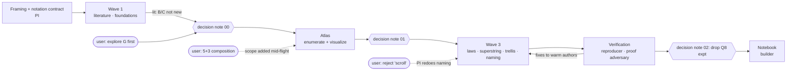

# Imbrication study, process — Knowledge Transfer (v0)

Date: 2026-10-18

Scope: how the PI thread (Opus) ran a mixed proof + experiment research cycle with a Sonnet
team, where it stalled, and which patterns should become agent configuration. The research
results themselves are in `notebook/imbrication.nb`; they are not repeated here.

## Executive Summary

- **What shipped:** one evaluated Wolfram notebook (21 live cells), 10 report topics, a
  9-node roadmap with 5 amendments, and 46 commits. The cycle ran from 12:24 to 14:25 by commit
  timestamps.
- **How:** 10 Sonnet agent runs, about 2.6 M subagent tokens in total. The PI wrote only the
  framing, decision notes, roadmap, naming v1 and the synthesis outline, and did 5 brute-force
  spot checks.
- **Primary outcome for process:** the claims that reached the PI were labelled honestly. Two
  verification archetypes did that: an empirical reproducer and an adversarial proof reviewer.
  Between them they caught 1 overstatement, 6 number slips (out of 942 numbers traced), 3 label
  errors and 1 mis-stated theorem range. No wrong theorem got through.
- **Primary failure:** the PI's initial framing aimed at the application (compression) rather
  than the object (the generative space). The user had to redirect it twice.

## Division of work

| Run | Role | Tokens | Corrections after return | How it was verified |
|:--|:--|--:|:--|:--|
| literature | prior-art map | 305 k | none | PI sanity-checked TCQ/D(R) numbers |
| foundations | Q1/Q2 theorems (Wolfram) | 182 k | none | PI re-derived 4 theorems; brute-forced the surprise sequence |
| atlas → laws (same agent) | exploration, then proofs | 529 k | 2 scope additions via message | PI brute-forced 3 laws; adversary reviewed proofs |
| naming v0 | coin names | 198 k | rejected by the user | n/a; PI redid it in-thread (skill, 2 searches) |
| superstring | literal scheme on real data | 229 k | 1 overstatement, 2 numbers | reproducer |
| trellis | regimes B/C, Viterbi | 230 k | 4 wording/number slips | PI checked closed form; reproducer |
| reproduction | rerun + claim→row trace | 200 k | — | — |
| proof review | adversarial | 252 k | — | — |
| notebook | synthesis deliverable | 431 k | none | PI read sections; timings CSV |

## Wins

- **Claim-label contract.** Every brief required each claim to carry THEOREM (with proof),
  CHECKED (with instance sizes), CONJECTURE, MEASURED or ESTIMATE, and later verdicts overrode
  the original labels. That one rule made review cheap: the reviewers argued about labels, not
  prose. The notebook inherited the labels claim by claim.
- **Two different verifiers for two kinds of truth.**
  - The **reproducer** reruns the code, diffs the CSVs byte for byte, traces every headline number
    to a row, and re-derives the analytic claims *without importing the author's code*. It caught
    "formula presented as achieved rate".
  - The **proof adversary** re-derives each step, writes independent brute force at larger
    instances, and gives verdicts SOUND / GAP / WRONG / LABEL TOO STRONG / LABEL TOO WEAK. It
    caught labels that were wrong in both directions, and showed the "sporadic cells" were a range
    error rather than noise.
- **Cheap PI spot checks.** Whenever a surprising claim was checkable in one sub-10 s call, the
  PI checked it before building on it. That was 5 checks in total, all of which passed. Their
  value is the licence they gave to trust the rest without reading full reports.
- **Warm agents for continuations, fresh agents for independence.** Corrections went back to the
  author (SendMessage), and the atlas agent carried its context straight into the proofs. Every
  verification was a fresh agent, so the checker never shared the author's blind spots.
- **Framing doc as the shared contract.** Notation, regimes, data paths and rules lived in one
  file. Mid-flight scope changes became an edit to that file plus a short SendMessage to the
  running agent, with no re-briefing. Agents pulled report sections with colgrep instead of
  reading whole reports.
- **Turning negative results into theorems.** Both experiments failed to compress. Asking for the
  *why* produced closed forms (identity reads = repetition code; plug-in pointer entropy is the
  same for every imbrex). These are the strongest conclusions in the study, and they made the
  planned Q8 experiment unnecessary.
- **Word-capped final messages.** "Under 250 words: claims with labels, surprises, path" kept the
  PI context small. The PI read one full deliverable (the notebook source), one figure, and a few
  report sections.

## Pain Points (re-planning choke points)

| # | Choke point | Symptom | Cost |
|:--|:--|:--|:--|
| 1 | Application-first framing | Regimes and hypotheses were all about compression; the user asked twice to look at the generative space itself | 1 held wave; atlas inserted ahead of two ready nodes |
| 2 | One-shot plan | First task list read "dispatch all → review all"; the user flagged it | none in compute; a re-plan into waves |
| 3 | Over-general statement to the user | "Completeness only goes downward" was true only for single reads; the user's 5+3 example exposed it | definition table rewritten; atlas scope extended mid-run |
| 4 | Taste task delegated with weak constraints | Naming agent returned "scroll"; rejected | 198 k tokens; redone in-thread for far less |
| 5 | Tool friction | Roadmap validator enforces conventional commit types (clashed with a research vocabulary, so the vocabulary was changed); no CLI command for Amendment Log rows (hand-edited); Wolfram front-end evaluation hangs (kernel-only workaround); DuckDuckGo search flaky (collision checks partial) | a few PI turns each |
| 6 | Shared-machine collateral | An agent's `pkill -f run_all.py` killed another agent's job | PI integrity check; no data loss, by luck of timing |

## Root Causes

- **#1, #3:** the PI translated the user's idea into the vocabulary it knew best (information
  theory) before mapping the object. Exploratory requests need an *object atlas* (enumerate,
  visualize, define variants of each notion) before any hypothesis about applications.
  Definitions shown to the user should name the neighbouring notions they exclude.
- **#2:** the default plan shape is a waterfall; nothing in the PI's instructions made "plan only
  the current wave" the default.
- **#4:** naming is judgement-heavy and cheap to do with full context. The delegation cost
  (brief, drift, the user's veto) exceeded the work.
- **#5, #6:** the tools assume software repositories and single-agent machines. Agent briefs did
  not forbid pattern-based kills until after the incident.

## Next-cycle Changes

Patterns worth bubbling up into Claude Code agent configuration for research that mixes proofs
and empirics:

| Proposal | Where it should live | Content |
|:--|:--|:--|
| **Claim-label contract** | a short research skill, or a section in `writing-reports` findings | The six labels (THEOREM, CHECKED, CONJECTURE, MEASURED, ESTIMATE, CITED with a verification grade); the latest review verdict overrides; deliverables never state a claim above its label |
| **`reproducer` agent type** | `.claude/agents/reproducer.md` (sibling of `spec-verifier`) | Rerun and byte-diff outputs; trace each headline number to a data row; re-derive analytic claims in code that imports nothing from the author; verdicts SUPPORTED / OVERSTATED / UNSUPPORTED; never kill processes by pattern |
| **`proof-adversary` agent type** | `.claude/agents/proof-adversary.md` | Assume wrong until checked; per-step re-derivation; independent brute force at larger or boundary instances; verdicts SOUND / SOUND WITH GAP / WRONG / LABEL TOO STRONG / LABEL TOO WEAK; output as a round-01 report beside the reviewed one |
| **Research-PI loop** | a PI skill, or an addition to `umbod` / `campaign-lead` | (1) framing doc first; (2) an object-atlas wave before application hypotheses; (3) plan one wave at a time, with held nodes and decision notes as amendment sources; (4) spot-check every surprising claim that takes ≤1 call; (5) corrections go to the warm author, verification to a fresh agent; (6) ask for a closed form for every negative result |
| **Brief template** | same skill | read-first list → question in the user's words → hard rules (compute time limit, no downloads, no pattern kills, commit only own files) → deliverables with named symbols → word-capped final message listing claims with labels and surprises |
| **Do-it-yourself rule** | same skill | keep in-thread: taste/naming, decision notes, synthesis outline, any check of one call or less |
| **Tooling** | `managing-roadmaps`, Wolfram MCP | dirtree-rdm: configurable commit-type set and an `amend` command that writes Amendment Log rows. Wolfram: a kernel-only "evaluate notebook and save with outputs" helper |

## Artifacts to Preserve

- `__design__/problem_framing.md`: a model for a notation contract, including the provenance
  table (§3.1) and the completeness-notions table (§2).
- `__reports__/pi_decisions/00–02`: decision notes used as amendment sources.
- `__reports__/reproduction/00-findings_v0.md` and `__reports__/generative_laws/01-review_v0.md`:
  examples of the two verifier outputs.
- `code/notebook/evaluate_notebook.wl`: kernel-only notebook evaluation.
- Memory note `research-campaigns-in-waves.md` (user auto-memory).

## Open Questions

- Should the proof adversary run on a stronger model than the author by default? Here a Sonnet
  adversary found real label errors, but no wrong theorem was present to test its recall.
- Is a fixed reproduction gate worth its cost (about 200 k tokens) when the author already ran
  byte-identical double runs? Here the value came from the claim→row audit, not the rerun.
- How early should the object-atlas wave run? Here it would have been cheaper as wave 1, with
  the literature pass in parallel.
