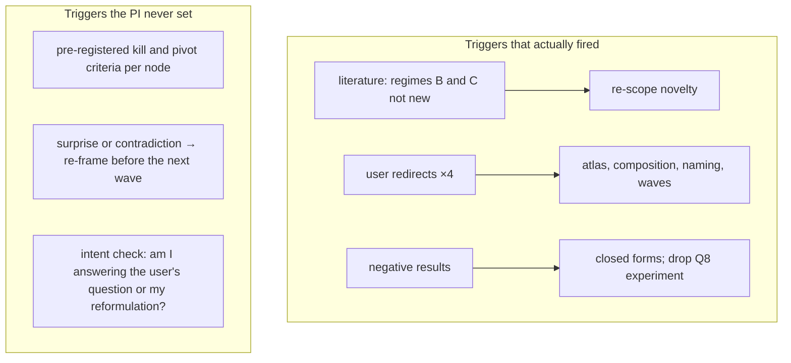

# Imbrication study, process — Knowledge Transfer (v1)

Date: 2026-10-18 · Supersedes [00-knowledge_transfer_v0.md](00-knowledge_transfer_v0.md) on the
points below; v0's division-of-work table, wins and artifact list still stand.

## What changed from v0

| v0 said | Correction (source: PI review of v0) |
|:--|:--|
| "Roadmap validator only accepts conventional commit types" (tool gap) | **Fixed upstream.** `managing-roadmaps@1.2.0` (2026-10-05, e8afff7, "accept project-defined commit types and scopes") relaxed it. This session ran the cached **1.0.0** (`~/.claude/plugins/cache/cracking-shells/managing-roadmaps/1.0.0`). The root cause is a stale plugin cache, and it cost one convention rewrite (commit 231f9e8). The missing `amend` command (Amendment Log rows written by hand) is still open in 1.2.0. |
| Patterns belong "in a skill" | Incomplete: see §1, a PI *agent* plus skills. |
| Wins listed verification; no section on tools, triggers, doubt or perseverance | The four sections below. They show that skepticism was applied to the team's output but not to the PI's own framing or to its decisions to stop. |

## 1. Why a skill and not a PI agent, and what it should be

v0 put the research loop in a skill because the PI here was the **main conversation**, the only
thread that talks to the user. That conflates two different things:

| Container | Encodes | Fit for the PI |
|:--|:--|:--|
| **Agent definition** (`.claude/agents/pi.md`) | *Who*: role, model and effort, tool allowlist, preloaded skills, standing rules. Can run as the main thread (session `agent` setting / `--agent`) or as a nested sub-PI | **Yes**: pins Opus, the delegation and verification policy, the Wolfram/Python routing, and safety rules, so no fresh session re-derives them |
| **Skill** | *How*: procedures, templates, checklists, loaded on demand by any role | Yes, for the reusable pieces: brief template, claim-label contract, wave/decision-note procedure |

Recommendation: a `research-pi` agent whose frontmatter preloads `managing-roadmaps`,
`writing-reports`, `colgrep-search` and a new `research-loop` skill, and which runs as the
main-thread agent for research sessions. Nested sub-PIs, one per sub-roadmap, would fit the
"graph of roadmaps" the user asked for. This study had none: everything hung from one PI,
which stayed workable at 10 runs but would not scale to parallel tracks that each need their
own re-planning. The verifier types from v0 (`reproducer`, `proof-adversary`) stay as agents.

## 2. Tools: why Python displaced Wolfram Language, and what that cost

| Cause | Mechanism | Was it the PI's doing? |
|:--|:--|:--|
| Success gates were shell commands | Every experiment spec required `python3 code/…/run_all.py` as the reproduction gate. With no `wolframscript` on the machine, WL cannot run headless from Bash, so any reproducible artifact had to be Python | **Yes** (the specs) |
| The 10 s rule was over-applied | The user's rule was about **symbolic** attempts ("if Mathematica cannot compute it in less than 10 seconds… the symbolic problem needs to be redefined"). The framing doc turned it into "every Wolfram call ≤ 10 s", which pushed every enumeration sweep, Viterbi run and 12-minute data sweep out of WL | **Yes** (misreading) |
| Session-bound MCP | WL state lives in an MCP session, not in files; agents prefer artifacts they can rerun | partly |
| Agent priors | numpy/PIL/struct are the default reflex for bit tricks and file I/O | no |

**Cost, with one concrete case.** T2 at ω=8 was computed as BEST determinants **mod 5 primes plus
CRT** in Python. That is a workaround for exact big-integer linear algebra, which WL does natively
in milliseconds (`Det` on a 128×128 integer matrix). Other places WL was the better tool and was
underused:
- Guibas–Odlyzko generating functions;
- `FindSequenceFunction` on T(p);
- `DeBruijnGraph` / `FindEulerianCycle`;
- exact rational distortion formulas.

The study's computation ended up split across two languages, so the notebook had to `Import` CSVs
and PNGs instead of recomputing.

**Routing rule for next time:**
- WL for symbolic, exact, combinatorial and graph work, and for anything that should live in the
  notebook.
- Python only for heavy I/O (safetensors) and long vectorized sweeps.
- The 10 s limit is a smell test on *symbolic* formulations, not a cap on every call.
- Install `wolframscript` (or add a "run .wl file" MCP tool) so WL artifacts can be reproduction
  gates too.

## 3. Triggers for reassessment: what fired, and what should

Every reassessment was **external** (literature, user) or **post hoc** (a decision note written
after the result). None came from criteria the PI set in advance. Proposal for the
`research-loop` skill: each wave's decision note is written *before* dispatch and lists, per node:
- the hypothesis;
- the result that would **confirm**, **kill** or **redirect** it;
- the cost ceiling.

After the wave, the note is graded against that list. Add a standing intent check at each
re-plan: restate the user's question in their words and say which part this wave answers. Choke
point #1 of v0, the application-first framing, would have shown up at the first such check.

## 4. Doubt: skepticism was asymmetric

| Object of doubt | Treatment | Outcome |
|:--|:--|:--|
| Agent outputs | spot checks, reproducer, proof adversary, label contract | strong: 5/5 spot checks, 1 overstatement and 4 label errors caught |
| PI's own statements to the user | stated flatly ("completeness only goes downward") | the user caught the scope error |
| PI's own framing | never reviewed | the user redirected twice |
| PI's decisions to stop (Q8 dropped) | justified by theorems, never reviewed | over-generalized (see §5) |

Fix: point the adversary at the PI as well.
1. **Framing red team** at wave 0: a fresh agent reads the user's request and the framing doc and
   lists alternative readings, neighbouring notions (e.g. compositional vs single-window
   completeness) and what the framing excludes.
2. **Stop review**: before closing a line of inquiry, the same adversary checks that the evidence
   covers the *whole* scope being closed.
3. PI statements to the user carry the same labels as agent claims.

## 5. Perseverance: separating "this approach is dead" from "this goal is unreached"

The negative results were turned into theorems, which was right for truth. But the PI then let
those theorems close **more than they cover**:

| Theorem | Scope it actually closes | Angles it does not close, and that were never tried |
|:--|:--|:--|
| Plug-in pointer entropy is the same for every imbrex | lossless regime A with entropy-coded pointers | **Lossy** regime A: the imbrex as an *overlapping VQ codebook* ("k-means with overlapping centroids", listed in framing §3.1, never run) |
| Identity reads = repetition code | regime B with f = identity | Cheap structured maps between identity and a random table (XOR, rotation, hash); a de Bruijn-structured table |
| Fixed-width pointers never beat lzma | raw bytes of images and weights | Other representations: exponent bytes of float weights (low entropy), palette-like data, partial coverage plus escapes |

The Q8 decision note dropped the shared-imbrex experiment "because the theorems answer it". That
was true for lossless coding and false for the lossy codebook. That gap was where the user's
application question (compressing weights) still had a live angle.

Proposal for the loop: a negative result must trigger a **re-angle step** before the line closes.
1. State the exact scope the negative result proves.
2. List at least 3 reformulations outside that scope: different regime, representation, objective
   or distortion measure.
3. Give each a cost estimate and a prior.
4. Run at most one cheap probe, or record why none is worth it.

Pivoting is not quitting, and the stop review (§4) checks the scope claim.

## Next-cycle changes (consolidated, replaces v0's table)

| Change | Where |
|:--|:--|
| Update the plugin cache to `managing-roadmaps@1.2.0`; add an `amend` command for Amendment Log rows | plugin install; playbook `dirtree-rdm` |
| `research-pi` agent (main-thread capable; preloads skills; pins model; routing and safety rules) | `.claude/agents/research-pi.md` |
| `reproducer` and `proof-adversary` agents; the adversary is also used for the framing red team and stop reviews | `.claude/agents/` |
| `research-loop` skill: claim labels; pre-registered wave notes with kill/redirect criteria; intent check; re-angle step; brief template; keep-in-thread rules | new skill |
| WL/Python routing rule; 10 s limit applies to symbolic attempts only; `wolframscript` or a run-file MCP so WL artifacts can be gates | `research-pi` frontmatter and body; machine setup |

## Open Questions

- Should the framing red team run *before* the first user-facing summary, at the price of one
  more agent run per study?
- Is the re-angle step's "≥ 3 reformulations, ≤ 1 probe" the right budget, or should it scale
  with how central the goal is to the user's question?
