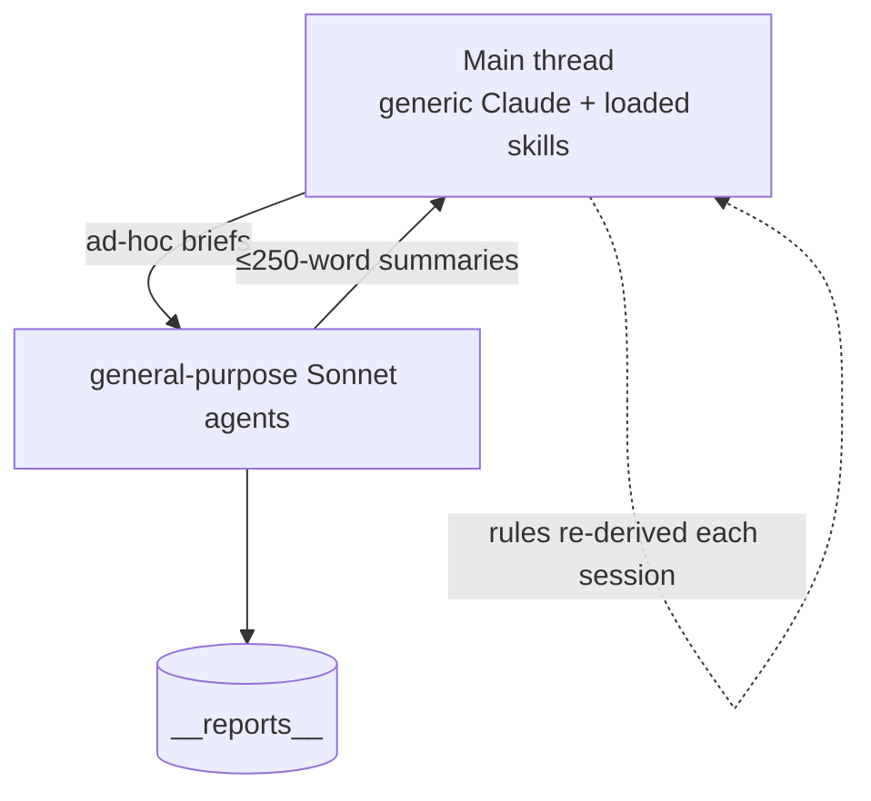
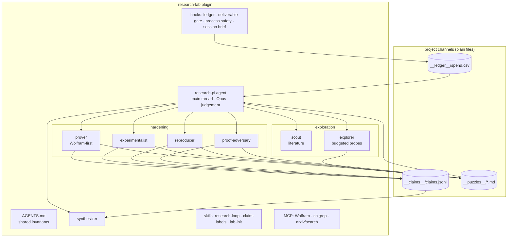
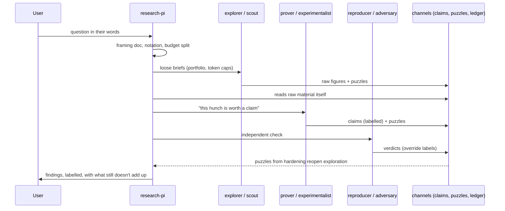

# Research-lab package — Architecture Analysis (v0)

Date: 2026-10-18 · Acts on [03-knowledge_transfer_v3.md](03-knowledge_transfer_v3.md).

## Executive Summary

- **Problem:** instantiate a multi-agent research team whose behavior reliably shows both modes:
  judgement-led exploration within a budget, and mechanical, verifiable hardening. The flow
  between them must be preserved in both directions.
- **Proposed change:** one Claude Code plugin, `research-lab`, with these parts:
  - a short shared `AGENTS.md`;
  - eight agent files: one judgement-first PI and seven narrow roles;
  - three skills;
  - four hooks that enforce only mechanical invariants;
  - MCP routing;
  - three file-based channels (claims, ledger, puzzles) that make the boundary concrete.
- **Design principle:** *put procedure where the work is mechanical and identity where it is
  judgement.* Hooks and skills guarantee the hardening side. The exploration side cannot be
  guaranteed; the package makes it likely by giving the PI the right material, budget visibility
  and a role description that names noticing as its job.
- **Non-goals:**
  - decision rules for the PI (no kill criteria, no red-team checklists);
  - a new orchestration engine (Claude Code's Agent and SendMessage are enough);
  - replacing existing skills (managing-roadmaps ≥1.2.0, writing-reports, writing-history,
    colgrep-search, coining-neologisms are reused).
- **Biggest risks:** the PI drowns in raw material; hooks over-block; the role prompt decays into
  a checklist.
- **Validation:** rerun a pilot study and compare process metrics with this study's (see Risks).

## Current State (this study)



The roles, rules and routing lived in the PI's head and were re-derived for every brief. Nothing
carried the puzzles back.

## Proposed State



## Package layout

```
research-lab/
├── .claude-plugin/plugin.json      name, version, description
├── AGENTS.md                       copied into a project by /lab-init; CLAUDE.md = "@AGENTS.md"
├── agents/
│   ├── research-pi.md   ├── scout.md        ├── explorer.md     ├── prover.md
│   ├── experimentalist.md ├── reproducer.md ├── proof-adversary.md └── synthesizer.md
├── skills/
│   ├── research-loop/SKILL.md      PI-facing: modes, boundary, portfolio, brief templates
│   ├── claim-labels/SKILL.md       worker-facing: label vocabulary, status lines, overrides
│   └── lab-init/SKILL.md           scaffolds AGENTS.md, __design__/framing.md, channels, settings
├── hooks/
│   ├── hooks.json
│   └── scripts/  ledger.py · deliverable_gate.py · process_guard.py · session_brief.py
├── .mcp.json                       Wolfram, colgrep, arxiv (+ one reliable web search)
└── templates/  framing.md · wave_note.md · brief.md
```

Packaging and multi-harness manifests come from the `spawning-agent-plugins` skill. Dependencies:
`managing-roadmaps@≥1.2.0`, `writing-reports`, `writing-history`, `colgrep-mcp`.

## Contracts & Invariants

### 1. AGENTS.md: what every agent shares (kept under one screen)

Every agent loads this file, so it holds only shared invariants, never the PI's identity:
- where the framing/notation contract lives, and that agents never redefine symbols silently;
- the claim-label vocabulary, as a pointer to the `claim-labels` skill;
- the channel paths (claims, puzzles, reports, roadmap) and the commit convention;
- safety: no downloads unless the brief allows them; never kill processes by pattern; commit only
  your own files;
- compute routing: Wolfram first for symbolic, exact, combinatorial and graph work, and for
  anything bound for the notebook; Python for heavy I/O and long vectorized sweeps. Wolfram's
  10 s limit is a smell test on **symbolic** formulations, not a cap on numeric work.

### 2. Agents: identity for judgement roles, narrow scope for mechanical ones

| Agent | Mode | Model | Tools (scope) | Body: the one thing it must do |
|:--|:--|:--|:--|:--|
| **research-pi** (main thread via `agent` setting / `--agent`) | judgement | Opus, high effort | all + Agent, SendMessage | *Notice.* Read primary material (figures, odd rows, puzzles) itself; let the next wave come from what is most off, said plainly; hold a portfolio of cheap probes within budget; decide when a hunch becomes a claim; re-read the user's own words at each re-plan; keep in-thread what is judgement-heavy (framing, naming, synthesis outline, one-call checks). No decision checklists in this file. |
| **scout** | exploration | Sonnet | arxiv, search, colgrep, Write (reports) | Map prior work with verifiable ids; mark UNVERIFIED rather than invent; return "what seems genuinely open" and puzzles |
| **explorer** | exploration | Sonnet | Wolfram, Python, Write | A loose brief with a token cap. Returns **raw material**: figures, tables, counter-intuitive cases and puzzles. Claims only as CHECKED or CONJECTURE |
| **prover** | hardening | Sonnet (Opus for hard proofs) | Wolfram, Write, Python for brute force | Turn a hunch into THEOREM or a counter-example; map every proof step to an executable check |
| **experimentalist** | hardening | Sonnet | Python, Wolfram, Write | State the hypothesis, protocol, controls and power; give the reproduction gate as one command; report cost; label MEASURED vs ESTIMATE |
| **reproducer** | hardening | Sonnet | Bash, Read, Write (own folder) | Rerun and byte-diff; trace claims to rows; re-derive without importing author code; SUPPORTED / OVERSTATED / UNSUPPORTED |
| **proof-adversary** | hardening | Sonnet or Opus | Wolfram, Python, Read, Write (own folder) | Assume wrong; independent checks at larger and boundary cases; SOUND / GAP / WRONG / LABEL TOO STRONG / LABEL TOO WEAK |
| **synthesizer** | synthesis | Sonnet | Wolfram, WriteNotebook, Read | Build the deliverable from the claims registry; never state a claim above its current label |

Every worker agent preloads `claim-labels`. The PI preloads `research-loop`, `managing-roadmaps`,
`writing-reports`, `writing-history` and `colgrep-search`.

### 3. Skills

- **research-loop** (PI):
  - the two modes and the boundary in both directions;
  - wave notes as *narrative* ("this doesn't add up because…"), not as pre-registration;
  - the exploration budget share and portfolio probes;
  - the re-angle habit after a negative result (state its scope; name what it leaves open);
  - brief templates per agent type, each ending with an **uncapped "Puzzles" section** and
    pointers to raw outputs.
- **claim-labels** (workers):
  - the six labels;
  - the status-line format;
  - how to append to `__claims__/claims.jsonl`;
  - override semantics (a later verdict on the same claim id wins).
- **lab-init** (one-off):
  - scaffolds AGENTS.md, `__design__/framing.md` from the template, the channel directories and
    `.claude/settings.json` (`agent: research-pi`, hooks enabled);
  - builds the colgrep index.

### 4. File channels (schemas)

```
__claims__/claims.jsonl   {id, statement, label, evidence: [paths], author_agent, wave,
                           verdicts: [{by, verdict, report, date}]}      # latest verdict = current label
__ledger__/spend.csv      timestamp, wave, agent_type, mode, tokens, wall_s, deliverable
__puzzles__/<wave>-<agent>.md   free text: what did not add up, with pointers to raw outputs
```

Invariant: the synthesizer reads labels **only** from `claims.jsonl`, and nothing reaches the
deliverable above its current label.

### 5. Hooks: mechanical invariants only

| Hook | Event / matcher | Effect | Failure mode |
|:--|:--|:--|:--|
| `ledger.py` | SubagentStop (all agents) | Parse the subagent transcript for token usage; append to `spend.csv` with agent type and mode; print the spend by mode back to the PI as context | logging failure never blocks |
| `deliverable_gate.py` | SubagentStop (worker agents) | Check that the declared deliverable exists, that its claims have labels, and that a `__puzzles__` entry exists (it may say "none"). If not, exit 2 and send the agent back to finish | at most one block per agent run, to avoid loops |
| `process_guard.py` | PreToolUse, Bash | Deny `pkill`, `killall` and `kill` by pattern; allow kills of a PID that the agent started | deny with an explanation |
| `session_brief.py` | SessionStart (PI) | Print the roadmap frontier, spend by mode against budget, and the unread puzzles | read-only |

Hooks never judge content: no hook decides whether a result is interesting or a direction is
promising.

### 6. MCP routing

- **WolframToolkit:** evaluator, notebook read/write. Add a headless "run a .wl file" path
  (install `wolframscript`, or a small MCP tool) so that Wolfram artifacts can be reproduction
  gates.
- **colgrep:** one index per project, refreshed by `lab-init` and at SessionStart, so agents pull
  sections instead of reading whole reports.
- **arxiv**, plus one reliable web search (DuckDuckGo was flaky here).
- Not needed: a database or orchestration server. Plain files are enough until the claims
  registry outgrows them.

## Key Flows



## Alternatives Considered

| Option | Why not chosen |
|:--|:--|
| Everything in one PI skill (v0's proposal) | Identity, model, tools and preloads need an agent file; a skill alone is re-derived per session |
| Decision rules for the PI (v1's proposal) | Rejected by the PI: open research is not decidable by rule, and the point is judgement |
| A claims/ledger MCP server from day one | More infrastructure than needed; files plus hooks give the same invariants, and an MCP can wrap them later |
| A single "verifier" agent | Empirical reproduction and proof review need different methods and verdict vocabularies |
| `umbod` FSM cycles as the backbone | Good for long multi-session campaigns. It can wrap this package later; it is not needed for one-session studies |

## Risks & Mitigations

| Risk | Mitigation |
|:--|:--|
| PI drowns in raw material | Puzzles are short free text with pointers; the PI pulls raw outputs on demand. Calibrate on the pilot |
| The PI role prompt decays into a checklist over edits | Keep `research-pi.md` short and identity-only; procedures live in skills. Review edits against v2's correction |
| The deliverable gate loops or over-blocks | One block per run; it checks presence only, never quality |
| Exploration budget eaten by hardening | `session_brief` and `ledger` show spend by mode at every return. A nudge, not a cap |
| Agents keep defaulting to Python | Routing line in AGENTS.md; the prover is Wolfram-first; Wolfram gates become possible once headless runs work |
| Stale plugin versions (as with managing-roadmaps 1.0.0) | Pin minimum versions in plugin.json; `lab-init` checks installed versions |

**Pilot validation.** Rerun a comparable open question and compare with this study:

| Metric | This study |
|:--|:--|
| Exploration share of spend | ≈ 24% |
| Puzzles raised and followed | not tracked |
| User redirects needed | 4 |
| Overstatements caught by verifiers | 1 |
| Claims overturned after synthesis | 0 |

The behavior is emerging if exploration share and puzzles followed rise while verifier catch
rates and post-synthesis reversals stay flat or fall.

## Roadmap Recommendation

Milestone sketch, to become a roadmap when the PI approves:
1. Write AGENTS.md, `claim-labels` and the hooks, then test them on this repository's history
   (do they flag what the reproducer flagged?).
2. Write the agent files and `research-loop`; package them with `spawning-agent-plugins`.
3. Run a pilot study and compare the metrics above.
