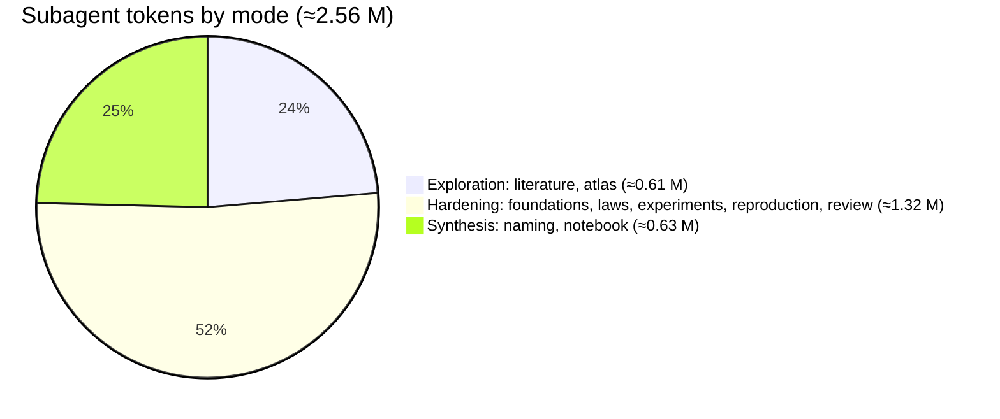
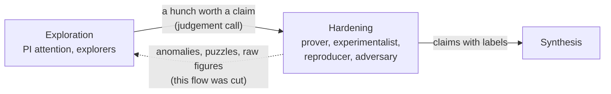

# Imbrication study, process — Knowledge Transfer (v3, consolidated)

Date: 2026-10-18 · Supersedes v0–v2 as the reference retrospective. Earlier versions stay as the
record of how the diagnosis evolved; [02](02-knowledge_transfer_v2.md) holds the full table of
missed signals. The package that acts on this report is
[03-architecture_v0.md](03-architecture_v0.md).

## Executive Summary

- **What shipped:** an evaluated Wolfram notebook (21 live cells), 10 report topics, a 9-node
  roadmap with 5 amendments, and about 46 commits in roughly two hours. That came from 10 Sonnet
  agent runs (about 2.6 M tokens) led by an Opus PI thread.
- **The organizing insight:** research runs in two modes that need opposite things.
  **Exploration** is attention: weak signals, things that don't add up, a debatable judgement of
  what is promising, limited only by budget. **Hardening** is mechanics: stated hypotheses,
  protocols, reproduction, statistical power, formalization, proofs, cost tracking.
- **What went well:** hardening. The label contract, the reproducer and the proof adversary
  caught every overstatement, and no wrong theorem got through.
- **What went badly:** exploration, and the boundary between the modes.
  - Exploration was under-resourced and mostly user-driven.
  - The PI routed hardening output to itself as compressed summaries, which filtered out the
    anomalies that should have opened the next branches.
  - When the PI was then asked to reassess more, it first reached for **rules** (v1). That was
    the same failure: putting procedure where judgement belongs.

## The two modes and where the budget went

| | Exploration | Hardening |
|:--|:--|:--|
| Driven by | a hunch, an anomaly, taste | a stated claim |
| Limited by | budget only; "most promising" is always debatable | correctness |
| Needs | raw material, freedom, room to be wrong | rules, labels, reproduction, proofs, power |
| Belongs to | the PI's own attention, or a loosely briefed explorer | tightly briefed agents and independent checkers |
| This study | about 24% of spend. The one loosely briefed wave (the atlas, at the user's prompting) produced most of what was learned about the object | about 52% of spend. Well run; every error was caught |

**Allocation, not quality, was the problem.** After wave 3, no budget was left for the signals
that hardening had produced. The study ended on a closed story rather than on a small portfolio
of probes.

## The boundary: where it broke

- **Exploration → hardening** worked when it happened: the count sequence 2, 6, 20, … went from
  surprise to bijective proof.
- **Hardening → exploration** was cut by design: 250-word labelled summaries, one figure read,
  reports read in sections. The signals that were dropped are listed in v2:
  - Bernoulli(θ) has h = 1, so the theory is blind to frequencies;
  - a trained map barely beats a random one;
  - Champernowne completes later than random;
  - the m-sequence and the de Bruijn word have the same parse statistics;
  - the user's own wording, which framed the object as the point.

## What carries forward

**Hardening (keep the rules here):**
- the claim labels THEOREM / CHECKED / CONJECTURE / MEASURED / ESTIMATE / CITED, with the latest
  verdict overriding;
- the reproducer (rerun, byte diff, claim→row trace, independent re-derivation) and the proof
  adversary (independent brute force at larger and boundary cases);
- warm agents for corrections, fresh agents for checks;
- a framing doc as the notation contract.

**Exploration (resource it, don't proceduralize it):**
- the PI looks at primary material itself (figures, odd rows, dead ends);
- agents return their puzzles uncapped;
- the next wave comes from what is most off, said plainly;
- a budget share is held back for a portfolio of cheap probes rather than one bet;
- the PI re-reads the user's own words at each re-plan.

**Facts corrected along the way:**
- The roadmap validator was already relaxed in `managing-roadmaps@1.2.0`; this session ran a
  stale 1.0.0 cache.
- Python displaced Wolfram because the PI made shell commands the reproduction gates, no
  `wolframscript` was installed, and the 10 s rule was over-applied to every call. The user meant
  it as a smell test on symbolic attempts.
- Perseverance: the negative theorems were allowed to close more than they prove. The lossy
  overlapping-codebook angle was never run.

## Next-cycle changes

All of them are packaged in [03-architecture_v0.md](03-architecture_v0.md):
- a judgement-first PI agent;
- tightly scoped hardening agents;
- an explorer agent for budgeted probes;
- a claims registry, a budget ledger and a puzzles channel as plain files;
- hooks that enforce only mechanical invariants;
- MCP routing that puts Wolfram first for exact work.

## Open Questions

- How much raw material can the PI take in before attention drowns? This study erred on the
  starved side.
- What exploration share fits a study whose object is new? Here about a quarter was too little; a
  third to a half may fit an open-ended question like this one.
