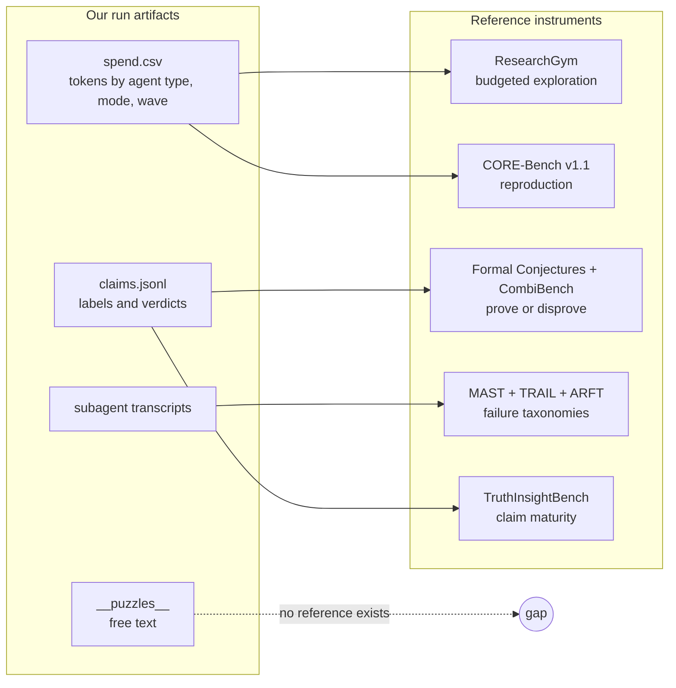

# Benchmarks for a research-MAS behavioral baseline — Findings (v0)

Date: 2026-10-18

---
type: findings
topic: meta_process
date: 2026-10-18
version: v0
prior-version: none
key-metric: benchmarks, datasets and instruments assessed: 68 entries (prior: N/A, delta: N/A)
decision-required: confirm
---

Context: [03-knowledge_transfer_v3.md](03-knowledge_transfer_v3.md) and [03-architecture_v0.md](03-architecture_v0.md)
describe the `research-lab` system. This survey asks which existing benchmarks can grade a *behavioral
baseline* of it: how it spends between exploration and hardening, how it delegates, verifies and
re-plans, and how it fails.

Reading conventions:
- **id confirmed**: the arXiv record was opened, or returned by the arXiv search tool in this session.
  **id via search**: the arXiv, ACL Anthology or GitHub URL came back from a web search with a matching
  title and I read only the abstract or README. Nothing was installed or run; setup cells are estimates
  from abstracts and READMEs.
- **UNVERIFIED** marks a field I could not confirm. Licences come from the GitHub API or the repo
  LICENSE file, or from a dataset tag; "name-matched repo" means the repo was found by name and not
  cross-checked against the paper's own link.
- **Trace** column: `Yes` = trajectories, logs or per-step labels are released or analysed;
  `Partial` = aggregate process metrics only (cost, milestones, rubric leaves); `No` = final answers
  only; `Unknown` = not read.
- **Fit E / H**: my judgement of fit to exploration and hardening, as High, Med, Low.

## Headline Result

metric: candidate benchmarks, datasets and instruments assessed, over four families
value: 68
unit: entries (46 with id confirmed, 22 with id via search; none invented)
prior: N/A (first run)
direction: new

Bottom line: no single benchmark grades our system. A practical baseline combines **three task
benchmarks** (ResearchGym, CORE-Bench v1.1, Formal Conjectures with CombiBench as control), **one trace
instrument** (MAST, with TRAIL and ARFT as taxonomies) and **one claim-integrity probe**
(TruthInsightBench), plus our own log metrics. Only 21 of 68 entries expose trace-level
data; the behaviors the PI cares most about (puzzle following, hardening-to-exploration flow, budget
allocation) are measured by none.

## Results Tables

### Family 1: LLM agents doing end-to-end research or discovery (20 rows)

| Benchmark [id] | Measures | Format, size | Trace | Fit E / H | Setup | Licence |
|:--|:--|:--|:--|:--|:--|:--|
| ResearchGym [2602.15112, id confirmed] | Propose hypotheses, run experiments, beat strong human baselines; capability-reliability gap | 5 containerized tasks, 39 sub-tasks; 12-24 h runs; $10 default API budget | Yes: repo ships `run_inspector.py`; paper catalogues long-horizon failures; includes Claude Code (Opus-4.5) | High / Low | Docker or uv, provider API keys; GPU need per task not checked | None found (no LICENSE per GitHub API) |
| FML-bench [2510.10472, id confirmed] | ML research ideas plus **Exploration Diversity** (variance of proposals across iterations) | 8 fundamental ML research tasks | Yes: metric is computed over per-iteration proposals | High / Low | Python, likely GPU (UNVERIFIED) | Apache-2.0 |
| RE-Bench [2411.15114, id confirmed] | Open-ended ML research engineering against 71 human 8-hour attempts | 7 environments; best-of-k at several time budgets | Yes: agent trajectories and human data released | Med / Low | GPU VMs; heavy | MIT (LICENSE file) |
| MLE-bench [2410.07095, id confirmed] | Kaggle-style ML engineering; medal rate; resource scaling; contamination | 75 competitions | Partial: scaling analysed; logs come from your harness | Low / Med | Docker, Kaggle data, GPU; heavy | MIT (code); data terms UNVERIFIED |
| PaperBench [2504.01848, id confirmed] | Replicate 20 ICML 2024 papers from scratch; hierarchical rubric gives partial credit | 20 papers, 8,316 gradable leaves; LLM judge | Partial: per-leaf scores, no trajectories mentioned | Low / High | Docker, GPU, judge-model cost; heavy | MIT (openai/preparedness) |
| CORE-Bench [2409.11363, id confirmed] with v1.1 and OOD suite [2606.26158, id confirmed] | Computational reproducibility from given code and data; v1.1 adds efficiency and reliability analysis | 270 tasks from 90 papers, 3 difficulty levels | Partial: efficiency, reliability, scaffold effects studied; accuracy now near saturation | Low / High | Docker, mostly CPU (UNVERIFIED); light to medium | MIT |
| ReplicationBench [2510.24591, id via search] | Faithfulness and correctness replicating astrophysics papers | Paper-scale expert-validated tasks (size not read) | Unknown | Low / High | Unknown | MIT (name-matched repo) |
| SciReplicate-Bench [2504.00255, id via search] | Algorithm reproduction from papers; memory, tool grounding, execution tracking | 100 tasks from 36 papers | Partial: site lists execution-tracking coverage | Low / Med | Python; light | None stated |
| EXP-Bench [2505.24785, id confirmed] | Full experiments: hypothesis, design, implement, execute, analyse | 461 tasks from 51 papers; 0.5% full-experiment success | Partial: per-aspect scores (design, implementation) | Low / Med | Docker; heavy | Apache-2.0 (Curie repo) |
| MLGym-Bench [2502.14499, id confirmed] | AI research tasks in a Gym environment | 13 tasks | Partial: Gym framework; log format not read | Med / Low | GPU likely; repo archived | CC BY-NC 4.0, non-commercial |
| MLRC-Bench [2504.09702, id confirmed] | Novel method proposals on ML competitions; LLM-judged innovation vs real performance | 7 competition tasks | Partial | Med / Low | UNVERIFIED | UNVERIFIED |
| InferenceBench [2607.20468, id confirmed] | Open-ended inference optimization; trajectories show convergence on one framework and re-measuring | 4 scenarios, 2 h, one H100, 15 agent configs | Yes: qualitative trajectory analysis | Med / Low | H100 GPU; heavy | Apache-2.0 (name-matched repo) |
| DiscoveryWorld [2406.06769, id confirmed] | Full discovery cycles in a simulated world: hypotheses, experiments, conclusions | 120 tasks (8 topics x 3 levels, variants); scores for completion, relevant actions, explanatory knowledge | Yes: action-level and knowledge scores | High / Med | Pure-Python simulator, offline except LLM API; light | Apache-2.0 |
| DiscoveryBench [2407.01725, id confirmed] | Dataset-driven hypothesis search and verification; facet-based failure modes | 264 real plus 903 synthetic tasks | Partial: facet scores | Med / Med | Light; data download | ODC-By |
| ScienceAgentBench [2410.05080, id confirmed] | Data-driven science as self-contained Python programs; program, output and cost metrics | 102 tasks from 44 papers | Partial: cost reported | Low / Med | Python, Docker; light to medium | MIT |
| BLADE [2408.09667, id confirmed] | Analytic decisions on open questions, matched to independent expert analyses; decision diversity | 12 datasets | Partial: decision-level matching | Med / Med | Python; light | UNVERIFIED |
| AstaBench [2510.21652, id confirmed] | Holistic science-research suite with cost accounting and reproducible search tools | 2,400+ problems; 57 agents, 22 classes | Partial: cost-aware, controlled tools | Med / Med | Full suite heavy, subsets light | Apache-2.0 |
| TruthInsightBench [2609.05079, id confirmed] | Discovery without a hidden target: judge scores the evidentiary maturity of the agent's own claims (controls, robustness, falsifiability, generalization) | 40 blind tasks, 10 domains; 29 artifact-grounded items; deterministic aggregation | Partial: judge reads artifacts | Med / High | Frozen data; light to medium | Apache-2.0 (name-matched repo) |
| Into the Unknown [2610.19159, id via search; details from a secondary blog summary] | Write follow-up papers on unpublished DOE-lab directions; checks integrity, completeness, sufficiency | 15 directions from 10 scientists; 9 agents, 135 submissions; 114 failed integrity | Yes: code, data and trajectories reported released (second-hand) | Med / High | Heavy; long agent runs | UNVERIFIED |
| AutoResearchEval and ARFT [2608.14905, id confirmed] | Process-level diagnosis across the research lifecycle; 45 failure patterns; agent-as-judge on trajectories | 100 tasks, 7 domains; 800 trajectories | Yes: process-level annotation | High / High | Heavy to rerun; taxonomy reusable offline | UNVERIFIED (name-matched repos unclear) |

### Family 2: Mathematical reasoning and proof an agent can attempt with tools (15 rows)

| Benchmark [id] | Measures | Format, size | Partial progress or counter-examples gradable | Trace | Fit E / H | Setup | Licence |
|:--|:--|:--|:--|:--|:--|:--|:--|
| Formal Conjectures [2605.13171, id confirmed] | Prove or disprove research statements | Lean 4; 2,615 statements: 1,029 open, 836 solved | Disproofs are Lean-checked; no partial credit within one problem | No (Lean-checked artifact; logs are yours) | Med / High | Lean 4 plus Mathlib, local; proof search is the cost | Apache-2.0 |
| FrontierMath Erdos [2609.25050, id confirmed] | Resolve (prove or disprove) 68 open Erdos problems in Lean under a fixed budget | 68 problems; $300 per problem per model | Disproof counts; budget fixed so cost per attempt is comparable | Partial: budgeted spend | Low / High | Lean; 68 x $300 = $20.4k per model if fully spent | UNVERIFIED |
| CombiBench [2505.03171, id confirmed] | Combinatorics in Lean 4, incl. fill-in-the-blank answers | 100 problems; all IMO combinatorics since 2000 bar one | Answer and proof are separable (Fine-Eval) | No | Low / High | Lean 4 plus Kimina server, local | MIT |
| PutnamBench [2407.11214, id confirmed] | Competition theorem proving | 1,692 formalizations of 640 theorems; Lean 4, Isabelle, part Coq | No | No | Low / High | Lean or Isabelle, local | Apache-2.0 (Lean, Isabelle), MIT (Coq) |
| FormalMATH [2505.02735, id confirmed] | Large-scale Lean 4 proving, Olympiad to undergraduate | 5,560 problems; negation-based disproof filter used in curation | No | No | Low / Med | Lean 4 | Apache-2.0 (name-matched repo) |
| IMO-Bench [2511.01846, id via search] | Answers (400), proof correctness (ProofBench), proof grading (GradingBench, 1,000 per 2608.00004) | Informal proofs | Yes: graded proof scores | No | Low / Med | LLM judge; light | Apache-2.0 (`google-deepmind/superhuman/imobench`) |
| ProofBench [2510.13888, id confirmed] | Fine-grained 0-7 proof scoring against experts | 145 problems, 435 LLM solutions | Yes: 0-7 partial credit | No | Low / Med | Light | UNVERIFIED |
| Open Proof Corpus [2506.21621, id confirmed] | Human-judged LLM proofs; gap between answer accuracy and full-proof validity | 5,000+ proofs | Yes: validity labels | No (proofs, not agent traces) | Low / Med | Download; light | UNVERIFIED |
| FrontierMath [2411.04872, id confirmed] | Expert-written problems with automated answer checking | Hundreds of problems | No | No | Low / Low | Access route UNVERIFIED | UNVERIFIED (likely restricted) |
| RealMath [2505.12575, id via search] | Research-level problems mined from papers and forums; refreshed over time | Verifiable answers | No | No | Low / Med | Light | None found in repo |
| UQ [2508.17580, id via search] | Real unsolved Stack Exchange questions; validator screening, community verification | 500 questions | Validation pipeline, not ground truth; asynchronous | No | Med / Low | Light; slow feedback | UNVERIFIED |
| CounterMATH [2502.10454, id confirmed] | Proof by counterexample, university level | Hand-built (size not read) | The counterexample is the answer | No | Low / Med | Light | None found (name-matched repo) |
| AlphaEvolve mathematical exploration [2511.02864, id via search] | Exploration at scale: constructions scored against best-known bounds | Problem repository (size not read) | Yes: a numeric score gives partial progress | Unknown | High / Med | Python evaluators score offline; the AlphaEvolve system is not needed to score | Apache-2.0 (`google-deepmind/alphaevolve_repository_of_problems`) |
| MECA [2607.27709, id confirmed] | Construct well-specified conjectures; graded by independent prove and refute attempts | 100 semi-open problems | Indirect: prover and refuter outcomes | Unknown | High / Med | A system paper; release UNVERIFIED | UNVERIFIED |
| SageMath-augmented agents [2607.06820, id via search] | Effect of computer-algebra access on research-level problems; token usage per configuration | Refined RealMath set | Accuracy only; token usage reported | Partial: tokens per setup | Med / Med | SageMath plus Context7 docs; local | UNVERIFIED |

### Family 3: Multi-agent failure taxonomies, trace and log analysis, coordination cost (20 rows)

| Dataset or framework [id] | Measures | Format, size | Trace | Fit E / H | Setup | Licence |
|:--|:--|:--|:--|:--|:--|:--|
| MAST and MAST-Data [2503.13657, id confirmed] | Failure taxonomy: 14 modes in 3 categories (system design, inter-agent misalignment, task verification); LLM annotator | 1,600+ annotated traces from 7 MAS frameworks | Yes: traces plus a judge pipeline | Both; "task verification" maps onto hardening | Light: download JSON; the judge needs an LLM API; our Claude Code transcripts need conversion | Dataset CC-BY-4.0 (HF tag); repo has no LICENSE |
| Who&When [2505.00212, id confirmed] | Automated failure attribution to agent and step | Failure logs from 127 MAS | Yes | Both | Light | MIT |
| Who&When Pro [2607.09996, id confirmed] | Attribution with failures injected after an exactly replayed successful prefix | 12,326 failed trajectories, 26 benchmarks, 3 modalities | Yes, with golden labels; the seeding method is reusable for planted-error tests | Both | Light | UNVERIFIED |
| TRAIL [2505.08638, id confirmed] | Error taxonomy and trace debugging; best long-context model scored 11% | 148 annotated traces, single and multi-agent | Yes | Both | Light | MIT |
| TraceElephant [2604.22708, id confirmed] | Attribution under full execution traces (inputs included) | Benchmark with reproducible environments | Yes (full) | Both | Light to medium | CC-BY-4.0 (name-matched repo) |
| Insights Generator [2605.21347, id confirmed] | Corpus-level trace diagnostics: hypotheses tested over trace populations, evidence-backed report | Method; scout-investigator architecture | Yes | Both; fits our spend and trace corpora | Needs LLM API | UNVERIFIED |
| TraceSIR [2603.00623, id confirmed] | Structured trace analysis and reporting (TraceFormat, ReportEval) | TraceBench, 3 scenarios | Yes | Both | Python; light | UNVERIFIED |
| AgentPex [2603.23806, id confirmed] | Trace compliance against rules extracted from agent prompts | 424 tau2-bench traces | Yes; our AGENTS.md and agent files are rule sources | H | Python; light | UNVERIFIED (LICENSE.TXT not read) |
| HAL, Holistic Agent Leaderboard [2510.11977, id confirmed] | Cost-controlled harness; models x scaffolds x benchmarks; LLM-aided log inspection | 21,730 rollouts, 9 models, 9 benchmarks, about $40k; 2.5B tokens of logs shared | Yes | Both | Rerun heavy; shared logs reusable; harness repo archived | None stated |
| AI Agents That Matter [2407.01502, id via search] | Method: cost-controlled comparison, hold-outs, standardization | No data | No (method) | Both | None | UNVERIFIED |
| Towards a Science of Scaling Agent Systems [2512.08296, id confirmed] | Architecture vs performance; coordination overhead; error propagation | 260 configs, 6 benchmarks, 5 architectures | Partial: aggregate metrics | Both | UNVERIFIED | UNVERIFIED |
| MultiAgentBench / MARBLE [2503.01935, id confirmed] | Milestone KPIs for collaboration; star, chain, tree, graph topologies | Scenarios including research | Partial: milestones | Both | Python; light to medium | MIT |
| SwarmBench [2608.30661, id confirmed] | Orchestrator accuracy, efficiency, cost, process quality | Size not read | Partial | Delegation | UNVERIFIED | UNVERIFIED |
| TheAgentCompany [2412.14161, id via search] | Simulated colleagues test communication; checkpoint partial credit | 175 tasks | Partial: checkpoints | Both | Self-hosted Docker stack; heavy | MIT |
| AgentBoard [2401.13178, id via search] | Incremental progress-rate metric; analytical toolkit | Multi-turn tasks (size not read) | Partial: progress rate | Both | UNVERIFIED | UNVERIFIED |
| Magentic-One and AutoGenBench [2411.04468, id via search] | Orchestrator with progress tracking; benchmarking harness | Open-source system | Partial | Both | Python; light | UNVERIFIED |
| MASLab [2505.16988, id via search] | Unified codebase of 20+ MAS methods under one protocol | Codebase | Partial | Both | Python; medium | UNVERIFIED |
| Inspect AI and inspect_evals [github.com/UKGovernmentBEIS/inspect_ai, id via search] | Eval harness: JSON or `.eval` logs, log API, dataframes, Inspect Scout transcript analysis; includes a MLE-bench port | 184 evals listed | Yes | Both | `pip`; Claude Code support not verified | MIT |
| Docent, Transluce [github.com/TransluceAI/docent, id via search] | Agent-transcript analysis platform | Repo only; no paper read | Yes | Both | Self-host; medium | Apache-2.0 (header) |
| Benchmark disclosure audit [2605.21404, id confirmed] | What a benchmark reports: identity, harness, inference settings, cost, failure breakdown | 12 papers audited; mean 0.38 for agent benchmarks; single auditor | N/A (reporting checklist) | Both | None | UNVERIFIED |

### Family 4: Scientific-process behaviors: hypotheses, exploration, novelty, honesty, reproducibility (13 rows)

| Benchmark [id] | Measures | Format, size | Trace | Fit E / H | Setup | Licence |
|:--|:--|:--|:--|:--|:--|:--|
| MOOSE-Chem [2410.07076, id via search] | Rediscovery of unseen chemistry hypotheses from background only | Chemistry corpus (size not read) | Partial | High / Low | LLM API; light | MIT |
| Si et al. ideation study [2409.04109, id via search] | Expert-rated novelty of LLM vs human research ideas | Large-scale human study | No | Med / Low | Human raters needed; costly | UNVERIFIED |
| SchNovel [ACL Anthology 2025.aisd-main.5, id via search] | Novelty assessment of papers | 15,000 paper pairs, 6 fields, 2-10 years apart | No | Low / Low | Light | UNVERIFIED |
| Old Ideas, Novel Problems [2610.02022, id confirmed] | Instability of LLM novelty judges: prompt framing flips verdicts on over half the pairs | Pairs mined from OpenReview | No | Low / Low | Light | UNVERIFIED |
| LLM-SRBench [2504.10415, id confirmed] | Equation discovery resistant to memorization; best symbolic accuracy 31.5% | 239 problems, 4 domains | Partial | Med / Med | Python; light | UNVERIFIED (name-matched repo has none) |
| MASK [2503.03750, id via search] | Honesty (stated vs believed) separated from accuracy | Human-collected dataset | No | Low / Med | LLM API; light | UNVERIFIED |
| AbstentionBench [2506.09038, id via search] | Whether an LLM abstains on unanswerable or underspecified questions; 20 LLMs tested | Multi-dataset | No | Low / Med | Light | Other (name-matched repo; terms not read) |
| KnownLieBench [2608.26372, id confirmed] | Deception after confirming the agent knows the truth | 112 cases, 8 domains | Partial: multi-round dialogues | Low / Med | Light | UNVERIFIED |
| Hidden Pitfalls of AI Scientist Systems [2509.08713, id via search] | Four failure modes: inappropriate benchmark choice, leakage, metric misuse, post-hoc selection | Controlled experiments on 2 open-source systems | Yes: argues trace logs and code are needed for integrity audits | Med / High | Reuse design; medium | UNVERIFIED |
| BadScientist [2510.18003, id via search] | Whether fabricating agents can fool LLM reviewers | Framework | Partial | Low / High | Light to medium | UNVERIFIED |
| ReAgent [2609.22111, id confirmed] | Static and dynamic audit of paper claims against repo and execution evidence | Curated agent paper-repo pairs | Yes: evidence trail | Low / High | Needs repo reruns; medium | UNVERIFIED |
| MLR-Bench [2505.19955, id confirmed] | Open-ended ML research with stepwise judge; coding agents fabricated or invalid results in about 80% of cases (per abstract) | 201 tasks from workshops | Partial | Med / High | LLM judge; medium | UNVERIFIED |
| Exploration and Exploitation Errors [2604.13151, id confirmed] | Policy-agnostic metric that separates exploration from exploitation errors using actions only | Deterministic grid plus task-DAG environments | Yes: computed from action trajectories | High / Low | Light, CPU, local | MIT (repo) |

### Ranked recommendation: a practical behavioral baseline

| Rank | Instrument | Role in the baseline | Why this one | Main caveat |
|:--|:--|:--|:--|:--|
| 1 | ResearchGym [2602.15112] | Exploration under budget; long-horizon failure modes | Fixed API budget, 12-24 h autonomy, Claude Code already evaluated, failure modes named (overconfidence, resource management, parallel-experiment coordination, context limits); plugs into the spend ledger directly | Only 5 tasks; ML research, not mathematics; no LICENSE |
| 2 | CORE-Bench v1.1 [2409.11363, 2606.26158] | Hardening: the reproducer role | Cheap, Docker, graded reproduction; v1.1 reports efficiency and reliability, which is what we want, since accuracy is near saturation | Not research-novel; measures one agent, not a lab |
| 3 | Formal Conjectures, combinatorics subset, with CombiBench as known-answer control [2605.13171, 2505.03171] | Hardening and exploration in our own domain; prove or disprove, counter-examples count | Lean kernel gives a non-negotiable verdict; disproofs are gradable; both permissive licences | Frontier systems solve little (CombiBench: 7 of 100 for the best model reported); expect mostly zeros, so also track cost per attempt and partial artifacts |
| 4 | MAST taxonomy and annotator, applied to our transcripts, cross-checked with TRAIL and ARFT [2503.13657, 2505.08638, 2608.14905] | Trace instrument: failure modes in delegation, coordination, verification | Only labelled multi-agent trace corpus with 14 modes and a judge pipeline; CC-BY-4.0 data | Auto-attribution is weak elsewhere (see Observations); hand-label first |
| 5 | TruthInsightBench [2609.05079] | Claim honesty and evidence maturity of the agent's own claims | Blind discovery tasks, deterministic aggregation, probes controls and falsifiability that the label contract targets | Young benchmark; one judge; repo licence name-matched only |

Infrastructure rather than benchmarks: run tasks through **Inspect AI** (MIT) so logs and token usage land in one
format, and read the shared **HAL** logs [2510.11977] for cost and behavior reference points.
Heavier alternatives if budget allows: FML-bench for a measured exploration-diversity score,
Into the Unknown for integrity under long runs.

### Log metrics to extract from our own runs

Our hooks already give tokens per agent type and mode; puzzles and claims are files.

| # | Metric | Source in our logs | Definition | Reference point |
|:--|:--|:--|:--|:--|
| 1 | Spend share by mode | `spend.csv` | Tokens per mode over total, per wave and cumulative | This study: about 24% / 52% / 24% (exploration, hardening, synthesis) |
| 2 | Spend by agent type and wave | `spend.csv` | Tokens and `wall_s` per agent type; PI tokens vs worker tokens | HAL cost-controlled reporting |
| 3 | Cost per accepted claim | `spend.csv`, `claims.jsonl` | Tokens divided by claims whose latest verdict is positive | None external |
| 4 | Exploration reserve | `spend.csv` | Share of exploration budget unspent at wave end; probes launched per wave | Portfolio idea in 03-KT |
| 5 | Exploration diversity | Explorer reports, puzzles | Embedding variance of probe proposals across iterations | FML-bench [2510.10472] |
| 6 | Repeat-measurement rate | Experimentalist and explorer transcripts | Share of experiments re-running a near-identical configuration | InferenceBench [2607.20468]; [2604.13151] |
| 7 | Delegation profile | Subagent transcripts | Spawns per wave, brief length, warm (SendMessage) vs fresh spawns, in-thread vs delegated judgement work | SwarmBench [2608.30661]; overhead in [2512.08296] |
| 8 | Puzzles raised and followed | `__puzzles__/`, later briefs, claim evidence | Follow rate = puzzles cited by a later brief or claim over puzzles raised; latency in waves; orphans | None (gap) |
| 9 | Claim label mix and transitions | `claims.jsonl` | Counts per label; share downgraded by a verifier | This study: 1 overstatement caught |
| 10 | Label calibration | `claims.jsonl` verdicts | P(overturned or downgraded given label); LABEL TOO STRONG and TOO WEAK rates | Concept only: MASK, AbstentionBench |
| 11 | Independent-verification coverage | `author_agent` vs `verdicts[].by` | Share of claims checked by an agent other than the author; claims unverified at synthesis | MAST "task verification" category |
| 12 | Verification yield | Verdicts | Catch rate over checked claims; recall on seeded errors | Seeding method of Who&When Pro [2607.09996] |
| 13 | Evidence traceability | `evidence` paths | Share of claims whose evidence path reruns byte-identically | CORE-Bench; ReAgent [2609.22111] |
| 14 | Re-planning events | Roadmap amendments, PI messages | Amendments per wave and trigger class (puzzle, failure, user) | This study: 4 user redirects, 5 amendments |
| 15 | Failure-mode tag rates | Sampled transcripts plus MAST annotator | Per-mode frequency over the 14 MAST modes; ARFT-45 for research-specific modes | MAST-Data; [2608.14905] |
| 16 | Hook interventions | `process_guard`, `deliverable_gate` | Denials and blocks per agent type | None |
| 17 | Early stops and context limits | Ledger `deliverable` column, transcripts | Runs ending without declared deliverable; context-limit hits | ResearchGym failure modes |
| 18 | Run-to-run variance | Repeated runs on one task | Spread of metrics 1-17 across repeats | CORE-Bench v1.1 reliability; HAL |

### Gaps: behaviors no benchmark measures, which we must grade ourselves

| # | Behavior | Why it is not covered | Nearest existing work | How we would grade it |
|:--|:--|:--|:--|:--|
| 1 | Following weak signals (puzzle following) | Benchmarks score outputs against targets; no hidden anomaly is planted in a way that rewards noticing it | DiscoveryWorld (explanatory knowledge); TruthInsightBench | Plant or retro-identify anomalies (the five dropped signals in 03-KT v3) and score whether a later wave addresses them |
| 2 | Hardening-to-exploration back-flow | Needs a two-mode system with a lossy summary channel | None | Compare PI decisions when given summaries vs raw outputs on the same run |
| 3 | PI-level budget allocation across modes | Exploration metrics are within a single agent's loop | FML-bench, InferenceBench, [2512.08296] (architecture level) | Spend share vs outcome across pilot runs; ablate the exploration reserve |
| 4 | Calibration of graded claim labels against later verdicts | Calibration work targets answers or abstention, not a label ladder | MASK, AbstentionBench, Into the Unknown | Metric 10, with verifier verdicts as ground truth and a human audit of a sample |
| 5 | Verifier recall (reproducer and adversary) | Attribution benchmarks grade LLM judges on given traces, not verifier agents in a pipeline | Who&When Pro seeding | Seed known errors into claims and proofs; measure catch rate |
| 6 | Judgement quality of "most promising" | No ground truth by construction | None | Retrospective: which branches later produced claims; user redirects as a proxy |
| 7 | Re-angling after a negative result | Negative results are not scored as scope-limited | None | Expert review of whether each negative result states its scope and what it leaves open |
| 8 | Effect of hooks, skills and role prompts | Benchmarks fix the scaffold; none compare plugin variants | HAL (scaffold comparisons) | A/B on one task battery: single agent, lab without hooks, full lab |
| 9 | Domain gold set for binary combinatorics | Existing sets are competition or open conjectures | CombiBench, Formal Conjectures | Replay the imbrication study questions with known outcomes (the pilot in 03-architecture) |

## Observations

| Signal | Baseline / Expected | Observed [source] | Interpretation |
|:--|:--|:--|:--|
| Trace-level coverage | Agent benchmarks expose process | 21 of 68 entries are `Yes`, 26 `Partial`, rest answers only or unread [source: tables above] | Task benchmarks give outcomes; the behavioral baseline has to come from our logs plus trace corpora (MAST, TRAIL, HAL) |
| Auto-attribution reliability | LLM judges label traces well enough to trust | Best model 11% on TRAIL [2505.08638]; 53.5% agent but 14.2% step accuracy on Who&When [2505.00212] | Do not trust an LLM-labelled failure rate without a hand-labelled sample of our own transcripts |
| Value of multi-agent structure | A lab beats one agent | Range from +80.8% to -70.0% vs single agent; centralized verification limits error propagation [2512.08296] | We need a single-agent control; our PI-plus-verifier design matches the favourable pattern but is untested |
| Exploration behavior of agents | Agents explore broadly | Agents converge on one framework and re-measure [2607.20468]; gain by hyperparameters, no novel hypotheses [2502.14499]; broad exploration correlates with gain [2510.10472] | Exploration share is not enough; track diversity and repeat-measurement (metrics 5 and 6) |
| Claim integrity | Written claims match what ran | About 80% of cases fabricated or invalid [2505.19955]; 114 of 135 failed integrity [2610.19159, second-hand] | Our reproducer's claim-to-row trace is the right check; its recall is the unmeasured part |
| Cost disclosure | Benchmarks report cost | None of eight agent-benchmark papers disclose inference cost, single auditor [2605.21404]; AstaBench, HAL, ScienceAgentBench, ResearchGym do | Compare ourselves only against cost-reporting sources; report tokens and dollars with the harness version |
| Saturation | Benchmarks stay discriminative | CORE-Bench accuracy saturating; authors recommend efficiency and reliability dimensions [2606.26158] | Use it for cost and variance, not accuracy |

## Charts & Visualizations



Caption: which of our artifacts each recommended instrument can be compared against. Puzzles have no reference.

```
Coverage of behaviors by the five recommended instruments (my judgement; ● direct, ◐ partial, · none)

                              ResGym  CORE-v1.1  FormalConj  MAST/TRAIL  TruthInsight
exploration spend              ●        ·          ◐           ·           ·
delegation / coordination      ◐        ·          ·           ●           ·
verification                   ◐        ●          ●           ●           ●
re-planning                    ◐        ·          ·           ·           ·
claim honesty / calibration    ◐        ·          ·           ·           ●
counter-example / disproof     ·        ·          ●           ·           ·
puzzle following               ·        ·          ·           ·           ·
```

Caption: no column covers puzzle following, and re-planning rests on one partial entry. Task benchmarks do not force
delegation; delegation behavior is read from our own traces with MAST tags.

## Contradictions & Surprises

- CORE-Bench is recommended although its accuracy is saturating; the case rests on efficiency and reliability, as its own follow-up argues [2606.26158].
- Benchmarks built for reproduction reward recovering a hidden result; the one built for discovery found four coding agents on a plateau of 58.4 to 60.3 out of 100 without reliable separation, with the missing acts being controls, robustness and falsifiability [2609.05079].
- The AutoResearch study traces failures to a missing metacognitive loop (checking output against findings, revising) and says it did not test orchestration-level fixes [2608.14905]. Our verifier agents are such a fix, so our baseline could address its open question.
- Cheap open-weight judges nearly match frontier judges for proof grading at 4-100x lower cost [2608.00004, id confirmed], which contrasts with the weak trace-attribution results.
- ResearchGym's GPT-5 agent beat the provided baselines in 1 of 15 evaluations yet surpassed an ICML 2025 Spotlight solution in one run [2602.15112]; spread across repeats will dominate any single-run comparison.

## Steering Questions

- [now] Confirm the five-item baseline, and whether to pay for ResearchGym (5 tasks, up to 24 h each) or start with the cheaper FML-bench plus our own logs.
- [now] Run each task under three configurations (single Claude Code agent; research-lab without hooks; full research-lab) so delegation and hook effects can be isolated?
- [next run] Hand-label about 20 of our transcripts with MAST before trusting the LLM annotator, given the weak attribution results above.
- [next run] Build the in-house gold set (gap 9) by replaying the imbrication study questions; decide who curates the planted anomalies for gap 1.
- [later] Resolve the UNVERIFIED licences (ResearchGym has none; several repos are name-matched only) before copying any task data into this repository.

## Pointers

- [03-knowledge_transfer_v3.md](03-knowledge_transfer_v3.md), [03-architecture_v0.md](03-architecture_v0.md), [README.md](README.md)
- ResearchGym: https://arxiv.org/abs/2602.15112, https://github.com/Anikethh/ResearchGym
- CORE-Bench: https://arxiv.org/abs/2409.11363, https://arxiv.org/abs/2606.26158, https://github.com/siegelz/core-bench
- Formal Conjectures: https://arxiv.org/abs/2605.13171, https://github.com/google-deepmind/formal-conjectures; CombiBench: https://arxiv.org/abs/2505.03171, https://github.com/MoonshotAI/CombiBench
- MAST: https://arxiv.org/abs/2503.13657, https://huggingface.co/datasets/mcemri/MAST-Data; TRAIL: https://arxiv.org/abs/2505.08638, https://github.com/patronus-ai/trail-benchmark
- TruthInsightBench: https://arxiv.org/abs/2609.05079; Into the Unknown: https://arxiv.org/abs/2610.19159; AutoResearchEval: https://arxiv.org/abs/2608.14905
- HAL: https://arxiv.org/abs/2510.11977; Inspect AI: https://github.com/UKGovernmentBEIS/inspect_ai; Docent: https://github.com/TransluceAI/docent
- FML-bench: https://arxiv.org/abs/2510.10472, https://github.com/qrzou/FML-bench; Exploration and Exploitation Errors: https://arxiv.org/abs/2604.13151
- Scaling Agent Systems: https://arxiv.org/abs/2512.08296; Hidden Pitfalls: https://arxiv.org/abs/2509.08713
