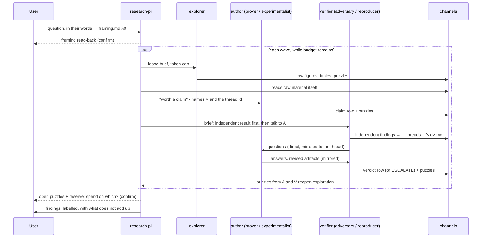

# Research-lab design — Outside Review (v0)

Date: 2026-10-18 · Reviews [03-architecture_v0.md](03-architecture_v0.md) against
[03-knowledge_transfer_v3.md](03-knowledge_transfer_v3.md) and the v2 correction
([02-knowledge_transfer_v2.md](02-knowledge_transfer_v2.md)). Takes the PI's revision notes
(a)–(e) as given and builds on them.

---
type: findings
topic: meta_process
date: 2026-10-18
version: v0
prior-version: none
key-metric: design sections reviewed: 21 (KEEP 7 · STRENGTHEN 8 · MERGE 1 · ADD 4 · CUT 1)
decision-required: confirm
---

## Headline

The design puts procedure where work is mechanical and identity where it is judgement, and that
split is right. Its holes are all **lifecycle** holes: nothing says what happens when a session
dies, when two verifiers disagree, when the budget runs out, or when an author and a verifier go
round in circles. The peer-to-peer change (d) is sound but needs one protection, or it erodes the
one thing that worked: fresh, independent checks. Three places in the design drift back toward
the v1 mistake and should be reworded.

## Verdict table

| Design section | Verdict | Reason |
|:--|:--|:--|
| AGENTS.md (shared invariants) | KEEP | One screen, invariants only. Add one line: which agent may write which channel |
| `research-pi` agent | STRENGTHEN | The body row is already a list of seven imperatives (§5). Rewrite as prose identity; add what reaches its context unfiltered and what it reads on resume |
| scout, explorer | KEEP | Distinct tool scopes justify two files; merge only in the minimal cut (§2) |
| prover, experimentalist | KEEP | Author roles; add the thread contract of §3 |
| reproducer, proof-adversary | STRENGTHEN | Become the verifier half of a pair (§3); independent result first, conversation second |
| synthesizer | KEEP | The label-only-from-registry invariant is the design's best mechanical idea |
| `research-loop` skill | STRENGTHEN | Carries the failure-mode table (§4) as positive habits for workers; the PI side stays descriptive |
| `claim-labels` skill | STRENGTHEN | "Latest verdict wins" is wrong when verdicts conflict; add `disputed` and weakest-open-verdict semantics |
| `lab-init` skill | KEEP | Add: store the user's request verbatim and append every redirect to it |
| `templates/` | MERGE | Into the skills that use them; a separate folder is one more place to keep in sync |
| `ledger.py` | STRENGTHEN | Add thread id and remaining budget; say plainly when the budget is gone |
| `deliverable_gate.py` | KEEP | Presence-only is the right line; add: evidence paths exist, verdict rows point to a thread file |
| `process_guard.py` | KEEP | Add: channel files are append-only (deny Write/Edit on `claims.jsonl`) |
| `session_brief.py` | STRENGTHEN | Fire on `resume` and `compact` too; print puzzles before the roadmap frontier |
| Key-flow diagram | STRENGTHEN | Show the loop (c), the pair thread (d) and the two human touchpoints (§1) |
| Pilot metrics | STRENGTHEN | "User redirects needed" rewards not asking; count only redirects the PI did not anticipate |
| Human launcher | ADD | (b): a `/lab` command that opens or resumes a session with `agent: research-pi` |
| User-words channel | ADD | `framing.md §0` in the user's words, appended at every redirect; v2's top missed signal |
| Thread channel | ADD | `__threads__/<claim-id>.md`, append-only, written by both halves of a pair |
| `__lab__/wave.md` | ADD | The current wave note, which is also the resume anchor |
| Framing red team as a gate | CUT | Keep the adversary available for a framing read on request; never as a wave-0 step (v2) |

## 1. Holes

### Lifecycle events the design does not handle

| Event | What happens today | Fix (mechanical part / judgement part) |
|:--|:--|:--|
| Session crash or compaction mid-wave | `session_brief` fires only at startup; the wave's intent is in the PI's lost context | Hook also on `resume` and `compact`; it prints `__lab__/wave.md` (the PI's current narrative note), ledger rows with no deliverable (agents in flight at the crash), open threads and disputed claims. **Judgement:** the PI re-reads the wave note and the user's words before dispatching anything |
| Agent drift from its brief | Only the deliverable gate notices, and only absence | Hardening roles: drift is the verifier's business. Exploration roles: drift is often the point; the explorer's first line states where it left the brief and why. Do not block it |
| Conflicting verdicts on one claim | Whichever verifier finished last sets the label | Current label = the **weakest** open verdict from distinct verifiers; two open verdicts that disagree set `disputed: true`; `session_brief` lists disputed claims. **Judgement:** the PI resolves (third check, or decides) |
| Budget exhaustion | Ledger shows spend by mode; nothing says "gone" | `framing.md` holds `budget` and `exploration_share`; ledger prints remaining; at zero the PI stops dispatching and goes to the user with the portfolio of what it would still probe. A human touchpoint, not a cap |
| Peer loops that never converge | Not designed yet (d) | §3: the verifier owns termination; a per-thread token cap in the brief, summed by the ledger, is the mechanical stop |
| Runaway agent | `process_guard` covers kills, not loops | Set `maxTurns` in worker frontmatter if the field exists (§3 table); otherwise the thread cap plus the ledger |
| Concurrent appends to `claims.jsonl` | Unstated | Ids are `<wave>-<agent>-<n>`; one line per append; append-only enforced by `process_guard` |

### Missing human touchpoints

Two of the four user redirects in this study came from framing. The user is the best
exploration signal the lab has, and the design routes them only at the start and the end.

1. **Launcher (b).** A `/lab` skill (user-invocable, model-invocation disabled) that runs
   `lab-init` if the channels are missing, else prints the session brief and hands over to the
   PI. The `.claude/settings.json` written by `lab-init` sets `agent: research-pi` so a plain
   `claude` in the project already *is* the PI; `/lab` is for dispatching a question into a
   running session: `/lab <question in the user's words>` appends the words to `framing.md §0`.
2. **Framing read-back.** Before wave 1 the PI shows the user its framing next to their own
   sentence and asks whether it is the same question. `decision-required: confirm`.
3. **Budget gone.** As above; `decision-required: intervene`.
4. **Before synthesis.** The PI shows the open puzzles and the reserve, and asks which to spend
   it on. The user may say "none"; the point is that the closed story is never the default.

None of these decides anything for the PI; they put the user's judgement where it was missing.

## 2. Consolidation: the minimal viable lab

```
research-lab-min/
├── AGENTS.md                 invariants + the six labels inline (10 more lines)
├── agents/  research-pi.md · explorer.md · author.md · verifier.md
├── skills/  research-loop/   (brief templates and lab-init as sections)
├── hooks/   lab_state.py (SubagentStop ledger + SessionStart/resume brief) · deliverable_gate.py
└── channels: __claims__ · __puzzles__ · __threads__ · __ledger__ · __lab__/wave.md
```

Four agents, one skill, two hook scripts, five file channels. What each cut costs:

| Removed | Folded into | Cost |
|:--|:--|:--|
| scout | explorer (gets arxiv + search) | CITED/UNVERIFIED discipline rests on the brief, not the tool scope |
| prover + experimentalist | author (method set by brief) | "Wolfram-first for proofs" becomes brief text; no per-role tool scope |
| reproducer + proof-adversary | verifier (two verdict vocabularies in one file) | The design's own objection stands: a merged verifier may byte-diff a proof or "review" an experiment. Mitigate by keeping both vocabularies and naming which one the brief invokes |
| synthesizer | the PI in-thread | PI context goes to notebook assembly; label-only-from-registry becomes a habit instead of a scope |
| `claim-labels`, `lab-init` as skills | AGENTS.md, `research-loop` sections | Cannot version them separately; fewer worked examples |
| `process_guard.py` | the AGENTS.md safety line | The pkill class of incident is prevented by text only |
| `templates/` | the skills | Nothing |

Do not cut: the pair structure (author ≠ verifier, fresh), the three channels the synthesizer
reads from, the ledger by mode, the puzzles section with no cap. Those are the behaviors the
retrospective paid for.

## 3. Peer-to-peer: author ↔ verifier pairs (d)

The PI should not relay. But direct conversation is exactly how a verifier gets talked out of a
finding, so the protocol protects independence first.



**Pairing.** The PI dispatches the author with the verifier named and a thread id equal to the
claim id. The verifier's brief carries the author's agent name. Both write every exchange to
`__threads__/<id>.md` (append-only) so the PI, and the deliverable gate, see the conversation
without being in it.

**Independence first.** The verifier's first thread entry is its own result, produced before
it reads the author's answers or asks anything. A verdict may change after conversation only by
pointing to a new artifact (`changed_by: path` in the verdict row); the gate checks the path
exists. This keeps "fresh agents for checks" while allowing the conversation.

**Termination.** The verifier owns it. It ends with a verdict from its vocabulary, or
`ESCALATE` when: the thread's token cap is reached (mechanical, from the ledger); the author
changes the claim's *statement* rather than its evidence (that changes what the user will be
told, so it is the PI's call); or the author stops answering. At the cap the verifier still
writes a verdict on what exists (GAP / OVERSTATED), never a silent "unresolved". The author
cannot close a thread; it can post a puzzle and stop.

**What the PI sees.** Three things, none of them a summary: the thread files, the puzzles both
halves wrote, and the ledger's per-thread spend. The handback to the PI is a verdict line and a
path. The `research-pi` body says the PI reads the thread, not the handback, before acting on an
ESCALATE.

**Mechanisms this relies on** (verified against the official docs on 2026-10-18; see pointers):

| Mechanism | Status | Note |
|:--|:--|:--|
| `SendMessage` resumes a finished subagent by id or name, context intact | VERIFIED | The verifier can keep questioning the author after its first return |
| Subagents named at spawn message each other directly | PARTLY VERIFIED | Stated in agent-teams.md's comparison table only. Test on the pilot before relying on it |
| Agent Teams: teammates message by name without the lead | VERIFIED, experimental | Interactive sessions only; one team per session; `/resume` does not restore teammates. Teammates do not fire `SubagentStop`, so the ledger and gate would go blind; they would move to `TaskCompleted` |
| Subagent nesting | VERIFIED | Three layers by default; sub-PIs per sub-roadmap (v1 §1) are possible |
| Frontmatter `skills`, `model`, `effort`, `maxTurns`, `tools`, `memory` | VERIFIED | `maxTurns` marks output partial and keeps the agent resumable: the runaway stop of §1 |
| Frontmatter `hooks`, `permissionMode`, `mcpServers` | **ignored for plugin subagents** | Every hook stays in `hooks/hooks.json` with `agent_type` matchers, as designed |
| Main thread as `research-pi` (`agent` setting, `--agent`) | VERIFIED | The agent prompt **replaces the default system prompt entirely**; resume keeps the identity |
| `SubagentStop`: `agent_type`, `agent_transcript_path`, `last_assistant_message`, `stop_hook_active`; `decision: block` | VERIFIED | `stop_hook_active` is the "one block per run" guard |
| `SessionStart` matchers `startup`, `resume`, `compact`, `fork`; `SubagentStart` adds context | VERIFIED | The resume brief is one matcher away; `SubagentStart` can inject the thread id and author name into the verifier |
| Skill `user-invocable`, `disable-model-invocation`, `context: fork`, `agent` | VERIFIED | The `/lab` launcher |
| Transcripts on disk; `--resume` restores history and `--agent` | VERIFIED | A tool call running at the crash is not re-run. Whether a live subagent reattaches after resume: NOT FOUND, so the resume brief lists in-flight agents from the ledger |
| Per-agent token caps | NOT FOUND | Brief "token caps" are advisory; the ledger measures, `maxTurns` bounds |

Implement pairs as **named subagents with `SendMessage`** first, so the SubagentStop hooks keep
seeing them; Agent Teams is the fallback if direct messaging fails the pilot.

## 4. Failure modes as positive instructions (a)

Risk-driven, as in a test definition: each row is a risk, the habit that covers it, and the
observable that tells you whether the habit held. Worker rows go into the worker agent bodies
and `claim-labels`, in this voice. PI rows go into `research-loop` as descriptions of how the PI
works, and their signals are for the **human** reading the pilot metrics, not for the PI to tick
each wave; that is the line v2 drew.

| # | Failure mode | Positive instruction | Observable signal | Who |
|:--|:--|:--|:--|:--|
| 1 | Tautological loop: the definition is restated as a result | Say what would differ if the claim were false, and show that case | Claim rows whose evidence is the framing doc; adversary LABEL TOO STRONG rate | author |
| 2 | Answering a reformulation, not the user | Open each wave note by quoting the user's sentence this wave serves | Wave notes with no quote; unanticipated redirects | PI |
| 3 | Over-generalized negative (v1 §5) | When a result closes a direction, write the scope it closes in one sentence and name one thing outside it | Closed claims without a scope sentence; empty puzzles after a negative | author, PI |
| 4 | Summary starvation (v2 root cause) | Open one raw artifact per returned agent before planning the next wave | Main-thread Reads of `data/`, figures and thread files between waves | PI |
| 5 | Confirmation drift: the explorer finds what the brief hoped | Report the case that fits worst next to the one that fits best | Returns without a worst-fit row | explorer |
| 6 | Label inflation | Label by what you ran, not by what you believe | Verifier downgrades per claim | author |
| 7 | Tool reflex (Python for exact work) | State in one line why the tool fits the object | Tool mix in the ledger against the routing line | all workers |
| 8 | Invented citations | Give the id you fetched, or write UNVERIFIED | Scout rows whose ids do not resolve | scout |
| 9 | Agreement cascade in a pair | Record your own result before reading the author; change a verdict only by pointing to a new artifact | Verdict changes without `changed_by` | verifier |
| 10 | Plan-following over signal-following | Write "this doesn't add up because…" before naming a roadmap node | Wave notes that open with a node id | PI |
| 11 | Notation drift | Use the framing doc's symbols; add a new one there before using it | Diffs to `framing.md` by workers; GAP verdicts on notation | all |
| 12 | Puzzles section used as a formality | End with the three things you would look at next and why they bother you | Puzzle files that say "none" in consecutive waves | all workers |

Row 4's signal is the one worth automating as a count (a PostToolUse hook on Read, main thread
only, logging paths); it counts, it does not judge.

## 5. Where the design drifts back toward v1

- **The `research-pi` body row** is seven imperatives. Rewrite as a role in prose: who the PI
  is, what it attends to, what it keeps in-thread. Test every sentence with "does this tell the
  PI *when* to decide *what*?"; if yes, it is a rule and moves out or goes.
- **The PI file is the whole system prompt.** With the `agent` setting, `research-pi.md`
  replaces Claude Code's default prompt. That makes "keep it short and identity-only" safe
  only if the pilot confirms nothing needed was in the default; if something was, the fix is a
  pointer to a skill, never a longer PI file.
- **"The re-angle habit after a negative result"** is v1 §5 softened. Keep the habit as row 3
  above; do not let it grow back a count ("≥ 3 reformulations, ≤ 1 probe").
- **Pilot metric "user redirects needed."** Fewer redirects can mean a PI that stopped asking.
  Count redirects the PI did not anticipate, or drop the metric.
- **`session_brief` order.** Roadmap frontier first points attention at the plan's next node
  (row 10). Print puzzles, then spend, then frontier.
- **Framing red team at wave 0** (v1 §4) must stay out, as v2 says. Keep the adversary
  *available* for a framing read when the PI asks for one; that is material, not a gate.
- My own additions pass the same test: `disputed` surfaces, it does not decide; budget-gone
  goes to the user; ESCALATE triggers are the verifier's, a hardening role where rules belong.

## Steering questions

- `[now]` Confirm the pair protocol's independence-first rule before the agent files are
  written; it changes the verifier briefs and the gate.
- `[now]` Minimal cut or full package for the pilot? The minimal lab tests the same behaviors
  with four agents; the full one tests the tool scopes too.
- `[next run]` Measure row 4's signal (raw Reads per wave) on the pilot; it is the direct test of
  v2's root cause.
- `[later]` When the claims registry outgrows `jsonl`, the thread channel is the first thing to
  move into a server, since it is the most relational.

## Pointers

- [03-architecture_v0.md](03-architecture_v0.md) · [03-knowledge_transfer_v3.md](03-knowledge_transfer_v3.md) · [02-knowledge_transfer_v2.md](02-knowledge_transfer_v2.md) · [01-knowledge_transfer_v1.md](01-knowledge_transfer_v1.md) §4–5
- Mechanism sources (read 2026-10-18): code.claude.com/docs/en/ `sub-agents.md`, `hooks.md`, `agent-teams.md`, `skills.md`, `cli-reference.md`, `sessions.md`
