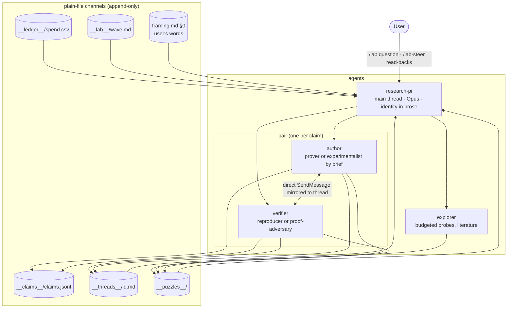
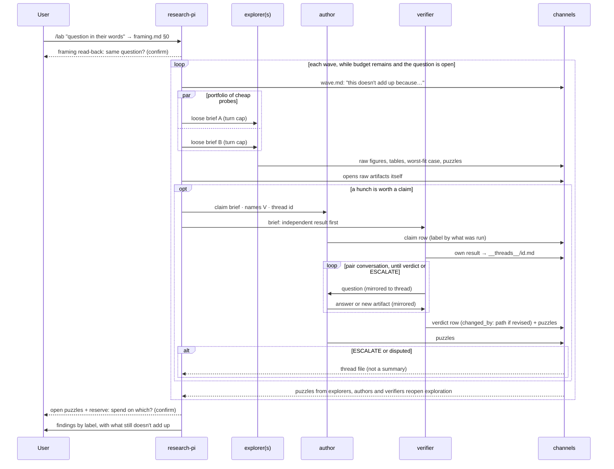
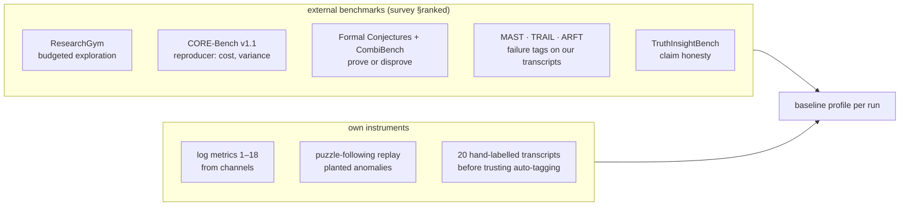

# Research-lab package — Architecture Analysis (v1)

Date: 2026-10-18 · Supersedes [03-architecture_v0.md](03-architecture_v0.md). This version
integrates the PI's revision notes, the outside review
([04-design_review_v0.md](04-design_review_v0.md), Fable 5.1) and the benchmark survey
([04-benchmarks_findings_v0.md](04-benchmarks_findings_v0.md)). Detail already in those reports is
referenced, not repeated.

## Executive Summary

- **Problem (unchanged):** a multi-agent research team that reliably shows judgement-led
  exploration within a budget and mechanical hardening, with the flow running both ways.
- **What v1 changes:**
  - peers converse directly in author ↔ verifier **pairs**, with independence protected;
  - the loops are explicit;
  - failure modes are written as **positive instructions** with observable signals;
  - lifecycle holes are closed (resume, disputes, budget exhaustion, runaways);
  - **human touchpoints** are added, including a `/lab` launcher;
  - two platform facts are respected (plugin subagents ignore frontmatter hooks; the PI file
    replaces the default system prompt);
  - a **behavioral baseline** combines five external benchmarks with our own log metrics and one
    new instrument for the gap no benchmark covers: puzzle-following.
- **Recommended pilot cut:** five agents (research-pi, explorer, author, reproducer,
  proof-adversary), one skill, three hook scripts, six channels. The full eight-agent package
  follows only if the pilot shows that per-role tool scopes matter.
- **Non-goals (unchanged):** decision rules for the PI; a new orchestration engine; replacing
  existing skills.

## What changed from v0, and why

| Change | Source |
|:--|:--|
| Author ↔ verifier pairs talk directly; the verifier records its own result first and owns termination | PI note (d); review §3 |
| Outer wave loop, parallel portfolio probes, inner pair loop drawn explicitly | PI note (c) |
| Failure modes written as positive habits plus signals; PI-side rows are descriptive and their signals are for the human | PI note (a); review §4 |
| `/lab` launcher; `agent: research-pi` in project settings; framing read-back; "reserve: spend on which?" before synthesis; budget-gone goes to the user | PI note (b); review §1 |
| `disputed` label semantics; `__threads__/`, `__lab__/wave.md`, `framing.md §0` channels; resume/compact brief | review §1 |
| PI body is prose identity, not imperatives; puzzles come first in the session brief; the "redirects needed" metric is replaced | review §5 |
| Behavioral baseline and puzzle-following instrument | PI note (e); benchmark survey |

## Proposed State



## Key Flows



## Package layout

```
research-lab/                         (full package; pilot cut marked ●)
├── .claude-plugin/plugin.json        min versions: managing-roadmaps ≥1.2.0, writing-reports, colgrep-mcp
├── AGENTS.md ●                       shared invariants (one screen), incl. channel write permissions
├── agents/
│   ├── research-pi.md ●   ├── explorer.md ●   ├── author.md ●
│   ├── reproducer.md ●    ├── proof-adversary.md ●
│   └── (full only) scout.md · prover.md · experimentalist.md · synthesizer.md
├── skills/
│   ├── research-loop/ ●              PI-facing description of the modes; brief templates; claim labels; lab-init section
│   ├── lab/ ●                        user-invocable launcher (model invocation off)
│   └── lab-status/ · lab-steer/      user-invocable touchpoints
├── hooks/hooks.json ● + scripts/
│   ├── lab_state.py ●                SubagentStop ledger + SessionStart brief (startup/resume/compact/fork)
│   ├── deliverable_gate.py ●         SubagentStop presence checks (workers), one block per run
│   └── process_guard.py ●            PreToolUse: no pattern kills; channel files append-only
└── .mcp.json ●                       WolframToolkit (+ headless .wl runner), colgrep, arxiv, one reliable web search
```

**Why five agents and not four.** The review's minimal cut merges reproducer and proof-adversary
into one verifier. The retrospective showed that the two checks need different methods and
verdict vocabularies, and both earned their cost, so the pilot keeps them apart. Scout folds into
explorer, prover and experimentalist fold into author (the brief sets the method), and
synthesis stays with the PI. Each of these folds is reversible if the pilot shows it costs
something.

## Contracts & Invariants

### Channels

| Channel | Writers | Schema / rule |
|:--|:--|:--|
| `__design__/framing.md §0` | `/lab`, `/lab-steer`, PI | the user's words verbatim, appended with date at every redirect; never paraphrased |
| `__lab__/wave.md` | PI | the current wave's narrative note; also the resume anchor |
| `__claims__/claims.jsonl` | author (claim rows), verifier (verdict rows) | `{id: <wave>-<agent>-<n>, statement, label, evidence[], author_agent, verdicts: [{by, verdict, thread, changed_by?}]}`. **Current label = weakest open verdict from distinct verifiers; disagreeing open verdicts set `disputed: true`**, which the PI resolves |
| `__threads__/<claim-id>.md` | author and verifier | append-only conversation; the verifier's first entry is its independent result |
| `__puzzles__/<wave>-<agent>.md` | every worker | uncapped; ends with the three things the agent would look at next and why they bother it |
| `__ledger__/spend.csv` | `lab_state.py` | `ts, wave, agent_type, mode, thread, tokens, wall_s, deliverable, budget_left` |

Invariants:
- Nothing reaches a deliverable above its current label.
- A verdict changes only with a `changed_by` path that exists.
- Channel files are append-only (enforced by `process_guard.py`).

### Agents

**research-pi**, the identity in prose. This file *is* the system prompt in the main thread.
Draft voice, to be kept this short:

> You lead a small research team on a question someone cares about. Your job is to notice. You
> read the raw things your team produces (figures, odd rows, the threads where colleagues
> argued, the puzzles they could not let go of), and you follow what does not add up, even when
> it is not on the roadmap. You keep the person's own words close; they are the question, and
> everything else is a reading of it. Exploration is yours: you decide which hunches deserve a
> claim, and you spread cheap probes when you cannot tell which is promising. Hardening is your
> team's: you trust their checks and spend your attention where judgement is needed. Framing,
> naming and the final synthesis you do yourself. When the budget runs out or you are about to
> close the story, you show the person what is still open. The procedures you and your team use
> are in the `research-loop` skill.

The test applied to every sentence: does it tell the PI *when* to decide *what*? If it does, it is
a rule, and it moves to a skill or is dropped.

| Agent | Mode | Frontmatter (VERIFIED fields) | Body, in one line |
|:--|:--|:--|:--|
| explorer | exploration | `model: sonnet`, `maxTurns`, tools: Wolfram, Python, arxiv, search, Write | Loose brief; returns raw material, the best- and worst-fitting case, and puzzles. Claims only as CHECKED or CONJECTURE |
| author | hardening | `model: sonnet` (Opus by brief for hard proofs), `maxTurns`, skills: research-loop | Turns a hunch into a labelled claim, by proof (Wolfram first) or experiment (one-command reproduction gate); answers its verifier in the thread |
| reproducer | hardening | `model: sonnet`, `maxTurns` | Independent result first: rerun, byte diff, claim → row, re-derivation without author code. Owns termination; SUPPORTED / OVERSTATED / UNSUPPORTED / ESCALATE |
| proof-adversary | hardening | `model: sonnet` or `opus`, `maxTurns` | Independent result first: per-step re-derivation, brute force at larger and boundary cases. Owns termination; SOUND / GAP / WRONG / LABEL TOO STRONG / LABEL TOO WEAK / ESCALATE |

Every worker carries the positive instructions of its rows below.

### Failure modes as positive instructions

Adopted from review §4, kept as written there (12 rows), grouped by who carries them:

| Carrier | Habits, in the agent's voice |
|:--|:--|
| author | Say what would differ if the claim were false, and show that case. Label by what you ran, not by what you believe. When a result closes a direction, write the scope it closes in one sentence and name one thing outside it |
| explorer | Report the worst-fitting case next to the best one. Give the id you fetched, or write UNVERIFIED |
| verifier | Record your own result before reading the author. Change a verdict only by pointing to a new artifact |
| all workers | Use the framing doc's symbols, and add a new one there before using it. State in one line why the tool fits the object. End with the three things you would look at next and why they bother you |
| PI (descriptive, in `research-loop`) | Wave notes open with the user's sentence they serve and with what doesn't add up, not with a node id. Each returned agent's raw artifact gets opened before the next wave. These are descriptions of how the PI works; their signals are read by the human in the pilot metrics, never ticked off by the PI |

### Hooks (all in `hooks/hooks.json`, with `agent_type` matchers)

| Script | Event | Effect |
|:--|:--|:--|
| `lab_state.py` | SubagentStop (all) | Read `agent_transcript_path` for tokens; append a ledger row (mode, thread, budget left); at zero budget, print that the budget is gone and that the user should be asked |
| `lab_state.py` | SessionStart `startup / resume / compact / fork` | Print, in this order: the last lines of `framing.md §0`, open puzzles, disputed claims and open threads, spend by mode and reserve, in-flight agents (ledger rows without a deliverable), the roadmap frontier |
| `deliverable_gate.py` | SubagentStop (workers) | Presence only: the deliverable exists; claims have labels; evidence paths exist; verdict rows point to a thread; a puzzles file exists. On failure `decision: block` once (guarded by `stop_hook_active`) |
| `process_guard.py` | PreToolUse Bash, Write, Edit | Deny pattern kills; deny edits to channel files other than appends |
| (optional) `read_counter` | PostToolUse Read, main thread | Count the PI's raw-artifact reads per wave (signal for failure row 4); counts only, never judges |

### Human-side UX

| Element | What it does |
|:--|:--|
| `lab-init` (section of research-loop, run by `/lab` when channels are missing) | Scaffolds channels and `framing.md`; writes `.claude/settings.json` with `agent: research-pi`, so a plain `claude` in the project *is* the PI; builds the colgrep index |
| `/lab <question>` | In a running session: appends the words to `framing.md §0` and hands over to the PI. From a generic session, its description hints at starting a research-pi session in the lab project |
| `/lab-status` | Prints the session brief on demand |
| `/lab-steer <note>` | Appends a dated user note to `framing.md §0`; the PI reads it at its next wave note |
| Read-backs | Framing read-back before wave 1; "open puzzles + reserve: spend on which?" before synthesis; budget-gone message. They are questions to the user, never caps |

### Platform facts relied on (from review §3; VERIFIED against the official docs on 2026-10-18 unless marked)

- `SendMessage` resumes a finished subagent with its context: VERIFIED.
- Direct messaging between named subagents: PARTLY VERIFIED, so it is test 1 of the pilot.
- Plugin subagents ignore frontmatter `hooks`, `permissionMode` and `mcpServers`; `skills`,
  `model`, `effort`, `maxTurns` and `tools` work.
- The main-thread `agent` setting replaces the default system prompt. The pilot checks for lost
  default behavior; the fix is a skill pointer, never a longer PI file.
- SubagentStop provides `agent_type`, `agent_transcript_path` and `stop_hook_active`. SessionStart
  matchers include `resume`, `compact` and `fork`.
- No per-agent token cap exists: `maxTurns` bounds runs and the ledger measures them.
- Agent Teams is the fallback for pairs. It is experimental, and teammates do not fire
  SubagentStop, so the hooks would move to TaskCompleted.

## Behavioral baseline



- **External:** the five benchmarks ranked in the survey, each tied to one role or mode. Inspect
  AI holds the logs; HAL's shared logs give reference points. They are used to profile behavior
  and spend, not to chase leaderboard scores.
- **Own log metrics** (survey table, 18 rows): the core set for the pilot is
  - spend share by mode (1);
  - exploration reserve (4);
  - delegation profile (7);
  - puzzles raised and followed (8);
  - label calibration (10);
  - independent-verification coverage (11);
  - evidence traceability (13);
  - re-planning events by trigger class (14);
  - hook interventions (16).
- **New instrument for the main gap, puzzle-following.**
  - Replay this study's question on the lab, from the same starting material. Score whether later
    waves pick up the signals that the original run missed (v2's table: Bernoulli h = 1, trained
    ≈ random map, Champernowne completion, m-sequence ≡ de Bruijn, the user's object-first
    wording) and whether they reach the known results.
  - Then plant one synthetic anomaly per run (e.g. a seeded inconsistency in an intermediate
    table) and score detection latency in waves.
  - This is the only metric that tests the v2 root cause directly.
- **Replaced metric:** "user redirects needed" becomes "redirects the PI did not anticipate":
  redirects whose content appears in no wave note or puzzle beforehand.
- **Calibration of auto-tagging:** hand-label about 20 transcripts with MAST before trusting an
  annotator (failure attribution elsewhere is weak: TRAIL 11%, Who&When 14%).

## Alternatives Considered

| Option | Decision |
|:--|:--|
| Full eight-agent package for the pilot | Deferred. The pilot tests the behaviors with five agents; the role split comes back only where tool scope proves to matter |
| Review's four-agent minimal cut (one merged verifier) | Rejected for the verifier merge only (see layout) |
| Agent Teams for pairs | Fallback only. Named subagents keep the SubagentStop hooks working |
| PI relays all peer traffic (v0) | Rejected (PI note d). The PI reads threads and puzzles instead |
| Wave-0 framing red team (v1 of the KT) | Cut. The adversary is available on request for a framing read, never as a gate |

## Risks & Mitigations

| Risk | Mitigation |
|:--|:--|
| A verifier is talked out of a finding in conversation | Independence-first entry; `changed_by` rule checked by the gate |
| Pair loops never converge | The verifier owns termination; ESCALATE when the turn cap is reached, the claim statement changes, or the author stops |
| PI drowns in raw material | Puzzles are short with pointers; raw artifacts are pulled on demand; the read counter gives the human a calibration signal |
| The PI file loses needed default behavior | Pilot check; fix by skill pointer |
| The PI prose decays into rules over edits | The "when to decide what" test on every edit; review edits against v2 |
| Direct subagent messaging fails | Agent Teams fallback, with hooks moved to TaskCompleted |
| Benchmarks pull optimization toward scores | Benchmarks profile behavior; the puzzle-following replay is the primary target |

## Roadmap Recommendation

Milestones, to become `__roadmap__/research_lab/` once the PI approves this version:
1. **Platform probes** (half a day): direct subagent messaging; that SubagentStop fields arrive for
   plugin agents; the main-thread `agent` setting and what the default prompt loses.
2. **Mechanical layer:** channels, `lab_state.py`, `deliverable_gate.py`, `process_guard.py`.
   Replay them on this repository's history: do they surface what the reproducer and reviewer
   surfaced?
3. **Agents and skill:** five agent files, `research-loop`, `/lab`, `/lab-status`, `/lab-steer`;
   package with `spawning-agent-plugins`.
4. **Baseline:** hand-label 20 transcripts; a puzzle-following replay of this study; one external
   benchmark (ResearchGym or Formal Conjectures) for a reference point.
