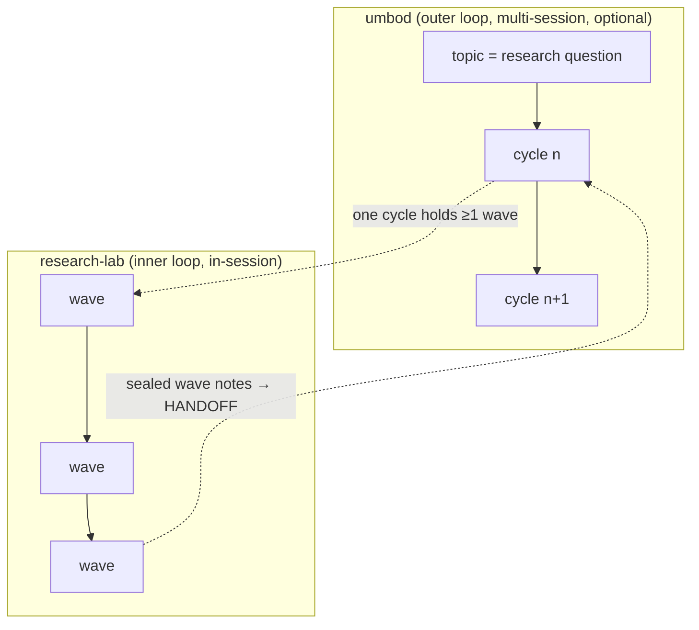

# Research-lab: composition with umbod, store design, language, sustainability — Architecture Analysis (v0)

Date: 2026-10-18 · Input to architecture v2. Placeholder names (ledger, lab, claims, threads,
puzzles) are replaced once the naming reports (`06-naming_*`) are in.

## Executive Summary

- **umbod:** reuse its contracts, not its CLI. Specifically:
  - the honesty tags plus the "what I am uncertain about" section, which merge with the claim
    labels and puzzles;
  - the PI-write-only INTENT, the INBOX with acknowledgements, and soft/hard QUESTIONS, which
    replace the ad hoc read-backs;
  - sealed per-cycle files, which make sealed wave notes;
  - the senior-reviewer verifier "judging by feel", which becomes a depth reviewer before
    synthesis;
  - the role-asymmetry table and agent identity for commits.
  Long, multi-session campaigns keep umbod as the outer loop, with one umbod cycle holding one
  or more lab waves. Name collision: umbod owns `__threads__/`.
- **Stores:** append-only **per-writer segment files** (JSONL) are the source of truth: git-diffable
  and lock-free in parallel, since each agent writes only its own segment. A **derived SQLite
  index** (gitignored, rebuilt incrementally) serves queries. This is event sourcing: mutable
  fields such as the current label are computed at read time, never updated in place.
- **Utility:** one Rust binary with subcommands for agents (append, query), hooks (gate, ledger,
  brief, guard) and the human (status, steer). It can also serve the same operations over MCP
  stdio.
- **Rust over Python:** hooks fire on every tool call of every agent. A Rust binary starts in
  about a millisecond with about 2 MB of resident memory; Python takes tens of milliseconds and
  about 15–20 MB, and depends on an interpreter and packages. The ecosystem is already Rust
  (`dirtree-rdm`, `umbod`). Python stays for offline analysis only, if at all.
- **Sustainability:** tracked in the ledger, not just preached. It covers tokens, CPU and energy
  estimates per run; communication saved by references instead of pastes and by prompt-cache-stable
  prefixes; compute saved by model tiering and sampled reproduction; and materials saved by no
  re-downloads, no raster bloat and index pruning.

## 1. Composition with umbod



| umbod element | Reuse? | How it appears in the lab |
|:--|:--|:--|
| CLI, FSM, branch discipline | **No** (as asked) | The lab runs in-session; umbod wraps it only for multi-session campaigns |
| Honesty contract: `[source:]` / `[assumption:]` tags; "What I am uncertain about" | **Yes, merged** | Claim evidence = source tags with commit hashes; ESTIMATE/CONJECTURE ≈ assumption; the uncertainty section *is* the puzzles entry (uncapped, the three things that bother you) |
| Worker mandate injected into every dispatch | **Yes** | The `research-loop` brief template carries it, so the contract travels with delegation |
| INTENT.md, PI-write-only (revisions = signals), enforced by a pre-commit hook | **Yes** | The user's words (framing §0) become a human-write-only file. The guard hook refuses agent edits; `/lab` and `/lab-steer` write it on the human's behalf |
| INBOX.md: human appends, agent acks without editing | **Yes** | `/lab-steer` appends; the PI acks in its wave note; unacked items appear in the session brief |
| QUESTIONS.md: soft and hard asks, answer/dismiss | **Yes** | Replaces ad hoc read-backs. The framing read-back and "reserve: spend on which?" are *soft* questions; budget gone is a *hard* question |
| Sealed cycle files (WORKLOG, HANDOFF immutable after seal) | **Yes** | Wave notes are sealed at wave end; the sealed history is the record of why each wave ran |
| Verifier as senior reviewer "weighing by feel": coverage, intent tracking, depth | **Yes, a new role slot** | A *depth reviewer* before synthesis, judging against the user's words. It differs from the mechanical reproducer and adversary: this one is judgement, as umbod intends. Optional in the pilot |
| Role-asymmetry table (who writes what) | **Yes** | The channel writers table, enforced by the guard hook |
| Agent identity bootstrap for commit attribution | **Yes** | Each agent's commits carry its model name (as done by hand in this study) |
| `__threads__/<slug>/` for topics | **Collision** | The lab's peer-conversation store must take another name |

## 2. What one entry contains

| Store (placeholder) | Entry | Key fields | Mutability |
|:--|:--|:--|:--|
| ledger | one agent run | `ts, run_id, wave, agent_id, agent_type, model, mode, claim_id?, tokens{in,out,cache_read,cache_write}, wall_s, cpu_s, energy_wh_est, tool_calls, deliverable, exit, budget_left` | append-only |
| lab | one wave | `wave, opened_at, sealed_at?, user_sentence, note` (narrative: "this doesn't add up because…"), `budget, exploration_share, acks[]` (inbox items), `questions[]` | open wave appendable; sealed waves immutable |
| claims | an event on a claim | `claim` event: `{id, statement, label, scope, evidence[{path, commit}], author}`; `verdict` event: `{claim_id, by, vocab, verdict, thread_ref, changed_by?}`; `supersede` event | append-only events; **current label and `disputed` are derived** |
| threads | one message in a pair conversation | `{claim_id, seq, from, to, kind: independent_result \| question \| answer \| artifact \| verdict \| escalate, body, refs[]}` | append-only |
| puzzles | a puzzle event | `raise: {id, wave, agent, text, refs[]}`; `follow: {puzzle_id, by_brief \| by_claim}`; `park: {puzzle_id, reason}` | append-only; **status is derived** |

The design principle is that nothing is updated in place. State such as "the current label",
"disputed", "puzzle followed" and "budget left" is a fold over events, so concurrent writers never
lose an update.

## 3. File stores or databases, and parallel access

| Option | Parallel writes | Reads/queries | Git and human readability | Verdict |
|:--|:--|:--|:--|:--|
| One shared JSONL file per store | Needs locks or relies on `O_APPEND` atomicity (safe for small lines on local filesystems, not guaranteed for large ones or on network filesystems) | Full scan | Good | Too fragile under many writers |
| SQLite (WAL) as source of truth | Many readers and one writer at a time (serialized, with a busy timeout) | Indexed SQL | Binary file; git merges impossible | Wrong source of truth for a git-tracked lab |
| A database server | Excellent | Excellent | None | Infrastructure out of proportion (hundreds to thousands of rows per study) |
| **Per-writer segments + derived index** | **Lock-free**: each writer appends to its own file `<store>/<wave>/<agent_id>.jsonl`, so there is no contention by construction | The derived SQLite index (gitignored) is updated incrementally from per-segment byte offsets; a query costs milliseconds | Segments are plain text, diffable and conflict-free in git (no two writers share a file) | **Chosen** |

Mechanics:
- A write appends one line to the agent's own segment and calls `fsync` (cheap: one `write` per
  entry).
- The utility validates each entry against the schema before appending, which makes it the only
  writer path. The guard hook denies direct edits.
- The index stores `(segment, offset)` watermarks and on each query ingests only new bytes. If the
  index is lost, a full rebuild is a replay of every segment, so the index is disposable.
- Reads that need strict freshness (the gates) skip the index and scan their own segments.
- Scale check: even 10⁵ events is a few MB, so the design will not be the bottleneck.

## 4. The utility (one binary)

```
<tool> append <store> --json …        # agents (or via MCP tool `append`)
<tool> query  open-puzzles | disputed | spend --by mode | claim <id> | thread <id>
<tool> brief                          # SessionStart hook (startup/resume/compact/fork)
<tool> hook subagent-stop             # ledger row + presence gate (reads hook JSON on stdin)
<tool> hook pre-tool-use              # guard: pattern kills, edits to stores or the user-words file
<tool> wave open|seal  ·  ask --soft|--hard  ·  steer "<note>"   # PI and human
<tool> mcp                            # same operations as an MCP stdio server
```

- **One binary, three front ends** (CLI, hook, MCP). Hooks call subcommands, so there is no
  separate script per hook.
- **MCP front end:** agents call typed tools (`append_claim`, `raise_puzzle`) instead of building
  shell commands. Schema errors come back as tool errors.
- **Read cost:** `query` returns compact rows with pointers, never file dumps (this saves
  communication, §6).

## 5. Why Rust and not Python

| Factor | Rust binary | Python script |
|:--|:--|:--|
| Start-up per hook call | about 1 ms | about 30–60 ms (interpreter + imports) |
| Resident memory per call | about 2–4 MB | about 15–25 MB |
| Calls per study | PreToolUse fires on **every** tool call of every agent: thousands per study (≈1,000+ in this one) | same |
| Dependencies | none at run time (static binary) | interpreter version, venv, packages; drift over time |
| Ecosystem fit | `dirtree-rdm` and `umbod` are Rust; shared crates for schema and validation | — |
| Costs | compilation; cross-platform builds (note: `dirtree-rdm` ships darwin-only, a known gap) | none |

The per-call overhead of hooks scales with agents × tool calls. With many parallel agents, Rust
keeps hooks out of the critical path and out of the energy budget. Python remains acceptable for
offline analysis of the ledger, though Wolfram can take that role too.

## 6. Sustainability across the board

Each line names a resource, a lever, and how the ledger makes it visible:

| Resource | Lever | Measured by |
|:--|:--|:--|
| **Agent communication** (tokens between agents) | Briefs reference files and paths instead of pasting; colgrep retrieval instead of whole-file reads; pairs talk directly instead of relaying through the PI; warm reuse (SendMessage) instead of re-reading context; `query` returns pointers | tokens per brief and per handback; PI tokens vs worker tokens |
| **Prompt-cache efficiency** | Stable prefixes: AGENTS.md, agent bodies and skills stay byte-stable within a study; variable content goes at the end of briefs | `cache_read` share in the ledger |
| **Model compute** | Tiering: Opus only for the PI and hard proofs; Sonnet for workers; Haiku for mechanical reading or formatting tasks; smallest instance first; Wolfram for exact work instead of brute-force sweeps | tokens by model; cost per accepted claim |
| **Local compute** | Bounded `--jobs` on shared machines. Reproduction at **sampled** scale: rerun the quick mode plus a random sample of cells and compare hashes, with full reruns only when a sample disagrees (this study reran two full sweeps, about 2× the CPU). Content-addressed caching of experiment outputs (code hash + parameters) | `cpu_s` per run; duplicate-configuration rate |
| **Electricity** | The ledger carries `energy_wh_est` per run: model tokens × a per-model Wh/token coefficient (an ESTIMATE, sourced and labelled) plus local `cpu_s` × a machine power coefficient. Budgets can be stated in Wh as well as tokens. Rust hooks keep the overhead floor low | Wh per wave, per accepted claim, per mode |
| **Materials and storage** | No re-downloads (local caches first, as in this study); derived data gitignored; figures referenced or stored as vector graphics, not embedded rasters (this study's notebook was 14 MB from three embedded PNGs); worktrees and indexes pruned at close | repository size; index store size |
| **Human attention** | Soft questions batched (umbod-style); hard questions only for budget-gone; the session brief puts puzzles first so the user reads the signal, not the plan | questions per wave; time-to-answer |

Sustainability is reported per study in the closing knowledge-transfer report: Wh, tokens and
CPU seconds per accepted claim and per mode.

## Risks

| Risk | Mitigation |
|:--|:--|
| Energy coefficients are uncertain | Labelled ESTIMATE with source; used for comparisons between runs, not absolute claims |
| Index drift from segments | The index is disposable; a `rebuild` subcommand replays the segments |
| Cross-platform Rust builds | CI builds for darwin and linux, arm64 and x64, from the start |
| Over-engineering the utility | The pilot needs only `append`, `query open-puzzles\|disputed\|spend`, `brief` and two hook subcommands |
