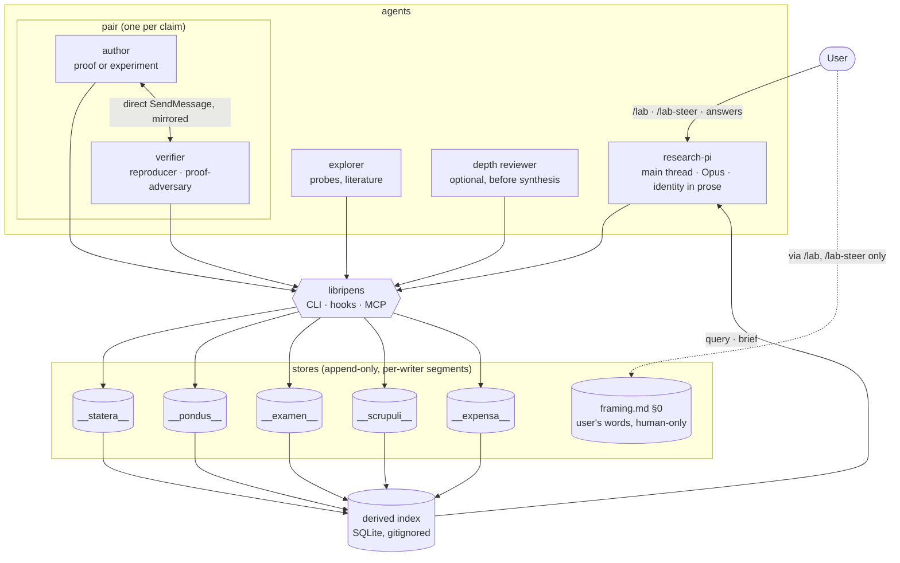

# Research-lab package — Architecture Analysis (v2, consolidated)

Date: 2026-10-18 · Supersedes [05-architecture_v1.md](05-architecture_v1.md) and absorbs
[06-stores_umbod_sustainability_v0.md](06-stores_umbod_sustainability_v0.md). Names adopted by the
PI from [06-naming_classical_v0.md](06-naming_classical_v0.md). This is the reference document for
building. Supporting detail stays in the outside review ([04](04-design_review_v0.md)) and the
benchmark survey ([04](04-benchmarks_findings_v0.md)).

## Executive Summary

- **Goal:** a multi-agent research team that reliably shows judgement-led exploration within a
  budget and mechanical hardening, with anomalies found during hardening flowing back to reopen
  exploration.
- **Principle:** procedure where the work is mechanical (stores, hooks, verifiers); identity where
  it is judgement (the PI). The PI file contains no rule that says *when* to decide *what*.
- **Package:** one plugin with these parts:
  - `AGENTS.md`;
  - five agents (research-pi, explorer, author, reproducer, proof-adversary), plus an optional
    depth reviewer;
  - one skill (`research-loop`) and three user commands (`/lab`, `/lab-status`, `/lab-steer`);
  - one Rust binary, **`libripens`**, which serves as CLI, hook entry point and MCP server;
  - five append-only stores named after the Roman balance.
- **Composition:** umbod's contracts are reused (honesty tags, human-only intent, inbox with
  acknowledgements, soft/hard questions, sealed records, a judgement-based senior reviewer). Its
  CLI is not. For multi-session campaigns umbod stays the outer loop.
- **Sustainability** is a ledger field, not a slogan: tokens, cache reads, CPU seconds and
  estimated Wh per run, reported per accepted claim and per mode.

## The balance: names

One Latin root system: weighing (*pendere*, *libra*). Paying and judging are the same act, so
every store is a role in one balance.

| Store / tool | Name | Gloss | Holds |
|:--|:--|:--|:--|
| ledger | **`__expensa__/`** | "things weighed out", the Roman payment entry | one event per agent run: what it spent |
| lab state | **`__statera__/`** | the balance in its current state | wave notes (open, then sealed), budget, inbox acknowledgements, questions to the human |
| claims | **`__pondus__/`** | the weight a claim can bear | claim and verdict events; the current label is derived |
| peer threads | **`__examen__/`** | the tongue of the balance; the verifier's independent weighing | per-claim conversation between author and verifier |
| puzzles | **`__scrupuli__/`** (sing. *scrupulus*) | the sharp pebble, and the smallest weight: a residue not rounded away | what did not add up, and whether anything followed it |
| tool | **`libripens`** | the neutral scale-holder in a Roman sale | the only writer path to the stores; hooks; queries |

Notes:
- `pondus` names a directory only, because a `pondus` package exists on several registries.
- `examen` reading as "exam" in Spanish and French is close enough to its sense to keep.
- The Latin forms have not been checked against a lexicon (flag carried from the naming report).

## Proposed State



## Key Flows

```mermaid
sequenceDiagram
  participant U as User
  participant PI as research-pi
  participant X as explorer(s)
  participant A as author
  participant V as verifier
  participant L as libripens + stores
  U->>L: /lab "question" → framing.md §0
  PI->>L: ask --soft "is this your question?" (framing read-back)
  loop each wave, while budget remains and the question is open
    PI->>L: wave open: user's sentence + "this doesn't add up because…"
    par portfolio of cheap probes
      PI->>X: loose brief A (maxTurns)
    and
      PI->>X: loose brief B (maxTurns)
    end
    X->>L: scrupuli raised + raw artifact refs
    PI->>PI: opens raw artifacts itself
    opt a hunch is worth a claim
      PI->>A: claim brief · names V · claim id
      PI->>V: brief: independent result first
      A->>L: pondus claim event (label by what was run)
      V->>L: examen: independent result (seq 1)
      loop pair conversation, until verdict or ESCALATE
        V->>A: question (mirrored to examen)
        A->>V: answer or new artifact (mirrored)
      end
      V->>L: pondus verdict (changed_by if revised) + scrupuli
      alt ESCALATE or disputed
        L-->>PI: brief lists it; PI reads the examen thread itself
      end
    end
    L-->>PI: open scrupuli from every role reopen exploration
    PI->>L: wave seal (statera, immutable)
  end
  PI->>L: ask --soft "open scrupuli + reserve: spend on which?"
  opt budget exhausted
    L-->>U: ask --hard "budget gone; this is what I would still probe"
  end
  PI->>U: findings by label, with what still doesn't add up
```

## Package layout

```
research-lab/
├── .claude-plugin/plugin.json     min versions: managing-roadmaps ≥1.2.0, writing-reports, colgrep-mcp
├── AGENTS.md                      shared invariants (one screen); copied by lab-init; CLAUDE.md = "@AGENTS.md"
├── agents/
│   ├── research-pi.md   explorer.md   author.md   reproducer.md   proof-adversary.md
│   └── depth-reviewer.md          optional; umbod-style senior reviewer
├── skills/
│   ├── research-loop/SKILL.md     modes, briefs (worker mandate), labels, honesty tags, lab-init section
│   ├── lab/SKILL.md               user-invocable, model invocation off
│   ├── lab-status/SKILL.md        user-invocable
│   └── lab-steer/SKILL.md         user-invocable
├── hooks/hooks.json               every hook calls `libripens hook …`, with agent_type matchers
├── .mcp.json                      libripens (mcp), WolframToolkit, colgrep, arxiv, one web search
└── libripens/                     Rust crate; CI builds darwin and linux, arm64 and x64
```

## Contracts & Invariants

### Stores

Layout: `__<store>__/<wave>/<agent_id>.jsonl`, one segment per writer. No two writers share a file,
so parallel appends need no locks and git never conflicts. `framing.md §0` is the single human-only
file.

| Store | Events (one JSON line each) | Derived at read time |
|:--|:--|:--|
| `__expensa__` | `run {ts, run_id, wave, agent_id, agent_type, model, mode, claim_id?, tokens{in,out,cache_read,cache_write}, wall_s, cpu_s, energy_wh_est, tool_calls, deliverable, exit}` | spend by mode, wave, agent and claim; budget left; Wh per accepted claim |
| `__statera__` | `wave_open {wave, user_sentence, note, budget, exploration_share}` · `wave_append {note}` · `wave_seal {wave}` · `ack {inbox_ref}` · `ask {id, soft\|hard, text}` · `answer {id, text, by: human}` | the current wave; sealed history; unacknowledged steer notes; open questions |
| `__pondus__` | `claim {id, statement, label, scope, evidence[{path, commit}], author}` · `verdict {claim_id, by, vocab, verdict, examen_ref, changed_by?}` · `supersede {old, new}` | **current label = weakest open verdict from distinct verifiers; disputed if open verdicts disagree** |
| `__examen__` | `msg {claim_id, seq, from, to, kind: independent_result\|question\|answer\|artifact\|verdict\|escalate, body, refs[]}` | open threads; ESCALATE list |
| `__scrupuli__` | `raise {id, wave, agent, text, refs[]}` · `follow {id, by_brief\|by_claim}` · `park {id, reason}` | open / followed / parked; follow rate; latency in waves |

Invariants (each enforced by `libripens`):
- **Single writer path:** agents append only through `libripens append` or its MCP tools, which
  validate the schema. The guard denies direct edits to the stores and to `framing.md §0`.
- **Append-only:** nothing is updated in place; sealed waves are immutable.
- **Independence first:** the first `__examen__` message on a claim is the verifier's
  `independent_result`.
- **A verdict changes only with evidence:** a later verdict by the same verifier needs a
  `changed_by` path that exists.
- **Nothing reaches a deliverable above its current label.**
- **Honesty tags (from umbod):** every claim's evidence is a `[source: path@commit]`; ESTIMATE and
  CONJECTURE carry an `[assumption: …]`.

Index: a gitignored SQLite file holding per-segment byte watermarks. Queries ingest new bytes
only; `libripens rebuild` replays every segment. Gates that need strict freshness scan the segments
directly.

### libripens (one Rust binary, three front ends)

```
libripens append <store> --json '…'          # agents; validates, appends to own segment, fsync
libripens query  scrupuli --open | pondus --disputed | expensa --by mode | examen <claim>
libripens wave   open|append|seal  ·  ask --soft|--hard  ·  answer  ·  steer "<note>"
libripens brief                               # SessionStart: startup / resume / compact / fork
libripens hook   subagent-stop | pre-tool-use # hook JSON on stdin; decision JSON on stdout
libripens rebuild                             # replay segments into the index
libripens mcp                                 # the same operations as typed MCP tools
```

- **Why Rust:** hooks fire on every tool call of every agent, more than 1,000 in the imbrication
  study.
  - A static binary starts in about 1 ms with about 2–4 MB of memory; Python takes about 30–60 ms
    and 15–25 MB, and depends on an interpreter and packages.
  - It matches `dirtree-rdm` and `umbod`.
  - Cross-platform CI builds from day one (`dirtree-rdm` still ships darwin-only).
- **Pilot scope:** `append`, `query`, `wave`, `ask`, `brief`, and the two `hook` subcommands. The
  MCP front end and `rebuild` come second.

### Hooks (`hooks/hooks.json`; frontmatter hooks are ignored for plugin subagents)

| Event / matcher | `libripens` call | Effect |
|:--|:--|:--|
| SubagentStop, all agents | `hook subagent-stop` | Read `agent_transcript_path`; append an `expensa` run event (tokens, CPU, Wh estimate) |
| SubagentStop, workers | same call | Presence gate: deliverable exists; claims labelled and tagged; evidence paths exist; verdicts reference `examen`; a `scrupuli` raise or an explicit "none". Blocks once (`stop_hook_active` guard) |
| PreToolUse: Bash, Write, Edit | `hook pre-tool-use` | Deny kills by pattern; deny direct edits to stores and `framing.md §0` |
| SessionStart: startup, resume, compact, fork | `brief` | Print, in this order: the latest user words and unacknowledged steer notes; open **scrupuli**; disputed claims and ESCALATEs; open questions; spend by mode and reserve; in-flight runs; roadmap frontier |
| PostToolUse: Read, main thread (optional) | `hook post-read` | Count the PI's reads of raw artifacts per wave (a signal for the human; it never judges) |

### Agents

**research-pi**, the identity in prose. It is the whole system prompt in the main thread, so it
stays this short:

> You lead a small research team on a question someone cares about. Your job is to notice. You
> read the raw things your team produces (figures, odd rows, the examen threads where colleagues
> argued, the scrupuli they could not let go of), and you follow what does not add up, even when
> it is not on the roadmap. You keep the person's own words close; they are the question, and
> everything else is a reading of it. Exploration is yours: you decide which hunches deserve a
> claim, and you spread cheap probes when you cannot tell which is promising. Hardening is your
> team's: you trust their checks and spend your attention where judgement is needed. Framing,
> naming and the final synthesis you do yourself. When the budget runs out or you are about to
> close the story, you show the person what is still open. The procedures you and your team use
> are in the `research-loop` skill.

Workers (frontmatter fields `model`, `effort`, `maxTurns`, `tools` and `skills` are honoured for
plugin subagents):

| Agent | Model | Carries, in its own voice |
|:--|:--|:--|
| explorer | Sonnet | Return raw material and the worst-fitting case next to the best one. Give the id you fetched, or write UNVERIFIED. End with the three things you would look at next and why they bother you |
| author | Sonnet (Opus by brief for hard proofs) | Say what would differ if the claim were false, and show that case. Label by what you ran. When a result closes a direction, write the scope it closes and name one thing outside it. Wolfram first for exact work; state in one line why the tool fits |
| reproducer | Sonnet | Record your own result before reading the author: rerun at **sampled** scale (quick mode plus random cells, with a full rerun only on a mismatch), claim → row, re-derive without author code. You own termination: SUPPORTED / OVERSTATED / UNSUPPORTED / ESCALATE |
| proof-adversary | Sonnet or Opus | Record your own result first: per-step re-derivation, independent checks at larger and boundary cases. You own termination: SOUND / GAP / WRONG / LABEL TOO STRONG / LABEL TOO WEAK / ESCALATE |
| depth-reviewer (optional) | Opus | umbod's senior reviewer: judge by feel whether the work answers the person's words and goes as deep as it promised; one verdict paragraph before synthesis |

All workers use the framing doc's symbols and close with `[source:]`/`[assumption:]` tags and a
scrupuli entry. That is umbod's "what I am uncertain about", uncapped.

### Human-side UX

| Element | What it does |
|:--|:--|
| `.claude/settings.json` written by lab-init | `agent: research-pi`, so a plain `claude` in the project *is* the PI |
| `/lab <question>` | Runs lab-init if needed; appends the words to `framing.md §0`; the PI opens with a soft read-back question |
| `/lab-status` | `libripens brief` on demand |
| `/lab-steer <note>` | umbod-style inbox: appends a dated note; the PI acknowledges it in the next wave note; unacknowledged notes head the brief |
| Questions | Soft (read-back, "reserve: spend on which?") are recorded and non-blocking; hard (budget gone) waits for an answer. Shown by `/lab-status` |

### Composition with umbod

For single-session studies the lab stands alone. For multi-session campaigns:
- an umbod topic is the research question, and its INTENT.md mirrors `framing.md §0`;
- one umbod cycle holds one or more lab waves;
- sealed `statera` waves feed the cycle's HANDOFF;
- umbod's verifier runs before `finish-cycle` as usual.

Reused contracts are listed in [06-stores…](06-stores_umbod_sustainability_v0.md) §1. The CLI and
FSM are not imported. The former name collision (`__threads__/`) is gone (`__examen__/`).

### Sustainability (measured in `__expensa__`)

| Resource | Levers |
|:--|:--|
| Agent communication | briefs reference paths; colgrep retrieval; pairs talk directly; warm reuse; `query` returns pointers |
| Prompt cache | AGENTS.md, agent bodies and skills stay byte-stable within a study; variable content goes at the end of briefs; `cache_read` is tracked |
| Compute | model tiering; smallest instance first; Wolfram for exact work; sampled reproduction; content-addressed result cache |
| Electricity | `energy_wh_est` = tokens × per-model coefficient + `cpu_s` × machine coefficient (labelled ESTIMATE, sourced); budgets can be stated in Wh |
| Materials and storage | no re-downloads; derived data gitignored; vector or referenced figures, not embedded rasters; prune indexes and worktrees at close |
| Human attention | soft questions batched; hard ones only for budget-gone; scrupuli first in the brief |

The closing knowledge-transfer report of every study states tokens, CPU seconds and Wh per
accepted claim and per mode.

## Behavioral baseline

- **External** (survey ranking): ResearchGym (budgeted exploration), CORE-Bench v1.1 (the
  reproducer: cost and variance), Formal Conjectures with CombiBench (prove or disprove), MAST /
  TRAIL / ARFT (failure tags on our transcripts), TruthInsightBench (claim honesty). Inspect AI
  holds the logs; HAL logs give reference points.
- **Own metrics from the stores:**
  - spend share by mode;
  - exploration reserve;
  - delegation profile;
  - **scrupuli raised and followed**;
  - label calibration;
  - independent-verification coverage;
  - evidence traceability;
  - re-planning events by trigger;
  - hook interventions;
  - Wh per accepted claim;
  - redirects the PI did not anticipate.
- **Puzzle-following replay** (the gap no benchmark covers):
  - Replay the imbrication question. Score whether later waves pick up what the original run missed
    (Bernoulli h = 1, a trained map ≈ a random map, Champernowne completion, m-sequence ≡ de Bruijn,
    the user's object-first wording).
  - Then plant one synthetic anomaly per run and score detection latency.
- **Calibration:** hand-label about 20 transcripts before trusting an automatic MAST annotator.

## Alternatives Considered

| Option | Decision |
|:--|:--|
| Transmission-tradition names (pinkas, shilu, pratigya, sugya, kushya, sofer) | Not chosen. Three traditions mixed; the Latin set is one coherent balance and pairs with *imbrex* |
| SQLite or a server as source of truth | Rejected: binary, unmergeable in git, and out of proportion. Kept only as a derived index |
| One shared JSONL file per store | Rejected: relies on append atomicity that fails for large lines or on network filesystems |
| Python hooks | Rejected: per-call start-up and memory multiplied by agents × tool calls; dependency drift |
| umbod CLI as the backbone | Not for in-session studies; kept as the outer loop for multi-session campaigns |
| Four-agent minimal cut (one merged verifier) | Rejected for the verifier merge; both verification methods earned their cost |
| Agent Teams for pairs | Fallback only: teammates do not fire SubagentStop, so hooks would move to TaskCompleted |

## Risks & Mitigations

| Risk | Mitigation |
|:--|:--|
| Direct subagent-to-subagent messaging is only partly verified | Platform probe first; Agent Teams fallback |
| The PI file loses default-prompt behavior | Pilot check; fix by a skill pointer, never a longer PI file |
| PI prose decays into rules | The "when to decide what" test on every edit |
| A verifier is talked out of a finding | Independence first; `changed_by` enforced |
| Pair loops never converge | The verifier owns termination; `maxTurns`; ESCALATE |
| Energy coefficients are uncertain | Labelled ESTIMATE; used to compare runs, not as absolute figures |
| Index drift | The index is disposable; `rebuild` |
| Over-building `libripens` | Pilot scope is limited to six subcommands |

## Roadmap Recommendation

To become `__roadmap__/research_lab/` on approval:
1. **Platform probes:** direct subagent messaging; SubagentStop fields for plugin agents; what the
   main-thread `agent` setting drops from the default prompt.
2. **`libripens` core:** store schemas, `append`, `query`, `wave`, `ask`, `brief`, and the two hook
   subcommands. Cross-platform CI. Replay it on this repository's history to check that the gate
   would have flagged what the reproducer flagged.
3. **Agents and skills:** five agent files, `research-loop`, `/lab`, `/lab-status`, `/lab-steer`;
   package with `spawning-agent-plugins`.
4. **Baseline:** 20 hand-labelled transcripts; the puzzle-following replay of the imbrication
   study; one external benchmark for a reference point.
