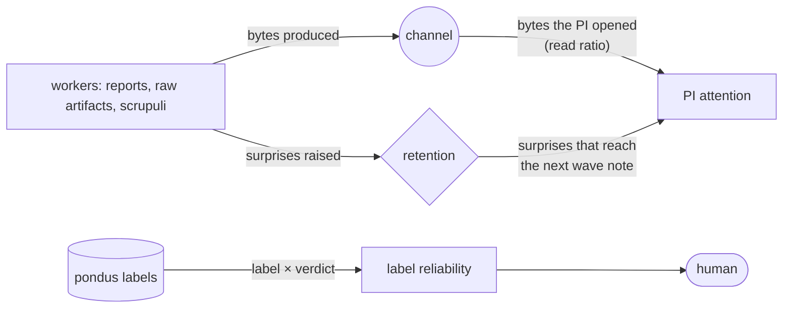

# Information measures for the lab — Outside counsel (v0)

Date: 2026-10-18 · Counsel on [08-information_measures_draft_v0.md](08-information_measures_draft_v0.md),
for the system in [07-architecture_v2.md](07-architecture_v2.md), under the constraint of
[02-knowledge_transfer_v2.md](02-knowledge_transfer_v2.md): measures are instruments for attention,
never decision rules. This is counsel, not a rewrite. Numbers marked MEASURED were computed on this
repository's reports on 2026-10-18 with an ad hoc Python script (recipe in §4; stdlib `lzma`,
unigram tokens, 25-word stop list); they are a pilot, not a result.

## 1. Verdicts

| Measure (draft §) | Verdict | One line |
|:--|:--|:--|
| Description length, zstd with a project dictionary (§1) | **KEEP** | Bits relative to what the project already says; milliseconds; the dictionary is exactly the remedy for short texts |
| Conditional complexity C(msg \| ctx), redundancy (§1) | **KEEP, narrow** | Separates rewording from new findings on this repo (redundancy 0.93 vs 0.22, MEASURED); use it only within a thread with the receiver's real context, never as cross-agent similarity |
| JSD map over the vocabulary distribution (§2) | **DROP** | At tens to hundreds of tokens the plug-in JSD saturates (0.85–0.94 bits for every report, MEASURED) and two halves of one report diverge as much as user vs report; smoothing collapses everything into 0.12–0.21 |
| Embedding map in 2D (§2) | **CHANGE** | Keep local embeddings; drop the 2D layout (fewer than ten points per wave) for cosine distances to a few named anchors |
| MI between agent identity and terms (§2) | **CHANGE** | As a number it is biased upward by about (K_x−1)(K_y−1)/(2N ln 2) bits at these counts; keep it as a per-agent list of distinctive terms with a Dirichlet prior |
| Divergence from the user's words (§2) | **CHANGE to coverage** | Distributional divergence fails (above); set coverage of the user's terms carried the signal: wave notes 0.23 → 0.09 → 0.12, "combinatorics" in no report and no PI note (MEASURED) |
| Pair-independence convergence (§2) | **CHANGE** | Author–verifier compression distance does not separate from unrelated pairs (0.79–0.87 vs 0.85–0.89, MEASURED); measure whose words the verdict reuses, and first use of terms in the `examen` thread |
| Scrupulus novelty (§2) | **KEEP, change estimator** | Sentence-length texts are below the range where compression says anything; use embedding similarity to existing claims and scrupuli |
| Semantic entropy, free variant (§3) | **KEEP as a count** | With two or three independent statements the "entropy" takes three values; report the number of distinct meanings and who holds which |
| Semantic entropy, sampled (§3) | **CHANGE to exploratory** | Fine at synthesis on disputed claims only; designed for short answers, less reliable on long technical statements |

## 2. Soundness

**What the compression measures estimate.** The compressed length of a message under a model
trained on the project corpus is its code length under that model, a surprisal in bits relative to
what the project already says. Compressor code lengths converge to the entropy rate slowly and
from above (Schürmann & Grassberger, cond-mat/0203436), which does not matter here because the
quantity of interest is the difference between messages under one fixed model, not an entropy
estimate. The zstd documentation states the small-file remedy plainly: a trained dictionary
"can help improve the compression of small files" (docs.rs/zstd 0.13, module `dict`). The
conditional form C(ctx + msg) − C(ctx) is the quantity behind the normalized compression distance
(Cilibrasi & Vitányi, cs/0312044). Two biases at the lab's scale:

- Below a few kilobytes, frame overhead and minimum match length dominate; NCD between unrelated
  reports here is 0.85–0.89 and between an author's report and the verifier's report on it
  0.79–0.87 (MEASURED). That gap is too thin to carry a judgement. Within a thread the picture is
  different: C(trellis v1 | trellis v0) = 364 bytes of 5,412 (redundancy 0.93) against
  C(superstring v1 | superstring v0) = 1,320 of 6,996 (0.81), and the commits confirm the
  reading: the trellis revision changed wording only, the superstring revision changed CSV flags,
  medians and withdrew a claim (`b752968`, `bb25366`).
- The context must be what the receiver actually holds (the brief, the files it was pointed to,
  the thread so far), and the compressor window must cover it; zstd needs its long-window mode or a
  high level for contexts beyond its default window (UNVERIFIED threshold; `lzma` preset 9 was
  used in the pilot).

**What the vocabulary measures estimate, and why they fail at this size.** A wave produces tens
of messages of a few hundred tokens each over a vocabulary of several hundred types. The plug-in
entropy of a distribution with K types from N tokens is biased by about −(K−1)/(2N ln 2) bits
(the Miller–Madow correction; textbook, citation UNVERIFIED); with K ≈ 500 and N ≈ 1000 that is
0.36 bits per term, the whole dynamic range of a JSD bounded by 1 bit. Bayesian estimators repair
entropy under sampling (Nemenman, Shafee & Bialek, physics/0108025) but not the support mismatch
between two sparse samples, which is what JSD measures here. The pilot shows it: JSD between the
two halves of one report is 0.41 (trellis v0, 986 tokens), 0.43 (atlas, 1,844) and 0.90 (a
151-token PI note), the same range as user-words versus any report. Mutual information between
agent identity and terms inherits the same bias with the sign reversed. What survives is set
arithmetic: which of the user's terms and framing symbols a text uses at all.

**Embeddings.** all-MiniLM-L6-v2 (Sentence-BERT lineage, Reimers & Gurevych, 1908.10084) is the
right tool for sentence- and paragraph-length texts, where compression is blind. Its known
small-sample pathology is hubness, asymmetric neighbourhoods in which a few texts are everyone's
neighbour (Nielsen & Hansen, 2311.18364). Distances to a handful of fixed anchors (the user's
words, framing §1, each open scrupulus, each claim statement) avoid it; a 2D projection of eight
points per wave does not inform, it decorates.

**Semantic entropy.** Kuhn, Gal & Farquhar (2302.09664) cluster sampled answers by mutual
entailment and take the entropy over clusters; Farquhar et al. (2024) is the journal version
(cited through Kossen et al., 2406.15927; venue UNVERIFIED here). Three facts bear on the lab.
With n independent statements the estimate lives on a lattice ({0, 1, log2 3} bits for n ≤ 3),
so it is a count of distinct meanings, and should be named one. Estimating it from pairwise
equivalence judgements is slow in n when the judge is weak (Yu & Liu, 2610.17971). The method was
built for short answers; for long outputs it discards within- and between-cluster similarity
(Nguyen, Payani & Mirzasoleiman, 2506.00245), and an embedding-based variant has been shown
cheaper in a multi-agent setting (Lin & Tahvildari, 2606.09800). So: the free variant is a count,
the sampled variant is exploratory, and when a claim is disputed the `examen` thread already holds
the disagreement in words, which the PI reads anyway.

## 3. Three additions, and what was set aside

1. **Anomaly retention (the rate–distortion view, with distortion defined on anomalies).** The
   feedback flow that was cut in the imbrication study was not a loss of summary fidelity; the
   summaries were faithful. It was a loss of the specific items judgement needed. Define the
   distortion of a handback or wave as the fraction of raised surprises that do not appear in what
   the PI acted on. Operationally: scrupuli raised in a wave versus scrupuli referenced in the next
   wave note, the next briefs, or opened by the PI (`post-read`). The architecture already derives
   a "follow rate"; this names it as the distortion and tracks it per source agent and per kind.
   Ground truth exists (§4): eight worker reports carry 35 "Contradictions & Surprises" bullets,
   and of the seven key terms of the five missed signals, three appear once each in the three PI
   decision notes and four never (MEASURED).
2. **Read ratio (the channel-capacity view).** Capacity between team and PI is bounded by what the
   PI actually reads. Report, per wave, bytes of worker output and raw artifacts the PI opened over
   bytes the workers produced, split by kind (figure, table, thread, report section). It costs
   nothing (the `post-read` hook and `expensa` already count both sides) and it is the empirical
   instrument for the open question both KT reports end on: where starvation ends and drowning
   begins. Displayed as a ratio, never as a target.
3. **Label reliability (calibration of claim labels).** From `__pondus__` alone: a table of
   author label × verifier verdict (SUPPORTED / OVERSTATED / …, SOUND / LABEL TOO STRONG / …), per
   study and cumulatively. Zero compute, and the study already has the rows: the adversarial
   review changed two labels and found one too weak among about twelve claims; the reproduction
   found four numeric mismatches and one overstated claim among fifteen. If authors are later asked
   for a confidence on each claim, a Brier score follows for free; models can be calibrated about
   their own claims when asked in the right form (Kadavath et al., 2207.05221), which makes the
   question worth asking.

Set aside, with reasons. **Surprisal under a reference language model** is the compression measure
with a better model; it needs token log-probabilities from a local LM, so it is offline and model
dependent, and the dictionary compressor is its cheap form. **Information bottleneck** (Tishby,
Pereira & Bialek, physics/0004057) is the right way to describe a brief (compress the PI's intent,
keep what predicts a good deliverable), but solving it needs a relevance variable the lab cannot
observe; keep the words, apply the draft's conditional complexity to briefs. **Transfer entropy**
(Schreiber, nlin/0001042) needs long stationary series; a study has a handful of waves. Its cheap
substitute for "who leads" is first use: which agent first wrote each framing term in an `examen`
thread, and whether the other adopted it. **Topic models** on tens of short documents are
unstable; the embedding anchors do the same job.

## 4. Validation

**Ground truth in hand.** Five missed signals (02 §2); two author → verifier → author sequences
(trellis `00` → reproduction → `01`; superstring `00` → reproduction → `01`); one author →
adversary sequence (laws `00` → `01-review`); three PI decision notes; the user's words as quoted
in 02 and the PI's own one-paragraph statement in `__design__/problem_framing.md` §1 (62 tokens,
56 types, MEASURED); commits that say what each revision changed.

**Pilot, this repository (MEASURED, 2026-10-18).** Recipe: lower-cased word tokens, code blocks
and `[source:]` tags removed, 25 function words dropped; JSD base 2 over the union vocabulary, with
and without Dirichlet(½) smoothing; `lzma` preset 9 for C(·).

| Text | user-term coverage | plug-in JSD | smoothed JSD |
|:--|--:|--:|--:|
| final notebook | 0.80 | 0.85 | 0.18 |
| literature | 0.68 | 0.85 | 0.12 |
| generative atlas (the user-prompted wave) | 0.52 | 0.87 | 0.14 |
| foundations · laws · superstring | 0.41 | 0.89–0.91 | 0.15–0.17 |
| strided trellis | 0.27 | 0.89 | 0.19 |
| PI notes: wave 2 · wave 3 · synthesis | 0.23 · 0.09 · 0.12 | 0.86 · 0.94 · 0.92 | 0.17 · 0.19 · 0.21 |

Reading: coverage orders the texts the way 02 diagnosed them by hand (the atlas closest to the
user, the experiments farthest, the PI's own notes drifting wave by wave), and one absence is
exact: "combinatorics", the user's first noun, appears in no report and no PI note. JSD orders
nothing. On pair convergence, NCD(author, verifier) sits at 0.79–0.87 against 0.85–0.89 for
unrelated reports, so the drafted measure would have reported nothing; it also had nothing to
report, since the reproducer was in fact independent and found mismatches. Conditional complexity
of the author's revision given its original (0.93 vs 0.81 redundancy) ranks the two revisions as
the commits describe them.

**Proposed offline experiment (one afternoon, no new agent runs for part A).**

- *A, retention replay.* Extract every bullet of "Contradictions & Surprises" and "Observations"
  from the eight worker reports (35 surprise bullets). For each, mark by hand whether its key terms
  appear in a later PI note, roadmap amendment or brief, and whether 02 lists it as missed. Then
  compute the retention measure of §3.1 and the embedding similarity of each bullet to the three PI
  notes. The measure carries signal if the five missed signals sit in the lowest similarity and
  zero-retention cells and the one followed signal (the count 2, 6, 20, 58, …) does not.
- *B, planted cascade (two Sonnet runs).* Take one claim with a known verdict (trellis row 10,
  "identical in 46 of 51 runs"). Run a verifier that must record its result before reading the
  author, and one that is handed the author's report first. Compute, for each verdict, the share
  of its bytes predictable from the author's text versus from its own first message, and the first
  use of each framing term. The measure carries signal if it separates the two runs; if it does
  not, the "independence first" invariant is the only guard, and it should be said so.

## 5. Cheapest viable version

| Measure | Where computed | Cost | Library or algorithm |
|:--|:--|:--|:--|
| bits of a message, with project dictionary | hook, `subagent-stop` | ms | `zstd` crate 0.13: `dict::from_samples` trained once per study on framing, `AGENTS.md`, skills and sealed reports; `EncoderDictionary`, `bulk::compress` (verified on docs.rs) |
| C(msg \| ctx), redundancy | hook, for briefs and handbacks whose ctx is on disk | ms to tens of ms for ≤ 100 KB (ESTIMATE) | same; long window or `lzma`-class compressor when ctx exceeds the zstd window |
| user-term and framing-symbol coverage | hook | µs | token set from `framing.md §0` and the §2 symbol table; intersection |
| anomaly retention, read ratio, label reliability | offline `libripens map --wave`, from stores only | ms | counting over `scrupuli`, `expensa`, `post-read`, `pondus` |
| embedding anchors, scrupulus novelty, distinct meanings | offline, on demand | ~30 ms per text on CPU after model load (ESTIMATE) | `fastembed` crate, `EmbeddingModel::AllMiniLML6V2`, 384-d, ONNX, cached locally (verified); cosine; log-odds terms with Dirichlet prior |
| sampled semantic entropy | on demand at synthesis, disputed claims | 5–10 model calls per claim | NLI or model-judged equivalence; report cluster count and members |

Not in the pilot: the JSD map, MI as a number, transfer entropy, topic models. Note for the pilot
on this machine: `zstd` is installed as a CLI, the Python `zstandard` module is not; the Rust
toolchain is present.

## 6. Folding in

| Measure | Event / file | Shown to the PI (brief) | Shown to the human |
|:--|:--|:--|:--|
| bits, new bits, redundancy, coverage | `__expensa__` `comm` event, as drafted, plus `coverage{user_terms, symbols}` | one line after the scrupuli, in words: "the brief to the author repeats 70% of what it can read; the wave note uses 3 of the user's 12 terms" | full table in `/lab-status --measures` |
| anomaly retention, read ratio | derived at `wave seal`, written to the `statera` seal event | one line: "of 9 surprises raised this wave, 2 appear in your note; you opened 1 of 6 figures" | per-wave table; the closing KT report states both |
| label reliability | derived from `__pondus__` | none during a study | table in the KT report |
| embedding anchors, novelty, distinct meanings | offline `map` output, gitignored | on request only | `libripens map` output |
| sampled semantic entropy | on demand | the cluster list, not the number | same |

Rules that keep an instrument from becoming a target, in addition to the draft's guard:

- Agents never receive a measure: no worker brief, hook message or store query returns one, and
  the `comm` event is readable by the PI's `query` but excluded from anything the PI forwards.
- The brief states counts and ratios in words, with their denominators, never a score, a
  threshold, a colour or a trend arrow. No measure appears in any gate, including the presence
  gate.
- Nothing is ranked. Per-agent tables are sorted by agent name.
- The human reads the full tables; the closing KT report states which measures were looked at and
  whether any changed what the PI did, so the instrument itself is reviewed each study.

## References

Verified on arXiv during this round: Kuhn, Gal, Farquhar 2302.09664; Kossen et al. 2406.15927;
Nguyen, Payani, Mirzasoleiman 2506.00245; Lin, Tahvildari 2606.09800; Yu, Liu 2610.17971;
Cilibrasi, Vitányi cs/0312044; Schürmann, Grassberger cond-mat/0203436; Nemenman, Shafee, Bialek
physics/0108025; Tishby, Pereira, Bialek physics/0004057; Schreiber nlin/0001042; Reimers,
Gurevych 1908.10084; Nielsen, Hansen 2311.18364; Kadavath et al. 2207.05221. Library facts
verified on docs.rs (`zstd` 0.13) and the `fastembed-rs` documentation. UNVERIFIED: the Miller–Madow
attribution, the Nature venue of Farquhar et al. 2024, zstd's window threshold, and every timing
marked ESTIMATE.
