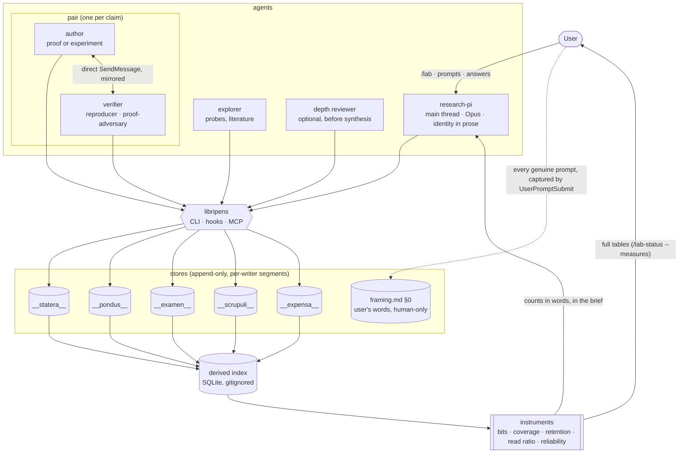

# Murmuration — Architecture Analysis (v5, consolidated)

Date: 2026-10-18 · Supersedes [11-architecture_v4.md](11-architecture_v4.md). It integrates wave 1:
- the platform probes, with 27 of 28 mechanisms run-backed on Claude Code 2.1.296
  ([`../platform_probes/01-findings_v1.md`](../platform_probes/01-findings_v1.md));
- the instrument validation
  ([`../instrument_validation/00-findings_v0.md`](../instrument_validation/00-findings_v0.md));
- the PI's wave-1 note ([`../pi_decisions/00-wave1_note_v0.md`](../pi_decisions/00-wave1_note_v0.md)).

This is the build reference.

## Executive Summary

- **Goal:** a multi-agent research team that reliably shows judgement-led exploration within a
  budget and mechanical hardening, with anomalies flowing back from hardening to exploration.
- **Principle:** procedure where the work is mechanical (stores, hooks, verifiers); identity where
  it is judgement (the PI). **Measurements are instruments for attention, never targets or
  gates.**
- **Repository:** `CrackingShells/Murmuration`, plugin id `murmuration`, distributed through
  Nest. The name is the bird; the instruments inside are the Roman balance.
- **Package:**
  - `AGENTS.md`;
  - five agents (research-pi on Opus; explorer, author, reproducer, proof-adversary on Sonnet),
    plus an optional depth reviewer (Sonnet);
  - one skill (`research-loop`) and user commands `/lab` and `/lab-status`;
  - the Rust binary **`libripens`** (CLI, hook entry point, resident MCP server);
  - five append-only stores named after the Roman balance.
- **New in v3:**
  - **Hooks across 20+ of the 33 events.** Your words are captured automatically
    (`UserPromptSubmit`). The per-run contract is injected at `SubagentStart`. Pair messages are
    mirrored by `PostToolUse(SendMessage)`. `FileChanged` gives live notice of puzzles.
    `PreCompact`/`PostCompact` show what the PI's context dropped. Most hooks go through
    `mcp_tool` handlers, so no process starts per event.
  - **Information instruments,** kept or changed per the counsel and validated on this
    repository:
    - bits and conditional bits per message;
    - coverage of the user's own terms;
    - anomaly retention;
    - PI read ratio;
    - label reliability.
    The measures that failed the pilot (JSD maps, MI as a number) are dropped.
- **New in v5 (wave 1):**
  - **The PI is checkable.** The factual claims in PI wave notes go to `__pondus__` like any
    worker claim (a genesis PI note cited a result 13 minutes before it existed).
  - **The failure is uptake, not carriage.** The genesis missed signals mostly *reached* the PI
    and were not acted on, so scrupuli now record `mention` and `follow` separately, and the KT
    metric is uptake.
  - **Fewer instruments in the brief.** Only coverage of the PI's own notes stays, with the term
    list written down per study; the rest are KT-only or dropped.
  - **Hooks revised to measured platform behavior:**
    - `mcp_tool` handlers are synchronous (median 3 ms);
    - `command` hooks at session start and exit;
    - FileChanged reaches the PI only through `asyncRewake`;
    - matchers are scoped (`murmuration:*`);
    - runs are per resume;
    - hand-backs arrive by two paths.
  - **Pairs are confirmed on the platform** (named agents, `SendMessage` both ways, no relay).
    The probe of a primed verifier supports "independent first, *then* converse" over pure
    isolation.
- **Composition:** umbod's contracts are reused, not its CLI; umbod stays the outer loop for
  multi-session campaigns.
- **Sustainability:** tokens, bits, cache reads, CPU seconds and estimated Wh in the ledger, per
  accepted claim and per mode.

## The balance: names

One Latin root system: weighing (*pendere*, *libra*). Paying and judging are the same act, so
every store is a role in one balance.

| Store / tool | Name | Gloss | Holds |
|:--|:--|:--|:--|
| ledger | **`__expensa__/`** | "things weighed out", the Roman payment entry | one event per agent run: what it spent |
| lab state | **`__statera__/`** | the balance in its current state | wave notes (open, then sealed), budget, inbox acknowledgements, questions to the human |
| claims | **`__pondus__/`** | the weight a claim can bear | claim and verdict events; the current label is derived |
| peer threads | **`__examen__/`** | the tongue of the balance; the verifier's independent weighing | per-claim conversation between author and verifier |
| puzzles | **`__scrupuli__/`** (sing. *scrupulus*) | the sharp pebble, and the smallest weight: a residue not rounded away | what did not add up, and whether anything followed it |
| tool | **`libripens`** | the neutral scale-holder in a Roman sale | the only writer path to the stores; hooks; queries |

Notes:
- `pondus` names a directory only, because a `pondus` package exists on several registries.
- `examen` reading as "exam" in Spanish and French is close enough to its sense to keep.
- The Latin forms have not been checked against a lexicon (flag carried from the naming report).

## Proposed State



## Key Flows

```mermaid
sequenceDiagram
  participant U as User
  participant PI as research-pi
  participant X as explorer(s)
  participant A as author
  participant V as verifier
  participant L as libripens + stores
  U->>L: /lab "question" → framing.md §0
  PI->>L: ask --soft "is this your question?" (framing read-back)
  loop each wave, while budget remains and the question is open
    PI->>L: wave open: user's sentence + "this doesn't add up because…"
    par portfolio of cheap probes
      PI->>X: loose brief A (maxTurns)
    and
      PI->>X: loose brief B (maxTurns)
    end
    X->>L: scrupuli raised + raw artifact refs
    PI->>PI: opens raw artifacts itself
    opt a hunch is worth a claim
      PI->>A: claim brief · names V · claim id
      PI->>V: brief: independent result first
      A->>L: pondus claim event (label by what was run)
      V->>L: examen: independent result (seq 1)
      loop pair conversation, until verdict or ESCALATE
        V->>A: question (mirrored to examen)
        A->>V: answer or new artifact (mirrored)
      end
      V->>L: pondus verdict (changed_by if revised) + scrupuli
      alt ESCALATE or disputed
        L-->>PI: brief lists it; PI reads the examen thread itself
      end
    end
    L-->>PI: open scrupuli from every role reopen exploration
    PI->>L: wave seal (statera, immutable)
  end
  PI->>L: ask --soft "open scrupuli + reserve: spend on which?"
  opt budget exhausted
    L-->>U: ask --hard "budget gone; this is what I would still probe"
  end
  PI->>U: findings by label, with what still doesn't add up
```

## Package layout

```
murmuration/                       (repository CrackingShells/Murmuration; distributed through Nest)
├── .claude-plugin/plugin.json     id "murmuration"; min versions: managing-roadmaps ≥1.2.0, writing-reports, colgrep-mcp
├── AGENTS.md                      shared invariants (one screen); copied by lab-init; CLAUDE.md = "@AGENTS.md"
├── agents/
│   ├── research-pi.md   explorer.md   author.md   reproducer.md   proof-adversary.md
│   └── depth-reviewer.md          optional; umbod-style senior reviewer
├── skills/
│   ├── research-loop/SKILL.md     modes, briefs (worker mandate), labels, honesty tags, lab-init section
│   ├── lab/SKILL.md               user-invocable, model invocation off
│   └── lab-status/SKILL.md        user-invocable (`--measures` for full instrument tables)
├── hooks/hooks.json               every hook calls `libripens hook …`, with agent_type matchers
├── .mcp.json                      libripens (mcp), WolframToolkit, colgrep, arxiv, one web search
└── libripens/                     Rust crate; CI builds darwin and linux, arm64 and x64
```

## Contracts & Invariants

### Stores

Layout: `__<store>__/<wave>/<agent_id>.jsonl`, one segment per writer. No two writers share a file,
so parallel appends need no locks and git never conflicts. `framing.md §0` is the single human-only
file.

| Store | Events (one JSON line each) | Derived at read time |
|:--|:--|:--|
| `__expensa__` | `run {ts, run_id, wave, agent_id, agent_type, model, mode, claim_id?, tokens{in,out,cache_read,cache_write}, wall_s, cpu_s, energy_wh_est, tool_calls, deliverable, exit}` | spend by mode, wave, agent and claim; budget left; Wh per accepted claim |
| `__statera__` | `wave_open {wave, user_sentence, note, budget, exploration_share}` · `wave_append {note}` · `wave_seal {wave}` · `ack {inbox_ref}` · `ask {id, soft\|hard, text}` · `answer {id, text, by: human}` | the current wave; sealed history; unacknowledged steer notes; open questions |
| `__pondus__` | `claim {id, statement, label, scope, evidence[{path, commit}], author}` (author may be `research-pi`: the factual claims of a wave note are claims like any other) · `verdict {claim_id, by, vocab, verdict, examen_ref, changed_by?}` · `supersede {old, new}` | **current label = weakest open verdict from distinct verifiers; disputed if open verdicts disagree** |
| `__examen__` | `msg {claim_id, seq, from, to, kind: independent_result\|question\|answer\|artifact\|verdict\|escalate, body, refs[]}` | open threads; ESCALATE list |
| `__scrupuli__` | `raise {id, wave, agent, text, refs[]}` · `mention {id, in_note}` (carried into a PI note: seen) · `follow {id, by_brief\|by_claim\|by_plan}` (changed what the team does: taken up) · `park {id, reason}` | open / mentioned / followed / parked; **uptake** = followed ÷ raised; latency in waves |

Invariants (each enforced by `libripens`):
- **Single writer path:** agents append only through `libripens append` or its MCP tools, which
  validate the schema. The guard denies direct edits to the stores and to `framing.md §0`.
- **Append-only:** nothing is updated in place; sealed waves are immutable.
- **Independence first:** the first `__examen__` message on a claim is the verifier's
  `independent_result`.
- **A verdict changes only with evidence:** a later verdict by the same verifier needs a
  `changed_by` path that exists.
- **Nothing reaches a deliverable above its current label.**
- **Honesty tags (from umbod):** every claim's evidence is a `[source: path@commit]`; ESTIMATE and
  CONJECTURE carry an `[assumption: …]`.

Index: a gitignored SQLite file holding per-segment byte watermarks. Queries ingest new bytes
only; `libripens rebuild` replays every segment. Gates that need strict freshness scan the segments
directly.

### libripens (one Rust binary, three front ends)

```
libripens append <store> --json '…'          # agents; validates, appends to own segment, fsync
libripens query  scrupuli --open | pondus --disputed | expensa --by mode | examen <claim>
libripens wave   open|append|seal  ·  ask --soft|--hard  ·  answer
libripens measure <text> --ctx <path>         # bits, new bits, coverage (also used by hooks)
libripens map --wave <n>                      # offline: retention, read ratio, anchors, novelty
libripens brief                               # SessionStart: startup / resume / compact / fork
libripens hook   subagent-stop | pre-tool-use # hook JSON on stdin; decision JSON on stdout
libripens rebuild                             # replay segments into the index
libripens mcp                                 # the same operations as typed MCP tools
```

- **Why Rust:** hooks fire on every tool call of every agent, more than 1,000 in the imbrication
  study.
  - A static binary starts in about 1 ms with about 2–4 MB of memory; Python takes about 30–60 ms
    and 15–25 MB, and depends on an interpreter and packages.
  - It matches `dirtree-rdm` and `umbod`.
  - Cross-platform CI builds from day one (`dirtree-rdm` still ships darwin-only).
- **Pilot scope:**
  - `append`, `query`, `wave`, `ask`, `brief`, `measure`;
  - the hook subcommands;
  - the MCP front end, which v3 needs from the start for the `mcp_tool` handlers.
  `map` and `rebuild` come second.

### Hooks (`hooks/hooks.json`; scoped `agent_type` matchers; frontmatter hooks, permissionMode and mcpServers are ignored for plugin agents — VERIFIED)

The full map is in [08-hooks_leverage_v0.md](08-hooks_leverage_v0.md); every row below is
run-backed in the probe findings v1 unless marked. Minimum Claude Code version: **2.1.271**.

| Event (matcher) | Handler | Effect |
|:--|:--|:--|
| SessionStart (startup/resume) | **command** `libripens brief` (mcp_tool is skipped here) | Brief: user words and unacknowledged prompts · open scrupuli · disputed claims and ESCALATEs · open questions · coverage of the PI's notes (words, denominators) · spend and reserve · in-flight runs · roadmap frontier. `watchPaths` on store segments; `sessionTitle` = wave. The first brief also carries the repository state (the `agent` setting drops the git snapshot) |
| SessionStart (compact/clear) | mcp_tool | Same brief, re-injected after compaction |
| UserPromptSubmit | mcp_tool | `classify_prompt`: genuine unless it starts with `<cross-session-message `, `<task-notification>` or `<agent-message from=`. Genuine prompts are appended verbatim to `framing.md §0`; the rest become `comm` events (hand-backs keyed by agent id or name) |
| UserPromptExpansion (`murmuration:lab`, `murmuration:lab-status`) | mcp_tool | lab-init when channels are missing |
| SubagentStart (`murmuration:*`) | mcp_tool | Open a run `(agent_id, n)` per start or resume; inject wave, claim id, partner name and the honesty contract (short: paid on every resume) |
| PreToolUse (`Agent`) | mcp_tool | Measure the brief (bits; redundancy against the injected context); recorded, and mentioned to the PI only when it repeats injected material |
| PreToolUse (`Bash`, `Edit\|Write`) | command (or mcp_tool once the outage behaviour is probed) | Guard: deny kills by pattern; stores and `framing.md §0` are append-only through `libripens` |
| PostToolUse (`SendMessage`) | mcp_tool, sync (ms) | Mirror pair messages into `__examen__` (sender from the hook's `agent_id`, recipient from `tool_response.pin.name`); `comm` event |
| PostToolUse (`Agent`) | mcp_tool, sync | Ledger telemetry for foreground runs (background launches carry none) |
| PostToolUse (`SubagentHandback`) | mcp_tool, sync | Auto mode: the hand-back text (SubagentStop has no `last_assistant_message` there) |
| PostToolUse (`Write\|Edit` under `data/`, figures; `Read`, main thread) | mcp_tool, sync | Register raw artifacts; PI read events (KT only) |
| PostToolBatch | mcp_tool | Record a parallel dispatch as one probe set |
| PostToolUseFailure · PermissionDenied · StopFailure | command, async | Waste and friction events (StopFailure is unreliable in one-shot `-p` runs) |
| SubagentStop (`murmuration:*`; ignore `agent_type: ""`) | command | Close the run (tokens from `agent_transcript_path`, summed over resumes); presence gate, `decision: block` once (`stop_hook_active`). The deliverable comes from `last_assistant_message`, or from the hand-back in auto mode |
| Stop (main) | command, async | Turn snapshot |
| PreCompact / PostCompact | mcp_tool | PI context size; `compact_summary` stored; later compared with the open scrupuli |
| FileChanged (no matcher; paths from `watchPaths`) | **command, `asyncRewake`**, exit 2 with one line on stderr | Live notice of new scrupuli, disputes and ESCALATEs. It reaches the PI at the next tool boundary as a non-genuine prompt; `systemMessage` would reach only the terminal |
| InstructionsLoaded | command, async | Hash instruction files (prompt-cache stability) |
| PreModelSwitch / PostModelSwitch | command | Log the switch and its cache-rewrite cost |
| WorktreeCreate / WorktreeRemove | command | Register worktrees; list the ones to prune at wave seal |
| Notification (`agent_needs_input`) | command | Desktop notice for hard questions |
| MessageDisplay | command | Display-only: claim ids shown with their current label (ASSUMED, not probed) |
| SessionEnd | **command** (mcp_tool fails at process exit) | Flush the index; closing ledger summary |
| TaskCreated / TaskCompleted / TeammateIdle | command | Agent Teams fallback only (NOT TESTABLE HEADLESS; manual procedure in the probe findings) |

Invariants:
- `deny` and `block` are used only by the guard and the presence gate. Everything else informs.
- `mcp_tool` handlers are synchronous: `async` is ignored on them, so anything slow goes to
  `command` + `async`, and the server answers in milliseconds from an internal queue. It must
  serve concurrent calls, since three can arrive in the same millisecond.
- LLM-evaluated hook types (`prompt`, `agent`) are off by default.

### Agents

**research-pi**, the identity in prose. It is the whole system prompt in the main thread, so it
stays this short:

> You lead a small research team on a question someone cares about. Your job is to notice. You
> read the raw things your team produces (figures, odd rows, the examen threads where colleagues
> argued, the scrupuli they could not let go of), and you follow what does not add up, even when
> it is not on the roadmap. You keep the person's own words close; they are the question, and
> everything else is a reading of it. Exploration is yours: you decide which hunches deserve a
> claim, and you spread cheap probes when you cannot tell which is promising. Hardening is your
> team's: you trust their checks and spend your attention where judgement is needed. Framing,
> naming and the final synthesis you do yourself. When the budget runs out or you are about to
> close the story, you show the person what is still open. The procedures you and your team use
> are in the `research-loop` skill.

**Model policy.**
- `research-pi` runs on Opus as the main-thread agent. It is the only Opus agent: judgement is
  where the strongest model earns its cost.
- Every other agent file sets `model: sonnet`. Hardening is mechanical by design, and its quality
  comes from independence (the pairs, independence first), not from model size.
- An Opus run for a worker is never a default. It happens only when the PI passes the model
  explicitly in a single dispatch, and the run's `expensa` event records the model, so the
  exception is visible in the ledger and the closing KT report.

Workers (frontmatter fields `model`, `effort`, `maxTurns`, `tools` and `skills` are honoured for
plugin subagents):

| Agent | Model | Carries, in its own voice |
|:--|:--|:--|
| explorer | Sonnet | Return raw material and the worst-fitting case next to the best one. Give the id you fetched, or write UNVERIFIED. End with the three things you would look at next and why they bother you |
| author | Sonnet | Say what would differ if the claim were false, and show that case. Label by what you ran. When a result closes a direction, write the scope it closes and name one thing outside it. Wolfram first for exact work; state in one line why the tool fits |
| reproducer | Sonnet | Record your own result before reading the author: rerun at **sampled** scale (quick mode plus random cells, with a full rerun only on a mismatch), claim → row, re-derive without author code. You own termination: SUPPORTED / OVERSTATED / UNSUPPORTED / ESCALATE |
| proof-adversary | Sonnet | Record your own result first: per-step re-derivation, independent checks at larger and boundary cases. You own termination: SOUND / GAP / WRONG / LABEL TOO STRONG / LABEL TOO WEAK / ESCALATE |
| depth-reviewer (optional) | Sonnet | umbod's senior reviewer: judge by feel whether the work answers the person's words and goes as deep as it promised; one verdict paragraph before synthesis |

All workers use the framing doc's symbols and close with `[source:]`/`[assumption:]` tags and a
scrupuli entry. That is umbod's "what I am uncertain about", uncapped.

**What the `agent` setting removes, and where it comes back** (VERIFIED). The main-thread agent
prompt replaces the 7,160-character default with the agent body plus tool-conditional blocks. The
default blocks the lab still needs are restored in the `research-loop` skill, never in
`research-pi.md`:
- parallel dispatch of independent work;
- reporting outcomes faithfully;
- confirming before outward-facing actions;
- memory.
The first brief carries the repository state. Expect a cold prompt cache on the PI's first run.

**Pairs on the platform** (VERIFIED):
- The PI dispatches author and verifier with `name`s and tells each its partner's name.
- `SendMessage to: <name>` works both ways and resumes the finished receiver; the PI relays
  nothing.
- Hook order across agents is not guaranteed to follow message order, so thread order comes from
  the `__examen__` sequence numbers, not from hook timing.
- The primed-verifier probe found the better diagnosis but anchored on the author's number. The
  protocol keeps both halves: independent result first, then read and converse. Replicating this
  (3–5 runs per arm) is a pilot task.

**The depth reviewer also reads the PI's wave notes**, whose factual claims are `pondus` claims.

### Information instruments

Decided by experiment: [instrument validation](../instrument_validation/00-findings_v0.md),
following the counsel ([08-information_counsel_v0.md](08-information_counsel_v0.md)).

| Instrument | Decision | Evidence (wave 1) |
|:--|:--|:--|
| Coverage of the user's terms **in the PI's own notes** | **In the brief**, in words with denominators. The term list is written down at lab-init and kept with the study | PI notes 0.50 → 0.17 → 0.08 vs the final notebook 0.92. Weak (3 points), and sensitive to the term list (about 2×) |
| Uptake: scrupuli followed ÷ raised (hand-labelled `follow` events) | KT only | Replaces anomaly retention: the genesis missed signals were mostly *mentioned* (carried) but not *followed* (taken up). Term-based retention was largely spurious (28 of 72 non-zero rows were hand-NONE) |
| PI read ratio | KT only | Untestable offline; its premise (summary starvation) is weakened by the uptake finding |
| Message bits; new bits and redundancy within a thread | KT only | lzma redundancy did not separate a primed verifier from an independent one (0.239 vs 0.233) |
| Label reliability | KT only | Not exercised yet |
| Scrupulus novelty and distinct meanings (embeddings) | KT only, on request | AUC 0.69–0.75, p = 0.16 |
| Sampled semantic entropy | on request at synthesis | Not tested |
| Whose words the verdict reuses; first use of framing terms; compression distance; JSD; MI; transfer entropy; topic models | **Dropped** | No separation (one run per arm); byte reuse tracks topic vocabulary and answer format, not priming |

Rules that keep instruments from becoming targets (unchanged):
- Agents never receive a measure.
- Counts are given in words with denominators.
- No measure enters a gate.
- Nothing is ranked.
- The KT report states which measures were looked at and whether any changed what the PI did.

### Human-side UX

| Element | What it does |
|:--|:--|
| `.claude/settings.json` written by lab-init | `agent: research-pi`, so a plain `claude` in the project *is* the PI |
| `/lab <question>` | Runs lab-init if needed; appends the words to `framing.md §0`; the PI opens with a soft read-back question |
| `/lab-status` | `libripens brief` on demand |
| Your prompts | Captured verbatim by `UserPromptSubmit` (umbod-style inbox): the PI acknowledges them in the next wave note, and unacknowledged ones head the brief. `/lab-steer` is no longer needed |
| Questions | Soft (read-back, "reserve: spend on which?") are recorded and non-blocking; hard (budget gone) waits for an answer. Shown by `/lab-status` |

### Composition with umbod

For single-session studies the lab stands alone. For multi-session campaigns:
- an umbod topic is the research question, and its INTENT.md mirrors `framing.md §0`;
- one umbod cycle holds one or more lab waves;
- sealed `statera` waves feed the cycle's HANDOFF;
- umbod's verifier runs before `finish-cycle` as usual.

Reused contracts are listed in [06-stores…](06-stores_umbod_sustainability_v0.md) §1. The CLI and
FSM are not imported. The former name collision (`__threads__/`) is gone (`__examen__/`).

### Sustainability (measured in `__expensa__`)

| Resource | Levers |
|:--|:--|
| Agent communication | measured in **bits** and **new bits** per message; context injected once by `SubagentStart` instead of pasted into briefs; briefs reference paths; colgrep retrieval; pairs talk directly; warm reuse; `query` returns pointers |
| Prompt cache | AGENTS.md, agent bodies and skills stay byte-stable within a study; variable content goes at the end of briefs; `cache_read` is tracked |
| Compute | model tiering; smallest instance first; Wolfram for exact work; sampled reproduction; content-addressed result cache |
| Electricity | `energy_wh_est` = tokens × per-model coefficient + `cpu_s` × machine coefficient (labelled ESTIMATE, sourced); budgets can be stated in Wh; hooks run as `mcp_tool` calls to a resident server, with no process start per event |
| Materials and storage | no re-downloads; derived data gitignored; vector or referenced figures, not embedded rasters; prune indexes and worktrees at close |
| Human attention | soft questions batched; hard ones only for budget-gone; scrupuli first in the brief |

The closing knowledge-transfer report of every study states tokens, CPU seconds and Wh per
accepted claim and per mode.

## Behavioral baseline

- **External** (survey ranking): ResearchGym (budgeted exploration), CORE-Bench v1.1 (the
  reproducer: cost and variance), Formal Conjectures with CombiBench (prove or disprove), MAST /
  TRAIL / ARFT (failure tags on our transcripts), TruthInsightBench (claim honesty). Inspect AI
  holds the logs; HAL logs give reference points.
- **Own metrics from the stores:**
  - spend share by mode;
  - exploration reserve;
  - delegation profile;
  - **scrupuli raised and followed**;
  - label calibration;
  - independent-verification coverage;
  - evidence traceability;
  - re-planning events by trigger;
  - hook interventions;
  - Wh per accepted claim;
  - redirects the PI did not anticipate.
- **Puzzle-following replay** (the gap no benchmark covers):
  - Replay the imbrication question. Score whether later waves pick up what the original run missed
    (Bernoulli h = 1, a trained map ≈ a random map, Champernowne completion, m-sequence ≡ de Bruijn,
    the user's object-first wording).
  - Then plant one synthetic anomaly per run and score detection latency.
- **Instrument validation:** done in wave 1. Its decisions are in §Information instruments.
  Experiment B (planted cascade) is to be replicated with 3–5 runs per arm in the pilot.
- **Calibration:** hand-label about 20 transcripts before trusting an automatic MAST annotator.

## Alternatives Considered

| Option | Decision |
|:--|:--|
| Transmission-tradition names (pinkas, shilu, pratigya, sugya, kushya, sofer) | Not chosen. Three traditions mixed; the Latin set is one coherent balance and pairs with *imbrex* |
| SQLite or a server as source of truth | Rejected: binary, unmergeable in git, and out of proportion. Kept only as a derived index |
| One shared JSONL file per store | Rejected: relies on append atomicity that fails for large lines or on network filesystems |
| Python hooks | Rejected: per-call start-up and memory multiplied by agents × tool calls; dependency drift |
| umbod CLI as the backbone | Not for in-session studies; kept as the outer loop for multi-session campaigns |
| Four-agent minimal cut (one merged verifier) | Rejected for the verifier merge; both verification methods earned their cost |
| Agent Teams for pairs | Fallback only: teammates do not fire SubagentStop, so hooks would move to TaskCompleted |
| Command handlers for every hook | Rejected for hot events: one process start per event × thousands of events; `mcp_tool` to a resident server instead |
| JSD/MI maps of agent positions | Dropped after the pilot: no ordering at these sample sizes; coverage and retention carried the signal |
| LLM-evaluated hooks (`prompt`, `agent`) by default | Rejected: judgement and tokens on every event; on demand only |

## Risks & Mitigations

| Risk | Mitigation |
|:--|:--|
| Direct subagent-to-subagent messaging is only partly verified | Platform probe first; Agent Teams fallback |
| The PI file loses default-prompt behavior | Pilot check; fix by a skill pointer, never a longer PI file |
| PI prose decays into rules | The "when to decide what" test on every edit |
| A verifier is talked out of a finding | Independence first; `changed_by` enforced |
| Pair loops never converge | The verifier owns termination; `maxTurns`; ESCALATE |
| Energy coefficients are uncertain | Labelled ESTIMATE; used to compare runs, not as absolute figures |
| Index drift | The index is disposable; `rebuild` |
| Over-building `libripens` | Pilot scope as listed; `map` deferred |
| Instruments become targets | Agents never see them; no gates; counts in words; reviewed in each KT report |
| `UserPromptSubmit` captures non-user text | Filter on the hand-back and cross-session wrappers (platform probe 1) |
| Hook-set version drift | lab-init checks for Claude Code ≥ 2.1.271 and degrades to the v2 hook set |
| Nested agents' hand-backs surface at the top-level thread (seen in wave 1: a probe's grandchild notified the PI) | `classify_prompt` treats them as `comm` events; the brief groups them under their parent run |
| One-shot `-p` runs lose closing `mcp_tool` events and a final turn can follow the "final" answer | Use `command` at exit; treat headless runs as probes, not studies |
| The `agent` setting changes the PI's prompt, and the default prompt itself varies (logged in vs out; 27 vs 110 tools) | Pin what the lab needs in `research-loop`; record the PI prompt hash in `expensa` at session start |

## Roadmap Recommendation

The roadmap lives in [`__roadmap__/murmuration/`](../../__roadmap__/murmuration/README.md). Wave 1 (platform
probes, instrument validation) is done; amendment A1 carries the probe and validation
consequences into the `build/` nodes. Next wave:
- `build/libripens_core`: stores (with `mention`/`follow`, PI claims), index, brief, the hook
  subcommands as revised above, a synchronous concurrent MCP server, cross-platform CI;
- `build/agents_and_skills`: PI identity; workers; `research-loop` restoring the needed default
  blocks; `/lab` with scoped matchers;
- then `build/pilot/baseline`, which adds the replication of experiment B, the ledger-vs-transcript
  reconciliation, the `__examen__`-vs-SendMessage reconciliation, and the Agent Teams manual
  probe.
