# Murmuration — Architecture Analysis (v6, minimal)

Date: 2026-10-19 · Supersedes [12-architecture_v5.md](12-architecture_v5.md) as the build
reference. v5 stays as the record of the full design. Inputs: both independent reviews
(`../design_review/00-review_*`), which judged v5 "promising but overbuilt", and two PI
decisions:
- build for the purpose, not for universality;
- evaluate by running Murmuration on itself (reflective runs over its own transcripts), not by
  statistical benchmarks.

## Executive Summary

- **Keep what helped agents in practice:**
  - a framing and notation document;
  - a brief template with an uncapped puzzles section;
  - claim labels with overriding verdicts;
  - independent verifiers that record their own result first;
  - warm agents for corrections and fresh agents for checks;
  - findable files.
- **Fix the three structural failures with documents, not machinery:**
  - the user's words are kept verbatim;
  - every open puzzle gets a disposition in the wave note (followed, or parked with a reason);
  - the PI's factual claims are filed like any worker claim.
- **Two hooks, both on rare events.** One permission deny rule. One on-demand status script. No
  Rust binary, no index, no MCP server, no live instruments.
- **Shipped files carry no design history.** Agent files, skills, templates and scripts are
  written for cold agents in any research project.

## Components

```mermaid
graph TD
  U([User]) -- "/lab · prompts" --> PI[research-pi · Opus]
  PI --> EX[explorer · Sonnet] & AU[author · Sonnet]
  AU <-- SendMessage --> RP[reproducer · Sonnet]
  AU <-- SendMessage --> AD[proof-adversary · Sonnet]
  subgraph project["research project files (markdown, one file per writer)"]
    W[(__statera__/<br/>user_words.md · wave-NN.md)]
    C[(__pondus__/<br/>claim-id.md)]
    S[(__scrupuli__/<br/>wave-agent.md)]
    F[(__design__/framing.md)]
  end
  H1{{hook: UserPromptSubmit}} --> W
  H2{{hook: SessionStart resume/compact}} -- "wave note + open puzzles" --> PI
  ST[lab_status.py<br/>on demand] --> W & C & S
```

| Component | Content |
|:--|:--|
| `agents/research-pi.md` | The identity in prose (Opus). It points to the `research-loop` skill for every procedure |
| `agents/{explorer,author,reproducer,proof-adversary}.md` | Sonnet; each carries its habits in its own voice |
| `skills/research-loop/` | Brief template; claim labels and verdict vocabularies; file formats; wave-note template with puzzle dispositions; the working defaults a main-thread agent prompt no longer carries |
| `skills/lab/` | User command: initialize a project (stores, framing stub, the user's words, project settings), or append a new question to the user's words |
| `skills/lab-status/` | User command: run the status script |
| `hooks/hooks.json` | `UserPromptSubmit` (append genuine prompts to `__statera__/user_words.md`) and `SessionStart` with matcher `resume\|compact` (print the current wave note and open puzzles). Both are no-ops outside an initialized project |
| `scripts/` | The two hook scripts and `lab_status.py`. Python standard library only; the hooks fire rarely, so start-up cost is irrelevant |
| Project settings written by `/lab` | `agent: murmuration:research-pi`; deny `Bash(pkill:*)` and `Bash(killall:*)` |

## File formats (in a research project)

| File | Writer | Content |
|:--|:--|:--|
| `__design__/framing.md` | PI | The question, notation, regimes or scope, and rules for the team |
| `__statera__/user_words.md` | the hook, `/lab` | The user's prompts, verbatim and dated; never edited by agents |
| `__statera__/wave-NN.md` | PI | Which of the user's sentences the wave serves; what does not add up; the dispatches; at close, each open puzzle marked `followed (by …)` or `parked (because …)`; the PI's factual claims as claim ids |
| `__pondus__/<claim-id>.md` | author (head), verifiers (appended sections) | Statement, label, scope sentence, evidence as `path@commit`; one verdict section per verifier, the independent result first, `changed_by:` when revised |
| `__scrupuli__/<wave>-<agent>.md` | each worker, and the PI | Numbered puzzles, each with pointers to raw artifacts |

Derived by `lab_status.py`:
- open puzzles (raised, with no disposition in a closed wave note);
- the current label of each claim (the weakest standing verdict);
- disputed claims;
- spend per agent, read from Claude Code's own transcripts.

## Reflective runs

Murmuration studies itself with its own team. The question is "how should Murmuration change?"
The data:
- the transcripts and project files of earlier runs;
- the wave notes, including puzzle dispositions;
- claim histories;
- the user's words.

Explorers read logs; authors propose changes as claims; verifiers check each claim against the
transcripts. Every change to an agent file, skill or script is a proposal the user approves; the
system never edits itself silently. The frozen parts of v5 (`libripens`, the full hook set, the
index, the instruments) come back only through a reflective run that shows a concrete need.

## Risks

| Risk | Mitigation |
|:--|:--|
| Dispositions turn into a rubber stamp ("parked: later") | The reflective run reads dispositions against what happened next; the user sees them in each wave note |
| Without a presence gate, workers skip puzzles or labels | The brief template asks for them; the reflective run counts omissions; reinstating a gate is a proposal like any other |
| Design context leaks into shipped files | A cold reviewer reads only the shipped files before each release |
| Single file per writer still collides when the same agent runs twice | File names carry the wave and the agent name; resumed agents append to their own file |
