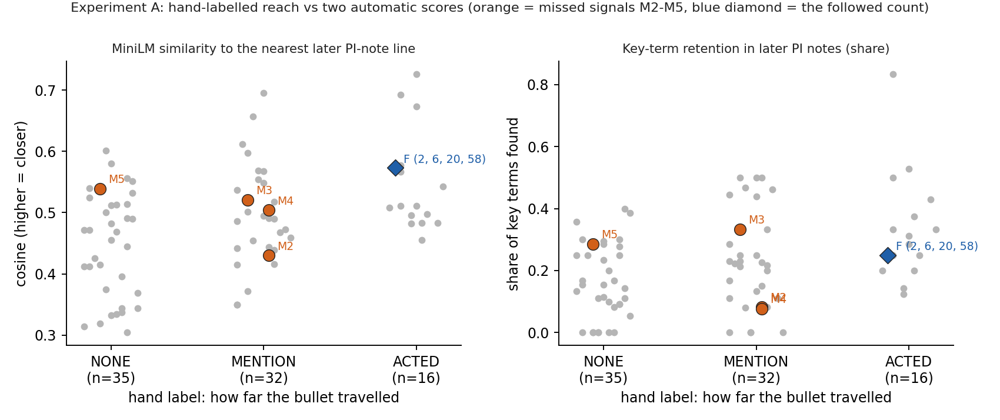
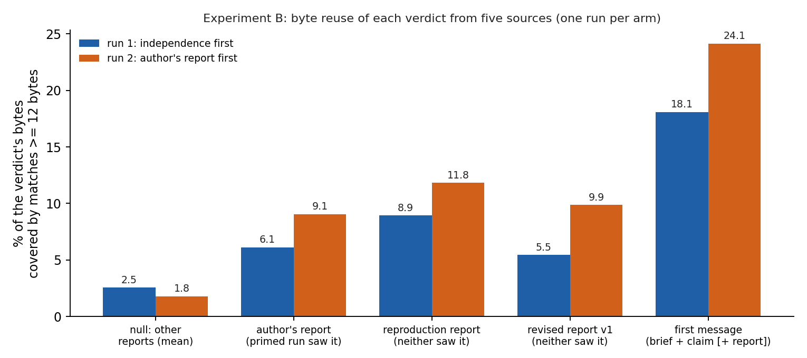

# Instrument validation on the genesis study — Findings (v0)

Date: 2026-10-18

---
type: findings
topic: instrument_validation
date: 2026-10-18
version: v0
prior-version: none
key-metric: known missed signals in zero-retention cells: 0 of 4 (prior: N/A, delta: N/A)
decision-required: confirm
---

Two experiments on the genesis study (`/Users/hacker/Documents/explore/combinatorics_on_binary`, read only, pinned at `17e97ae`), testing the instruments of [architecture v4 §Information instruments](../genesis/11-architecture_v4.md) against ground truth from [02-knowledge_transfer_v2](../genesis/02-knowledge_transfer_v2.md). Code is in `validation/` (stdlib plus numpy; Python fits because everything is deterministic text arithmetic on a few hundred kilobytes). Labels: **MEASURED** = computed by the scripts here; **CHECKED** = also reproduced by a second route; **CONJECTURE** = reading, not shown.

## Headline Result

metric: the four known missed signals that map to a worker bullet, found in zero-retention cells (Experiment A)
value: 0 of 4 at zero retention; 1 of 4 at or below the 25th percentile of similarity to the PI notes; the followed signal scores 0.25 retention, inside the range of the missed ones (0.08 to 0.33)
unit: signals out of 4 (the fifth, "ρ depends on G", is a user remark with no worker bullet)
prior: N/A (first run)
direction: new

| Gate (instrument_validation.md) | Result |
|:--|:--|
| A scored | **The instruments do not separate.** 3 of 4 missed signals were carried into a later PI note or outline (labelled MENTION); the instrument sees carriage, the failure was uptake |
| B scored | **No separation** of an independence-first from a primed verifier by byte reuse or term first use (n = 1 per arm). One behaviour differs and is not a measure: the primed run swept its equality tolerance until it reproduced the author's number |
| Decision table | 1 IN BRIEF, 7 KT ONLY, 3 DROPPED (one of the three unchanged from counsel and not retested); table `Instrument decisions` below |

## Results Tables

### A1. The surprise bullets and how far each travelled (hand labels, `validation/labels/surprises.csv`)

| report | C&S | Obs. | NONE | MENTION | ACTED | later PI-class doc exists |
|:--|--:|--:|--:|--:|--:|:--|
| literature | 4 | 7 | 3 | 3 | 5 | yes (wave-2 note, 1 min later) |
| foundations | 4 | 6 | 5 | 4 | 1 | yes |
| generative_atlas | 5 | 8 | 6 | 4 | 3 | yes |
| generative_laws | 5 | 7 | 4 | 8 | 0 | yes (Q8 note and outline, 1.5 min later) |
| superstring_g | 4 | 8 | 5 | 4 | 3 | yes |
| strided_trellis | 5 | 7 | 4 | 4 | 4 | yes |
| reproduction | 4 | 7 | 11 | 0 | 0 | **no** (no PI note after 13:51:58) |
| naming | 4 | 9 | 8 | 5 | 0 | yes |
| **total** | **35** | **59** | **46** | **32** | **16** | 83 of 94 bullets |

NONE = no key term or idea in any later PI note, brief, framing edit or the outline. MENTION = carried (quoted, relayed, listed as open) with no change of plan. ACTED = changed a decision or opened a node. Of the 35 C&S bullets: 16 NONE, 12 MENTION, 7 ACTED (counsel's 35 reproduced).

### A2. The ground-truth signals (02 §2) on the automatic scores

| 02 row | bullet | hand label | key-term retention (terms matched) | similarity to nearest later PI line (percentile of 83) | user terms hit (of 12) |
|:--|:--|:--|:--|:--|--:|
| 1 user's words | no bullet; see A4 | | | | |
| 2 Champernowne (M2) | atlas:CS:1 | MENTION | 0.08 (champernowne) | 0.430 (25th) | 2 |
| 3 Bernoulli h = 1 (M3) | laws:CS:4 | MENTION | 0.33 (generat, θ) | 0.521 (70th) | 1 |
| 4 trained ≈ random (M4) | trellis:OBS:6 | MENTION | 0.08 ("04") | 0.504 (60th) | 0 |
| 5 m-sequence = de Bruijn (M5) | atlas:CS:4 | NONE | 0.29 (φ, measurement) | 0.539 (75th) | 0 |
| 6 ρ depends on G (M6) | no clean bullet; related superstring:OBS:3, :OBS:7 (ACTED), reproduction:CS:2, :OBS:2 (no later PI doc) | | 0.14 to 0.33 | 0.50 to 0.58 | |
| followed: 2, 6, 20, 58 | foundations:CS:3 | ACTED (as T(p), numbers never quoted) | 0.25 (independent, known) | 0.573 (87th) | 2 |

### A3. Do the scores separate? (bullets with a later PI document, n = 83)

| comparison | AUC | note |
|:--|--:|:--|
| similarity, carried (MENTION+ACTED) vs NONE | 0.69 | hand labels as truth |
| retention, carried vs NONE | 0.66 | |
| similarity, ACTED vs rest | 0.72 | |
| retention, ACTED vs rest | 0.74 | |
| similarity, followed (n = 4) above missed (n = 4) | 0.75, exact permutation p = 0.16 | the pre-set criterion |
| retention, followed above missed | 0.72, p = 0.20 | |
| user terms hit, followed above missed | 0.50, p = 0.67 | |
| retention > 0 against hand "carried" | precision 0.61, recall 0.92, specificity 0.20 | 28 false positives, 4 false negatives |

Zero retention by hand label: NONE 7 of 35, MENTION 4 of 32, ACTED 0 of 16. Mean similarity: NONE 0.448, MENTION 0.496, ACTED 0.549. Embedder: all-MiniLM-L6-v2 in numpy, 1.5e-7 from the transformers output (CHECKED).

### A4. User-term coverage of whole documents (12 words quoted in 02: combinatorics, problem, bounds, numbers, expressed, generative, sequences, whole, space, dumb, naive, idea)

| document | coverage | document | coverage |
|:--|--:|:--|--:|
| framing §1 (the PI's paragraph) | 0.58 | literature | 0.58 |
| PI note, wave 2 | 0.50 | foundations | 0.42 |
| PI note, wave 3 | 0.17 | atlas | 0.42 |
| PI note, Q8 and synthesis | 0.08 | laws | 0.58 |
| notebook outline | 0.50 | superstring · trellis · reproduction · naming | 0.50 · 0.33 · 0.25 · 0.58 |
| final notebook | 0.92 | | |

### B1. The two verifier runs against the known verdict

| | run 1: independence first | run 2: author's report first | ground truth (reproduction row 10, revised report v1) |
|:--|:--|:--|:--|
| first message | claim + data pointers | the same + the author's full report (12.7 KB) | |
| verdict label | UNSUPPORTED | OVERSTATED | MISMATCH ("identical" false for 11 runs) |
| strictly equal / differ | 40 / 11 | 40 / 11 | 40 / 11 (CHECKED by me with pandas) |
| within 1e-3 | not computed | 46 (found by a tolerance sweep) | 46 |
| the author's 5 exceptions | not identified | identified as the 5 with \|diff\| > 1e-3 | yes |
| commands run | 8 tool calls | 10 tool calls | |
| paths read outside the allowed list | none | none | |

### B2. Byte reuse (share of the verdict's bytes covered by matches of at least 12 bytes) and lzma redundancy

| source text | run 1 | run 2 | meaning |
|:--|--:|--:|:--|
| author's report (v0) | 6.1 % | 9.1 % | what the measure is for |
| own first message | 18.1 % | 24.1 % | run 2's message contains the report |
| the shared part of the first message (instructions + claim + answer format) | 18.1 % | 19.7 % | scaffold, identical for both |
| the claim sentence alone | 2.3 % | 3.8 % | |
| null: six unrelated worker reports (mean; max) | 2.6 % (3.4) | 1.8 % (3.0) | topic-free baseline |
| reproduction report (neither run saw it) | 8.9 % | 11.8 % | control |
| revised trellis report v1 (neither run saw it) | 5.5 % | 9.9 % | control |
| the other run's verdict | 25.3 % | 26.9 % | |
| lzma redundancy given the author's report | 0.239 | 0.233 | |
| lzma redundancy given the first message | 0.322 | 0.379 | |

Sensitivity to the match length: at 8 bytes the author reuse is 25.2 % and 24.2 %, at 20 bytes 1.2 % and 1.3 %; the order of the two runs flips with the length.

### B3. First use of terms by the agent (event index in each run; none = never)

| group | term | run 1 | run 2 |
|:--|:--|--:|--:|
| claim framing (in both first messages) | fixed point · identical · majority | 13 · 12 · 10 | 12 · 12 · 12 |
| claim framing | exceptions · 46 of 51 | 13 · 13 | 21 · 21 |
| report only (in run 2's message only) | side information · repetition code · decorrelat · Lloyd · regime C | none | none |
| report only | held-out | 10 | 19 |
| own method | tolerance | 8 | 10 |
| own method | 1e-3 · "40 of 51" | none · none | 10 · 21 |

The terms were chosen after both final verdicts had been read; they are not pre-registered.

## Observations

| Signal | Baseline / Expected | Observed [source] | Interpretation |
|:--|:--|:--|:--|
| Missed signals in zero-retention cells | all 5 there, the followed one not (counsel §4) | 0 of 4 at zero retention; followed 0.25 vs missed 0.08, 0.29, 0.33, 0.08 [A2, `retention_scores.csv`] | **MEASURED**: the criterion fails as stated |
| Why it fails | the PI note drops the signal | 3 of 4 missed signals were quoted or listed later, PI note 01 even says "brute-forced independently" for Champernowne [labels `reach_where`] | **MEASURED** (my labels, not blind): the PI attended, then relayed; 02 calls this "relayed as a curiosity" |
| Term overlap is noisy | matches name the idea | the followed count matched on "independent" and "known"; its numbers appear in no later note; the Bernoulli bullet matched on "generat" and θ [`matched_pi`] | **MEASURED**: key-term retention at 94 bullets is a mixture of real and spurious hits |
| Embedding similarity | high for carried ideas | AUC 0.69 carried vs NONE; followed above missed 0.75 but p = 0.16 [A3] | weak real signal, not a detector. **CONJECTURE** that it would reach significance with a larger ground-truth set |
| User-term coverage | PI notes drift wave by wave (02) | 0.50, 0.17, 0.08 over the three PI notes; final notebook 0.92 [A4] | **MEASURED**, 3 points; direction matches 02. Bullet level does not separate (AUC 0.50) |
| Word reuse and term first use | separates primed from independent | independent run reuses 6.1 % of text it never saw, primed run 9.1 %; the primed run reuses more of the two texts it never saw (11.8 %, 9.9 %) than of its own prime [B2] | **MEASURED**, n = 1: topic vocabulary dominates; the measure does not track priming |
| Priming shows up as behaviour | | run 2 swept tolerance to 1e-3 and reproduced the author's 46 and "5 exceptions"; run 1 stopped at 1e-9 and called the claim UNSUPPORTED [B1, transcripts] | **CONJECTURE**: anchoring on the author's number; one run each cannot say it is not sampling noise |

## Charts & Visualizations

Caption: each dot is one of the 83 bullets with a later PI document; x = hand label, y = MiniLM similarity (left) or key-term retention (right); orange = the four mapped missed signals, blue diamond = the followed count. The missed signals sit inside the cloud of the carried bullets on both scores.

Caption: byte reuse of each verdict (matches of 12 bytes or more) from five sources, one run per arm. Both runs sit above the null of unrelated reports; the primed run is higher against every report on the topic, including the two it never saw.

## Contradictions & Surprises

- Counsel's "combinatorics appears in no report" (MEASURED in 08) is false by substring: it occurs in the laws report (a citation, "Combinatorics on Words") and the naming report ("scroll combinatorics", a proposed name for the theory). It is true of all three PI notes, and the final notebook uses it.
- PI note 02 (13:38:40) cites "re-derived in reproduction"; the reproduction report was committed at 13:51:58. The same row states that the entropy of pointers is the same for any G, which the reproduction later qualified (it fails for the adaptive rows).
- PI note 02 says "best ρ ≥ 0.976 on images and weights"; the superstring report says weights and the grayscale image never go below 1.000, and 0.976 is one RGB palette effect (the report's first surprise bullet).
- The followed signal (2, 6, 20, 58, …) reached the PI only as the formula T(p); the numbers appear in no later note, and automatic retention scored it with the words "independent" and "known".
- The primed verifier reached the better diagnosis (46 within 1e-3, label OVERSTATED, the wording the author later adopted); the independent one reported only the strict count and the harsher label.

## Steering Questions

- [now] Confirm the decision table: user-term coverage of the PI's own notes is the only instrument to reach the brief; retention, read ratio and the rest stay in the KT report. Should the amended rows go into a v5 of the architecture? I did not write one.
- [now] Is "carried but not acted on" (MENTION without ACTED) the quantity the lab wants to see? It needs a judge that reads the PI note against the bullet, not term overlap. One wave of live data would show whether a Sonnet judge agrees with a hand label.
- [next run] Replicate Experiment B with 3 to 5 runs per arm and one more claim with a known verdict, so that "tolerance sweep reproduces the author's number" can be told from noise.
- [next run] Re-label A blind: my labels were made knowing which bullets were the missed signals.
- [later] Test the untested rows (message bits, read ratio, sampled semantic entropy) on the pilot study, where the hooks exist.

## Instrument decisions

| Instrument (v4 row) | Decision | Evidence | Label | Change to v4 |
|:--|:--|:--|:--|:--|
| User-term coverage of the PI's own notes | **IN BRIEF** | Notes 0.50 → 0.17 → 0.08, final notebook 0.92, as 02 describes; bullet level does not separate | MEASURED (3 points); predictive value CONJECTURE | State "your wave note uses N of the user's 12 terms, missing: …" in words, on the PI's own notes only; never as "no report contains it" |
| Anomaly retention | KT ONLY | Missed signals not at zero retention; hand labels say 3 of 4 were carried; precision 0.61 against hand labels; would have reassured on Champernowne | MEASURED | Leave the brief; the KT report lists raised surprises that no later note names |
| PI read ratio | KT ONLY | Not testable on genesis (no read logs) | untested | Leave the brief |
| Message bits | KT ONLY | Not tested here; pilot only in counsel | untested | none |
| New bits and redundancy (within a thread) | KT ONLY | lzma redundancy of the verdict given the author 0.239 vs 0.233: no separation; stated use (briefs) untested | MEASURED | Drop the brief sentence "repeats 70%" |
| Label reliability | KT ONLY | Zero compute, unchanged; not exercised here | untested | none |
| Scrupulus novelty, distinct meanings | KT ONLY (on request) | Similarity AUC 0.69 carried vs NONE, 0.75 followed vs missed (p = 0.16); the two verifiers agree on every number and give two labels | MEASURED, weak | none |
| Sampled semantic entropy | KT ONLY (on request) | Not tested | untested | none |
| Whose words the verdict reuses; first use of framing terms | **DROPPED** | No separation, n = 1 per arm; topic vocabulary dominates; the primed run reuses its prime less than texts it never saw | MEASURED | Replace the v4 line "pending validation experiment B": independence first is the only guard |
| Compression distance author to verifier | **DROPPED** | Already dropped by counsel; lzma redundancy here confirms no separation | MEASURED | none |
| JSD maps, MI as a number, transfer entropy, topic models | DROPPED (unchanged) | Not retested | | none |

## Limits

- One labeller (a Sonnet agent) who knew the 02 ground truth; MENTION versus ACTED for M2 to M4 follows 02's own words.
- Retention counted against the PI-class corpus only (3 notes, the outline, brief and framing edits after each report); the reproduction bullets have no later PI document and are excluded from A3.
- Experiment B has one run per arm, a verdict label chosen from the answer format I supplied, and agent words reconstructed from the subagent logs (thinking blocks are empty in those logs).
- The 12 user terms include generic words (problem, numbers, space, idea) and were taken from 02, not from the user's original message.

## Pointers

- Code: `validation/retention_replay.py`, `validation/planted_cascade.py`, `validation/minilm_np.py`, `validation/figures.py` (`--selftest` on the first two)
- Hand labels: `validation/labels/surprises.csv`; scores: `validation/data/retention_scores.csv`, `summary.json`, `user_coverage.csv`
- Runs: `validation/runs/` (first messages, transcripts, verdicts, check logs, `planted_cascade_results.json`)
- Ground truth: [02-knowledge_transfer_v2](../genesis/02-knowledge_transfer_v2.md); genesis `__reports__/reproduction/00-findings_v0.md` row 10; `__reports__/strided_trellis/00-findings_v0.md`, `01-findings_v1.md`
- Instruments under test: [11-architecture_v4](../genesis/11-architecture_v4.md) §Information instruments; [08-information_counsel_v0](../genesis/08-information_counsel_v0.md) §4–5
- Task: `__roadmap__/murmuration/instrument_validation.md`
