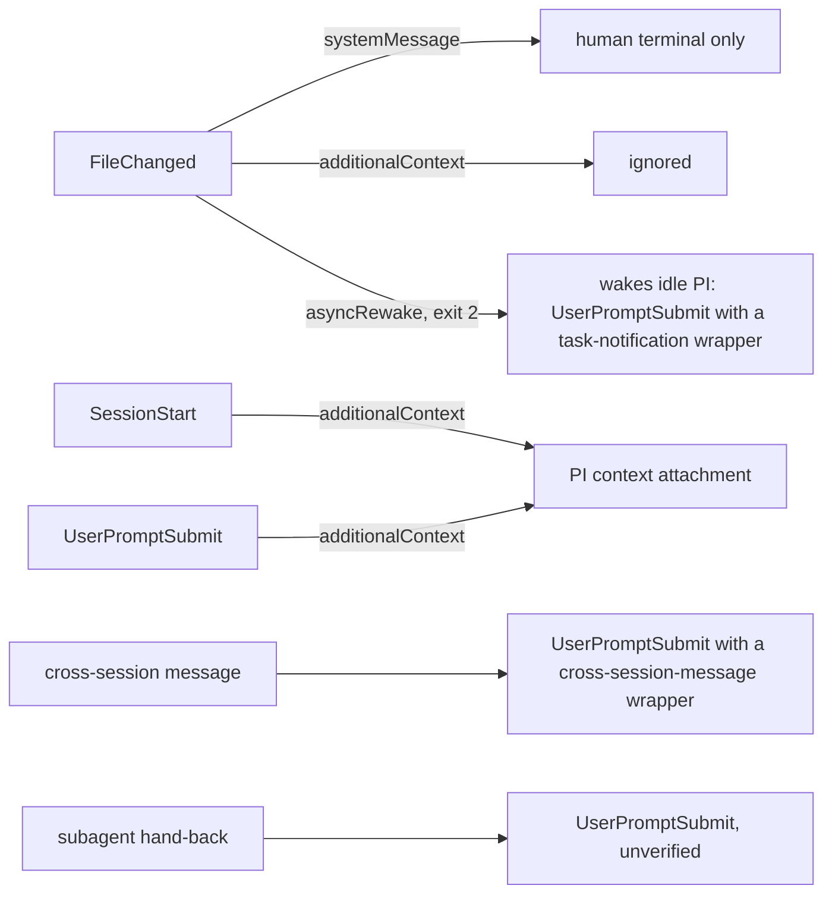

# Platform probes — Findings (v0)

Date: 2026-10-18

---
type: findings
topic: platform_probes
date: 2026-10-18
version: v0
prior-version: none
key-metric: mechanisms with a verdict from a run: 14 of 25 (prior: N/A, delta: N/A)
decision-required: intervene
---

`intervene`: the Claude Code CLI is logged out (`OAuth refresh token is no longer valid`), so every probe that
needs a model could not run. The PI has to run `claude auth login`; then `probes/run_model_probes.sh` closes the
ten blocked rows. Everything below was observed on Claude Code **2.1.296**, macOS.

## Headline Result

metric: v4 mechanisms with a run-backed verdict (of 25 listed)
value: 14 (9 VERIFIED, 1 PARTLY VERIFIED, 4 FAILED with a fallback)
unit: mechanisms
prior: N/A (first run)
direction: new

Blocked and not guessed: 10 rows need a model (named plugin agents messaging each other, SubagentStart/Stop fields,
`mcp_tool` on subagent events, UserPromptSubmit for a subagent hand-back, PostCompact, PostToolUse on `Agent` and
`SendMessage`, the behaviour diff of the main-thread agent, `SubagentHandback`, frontmatter hooks). 1 row is NOT
TESTABLE HEADLESS (Agent Teams). Minimum version for the v4 hook set: **2.1.271** (documented floor); verified at 2.1.296 only.

## Results Tables

Evidence paths: `probes/out/…` is local and gitignored; the curated copies are in
[`evidence/`](evidence/). `dbg:NNN` is a line of that run's `probes/out/<run>.debug.log`.

### Mechanism verdicts, part 1: subagents and messaging

| # | Mechanism | Verdict | Evidence |
|--:|:--|:--|:--|
| 1 | Two sibling subagents message each other directly with `SendMessage` (by agent id, host session) | **PARTLY VERIFIED**: delivery, resume of the finished receiver, and the reply all worked; the agents were unnamed and not the plugin's | `evidence/subagent_pair_transcripts.txt`: A's `SendMessage` returned `Resuming agent a5073b7`; B's transcript shows the message as `<agent-message from="a4b39e7…">`; B then called `SendMessage` to A; A's transcript shows `PONG-FROM-B nonce=7731` |
| 2 | The same between **named plugin** agents (`probe:probe-author` ↔ `probe:probe-verifier`) | **NOT RUN** (login). Fallback if it fails: Agent Teams, interactive only (row 23) | `run_model_probes.sh` M1 |
| 3 | SubagentStart fires for plugin agents; fields | **NOT RUN**. Documented fields: `agent_id`, `agent_type`; matcher is the scoped id `probe:probe-author` (contains `:`, so an unanchored regex) | hooks.md §SubagentStart; sub-agents.md §Plugin subagents |
| 4 | SubagentStop fields; `decision: block` once via `stop_hook_active` | **NOT RUN**. Documented: `stop_hook_active`, `agent_id`, `agent_type`, `agent_transcript_path`, `last_assistant_message`, `background_tasks`, `session_crons` | hooks.md §SubagentStop; M2 |
| 24 | Subagent report in auto mode goes through `SubagentHandback`; `last_assistant_message` is then not the report | **NOT RUN** (documented, and the host session itself behaves this way: every subagent report here arrived as `[Subagent hand-back]`) | hooks.md:1929, :2589; tools-reference.md:53; M6 |
| 25 | Frontmatter `hooks`, `mcpServers`, `permissionMode` ignored for plugin agents | **NOT RUN** (documented) | sub-agents.md §Plugin subagents |
| 23 | Agent Teams: teammates message by name; TaskCreated, TaskCompleted, TeammateIdle | **NOT TESTABLE HEADLESS** — manual procedure below | agent-teams.md §Enable agent teams |

### Mechanism verdicts, part 2: hook input and output

| # | Mechanism | Verdict | Evidence |
|--:|:--|:--|:--|
| 5 | `mcp_tool` handler calls a plugin MCP server | **VERIFIED** on UserPromptSubmit, UserPromptExpansion, SessionStart(`clear`), SessionEnd(`clear`), PreCompact(`manual`). Server name is `plugin:probe:stub`; `${session_id}`, `${prompt}`, `${prompt_id}`, `${source}`, `${reason}`, `${trigger}` were substituted | `probes/out/mcp_calls.jsonl` (53 lines); `smoke1` dbg:268 `Hooks: mcp_tool calling plugin:probe:stub/record with 4 arg(s)` |
| 6 | `mcp_tool` on SubagentStart, SubagentStop, PostToolUse, PostToolBatch | **NOT RUN** | M1 |
| 7 | `async: true` on an `mcp_tool` hook (v4 §Hooks marks five rows "mcp_tool, async") | **FAILED**: accepted without a warning, ignored; the turn started only after both 4 s calls. Fallback: `command` + `async: true`, or a sync `mcp_tool` that returns in milliseconds | `a2_mcpasync_timing` dbg:272-289 (turn 1 start 8 s after the hooks began); hooks.md:4056 says `async` is `command` only |
| 8 | `mcp_tool` on SessionStart(`startup`/`resume`) and on SessionEnd at process exit | **FAILED**. Fallback: `command` (v4 already uses it for SessionStart and SessionEnd) | `smoke1` dbg:102-103 `mcp_tool hook skipped … (no MCP client context)`; dbg:314 `mcp_tool hook error: … is not connected` |
| 9 | UserPromptSubmit: genuine prompt vs cross-session message | **VERIFIED**: no origin field on the hook input; the cross-session text starts with `<cross-session-message from="uds:…" from-session="…" from-name="…" from-mode="…">`. The transcript marks it `turnOrigin: "peer"`, `promptSource: "system"` | `evidence/hook_inputs.jsonl` (`x1_xsession`); `x1_xsession` dbg:299, dbg:318 `cc_turn_origin=peer` |
| 10 | UserPromptSubmit for a turn Claude Code starts on its own (asyncRewake) | **VERIFIED**: prompt is `<task-notification>
Stop hook feedback
</task-notification><system-reminder>Stop hook blocking error from command "FileChanged": …` | `evidence/hook_inputs.jsonl` (`s3_rewake`); dbg:312 |
| 11 | UserPromptSubmit for a background subagent's hand-back | **NOT RUN**. Documented to fire; the host session shows the in-session frame `<agent-message from="…">[Subagent hand-back] …` | hooks.md §UserPromptSubmit; M1, M5 |
| 20 | SessionStart `additionalContext`, `sessionTitle`; UserPromptSubmit `additionalContext` | **VERIFIED**: contexts arrive as `hook_additional_context` attachments; `session_title` then appears on later hook inputs and survives `/clear` | `r1_default` and `s2_misc` transcripts; `evidence/hook_inputs.jsonl` |
| 19 | UserPromptExpansion matcher `lab`, `lab-status` (v4 spelling) | **FAILED as spelled**: `command_name` is the scoped `probe:probe-skill`; only the matcher `probe:probe-skill` fired, `probe-skill` and `^probe-skill$` did not. Fallback: match `murmuration:lab` | `s2_misc`: events `UserPromptExpansion@probe:probe-skill` only |

### Mechanism verdicts, part 3: session, files, compaction, main thread

| # | Mechanism | Verdict | Evidence |
|--:|:--|:--|:--|
| 12 | Main-thread `agent` setting / `--agent` replaces the default system prompt | **VERIFIED**: 6,259 characters of default prompt become the 426-character agent body; `--agent` and the `agent` setting are byte-identical; every hook input of the main thread carries `agent_type: "probe:probe-author"` | `evidence/system_prompt_default_main.txt`, `evidence/system_prompt_agent_main.txt` (transcript `prompt_snapshot`) |
| 13 | Same small task with and without the main-thread agent | **NOT RUN** | M3 |
| 14 | SessionStart `watchPaths` + FileChanged | **VERIFIED**: files and directories (recursive); a new file gives `event: "add"`, an edit `"change"`; hooks with no matcher or `*` fire for any watched path; `/clear` re-issues the watch | `s1_watch` dbg:129-130, :305; `s4_watchdir` dbg:307 |
| 15 | FileChanged reaches the PI live | **FAILED for `systemMessage`** (terminal notice for the human; not in the SDK stream; never the model) and `hookSpecificOutput.additionalContext` is ignored. Fallback **VERIFIED**: an `asyncRewake` command hook exiting 2 wakes an idle session | `s2_misc` dbg:374 `unrecognized keys (ignored): hookSpecificOutput.additionalContext`; `s3_rewake` dbg:307-312; hooks.md §FileChanged |
| 16 | PreCompact fields | **VERIFIED**: `trigger` (`manual`), `custom_instructions` (`null`) | `evidence/hook_inputs.jsonl` (`s2_misc`) |
| 17 | PostCompact fields (`compact_summary`) | **NOT RUN** (compaction needs a model) | M4 |
| 18 | PostToolUse on `SendMessage` and on `Agent` | **NOT RUN**. Documented: a default Agent call returns `status: "async_launched"` with no token fields; usage only on foreground runs | hooks.md:1919-1931; M1 |
| 21 | PreModelSwitch / PostModelSwitch | **VERIFIED** with `/model sonnet`: `from_model`, `to_model`, `requested_model`, `source`, `context_tokens`, `prompt_cache_warm`, `cache_ttl`, `estimated_cache_write_usd`, `pricing` | `evidence/hook_inputs.jsonl` (`s2_misc`) |
| 22 | Cross-session messages into a headless session | **VERIFIED**: a `claude -p --input-format stream-json` session is addressable by its `--name`, with `crossSessionInbound: accept` | `x1_xsession` dbg:299 `[uds-messaging] Routed user message to queue` |

## Observations

| Signal | Baseline / Expected | Observed [source] | Interpretation |
|:--|:--|:--|:--|
| Hook latency per event | v4: a resident `mcp_tool` server avoids a ~30–60 ms process start; a static binary starts in ~1 ms | `command` hook (bash + jq): median 188 ms, p90 403 ms, n=34; `mcp_tool` to a trivial stub: median 3 ms, n=32 [`probes/out/*.debug.log`, transcript `durationMs`] | The 1 ms figure for a Rust `command` hook is untested; bash + jq is the floor of 140 ms, not the design |
| `async` on `mcp_tool` | v4 §Hooks: five rows "mcp_tool, async" | Ignored; the call blocks the turn [`a2_mcpasync_timing`] | Those rows block unless the tool returns in ms |
| Parallel hooks vs a single-threaded server | Hooks on one event run concurrently | Three `mcp_tool` calls reached the stub in the same millisecond and were served one after another [`a2_mcpasync_timing` dbg:272-274; `mcp_calls.jsonl`] | `libripens mcp` must serve concurrent calls |
| Origin of a prompt | A field, or a wrapper | No field; wrapper tags only [`evidence/hook_inputs.jsonl`] | The capture filter is a prefix test; the transcript's `turnOrigin` is the cross-check |
| Default prompt lost under `--agent` | v4 risk: "the PI file loses default-prompt behavior" | Nine blocks of the default prompt gone (list in Contradictions) plus the `gitStatus` snapshot [`evidence/system_prompt_*`, `r2_agent` transcript, sub-agents.md] | The risk is real and now enumerable |
| Subagent report channel | `SubagentStop.last_assistant_message` holds the report | In auto mode it is not the report; the report is `SubagentHandback`'s `message` [hooks.md:2589] | The presence gate and the ledger read the wrong field unless they handle it |

## Charts & Visualizations

How each event reaches the PI (the model) and the human, as observed or documented:

Caption: every edge but the last was observed (runs `s2_misc`, `s3_rewake`, `r1_default`, `x1_xsession`); the last edge is documented, not run.

## Contradictions & Surprises

- **The default prompt is almost all of what a bare agent loses.** The `research-pi` body replaces: the security
  line; the Harness block (prefer dedicated tools, parallel calls in one response, `file:line` references,
  `<pasted_content>` handling); the code-style line; the pronoun rule; "confirm hard-to-reverse or outward-facing
  actions, report outcomes faithfully"; the skill-invocation hint; the whole Memory section; the model-id
  environment block; the context-management note; "when you have enough information, act". The parallel-calls line
  matters to v4: the portfolio of probes is a parallel `Agent` dispatch. Context kept: `~/.claude/CLAUDE.md`, user email, skill listing, agent listing, date, environment; the git status snapshot is dropped.
- **`SubagentHandback` changes where the deliverable lives**, in auto mode only. v4's gate and ledger assume
  `SubagentStop`. Background is also the default for `Agent` calls, so `PostToolUse(Agent)` carries telemetry only for foreground runs.
- **Naming turns a subagent into a teammate when Agent Teams is enabled** (sub-agents.md §Subagent names): `SubagentStop` stops firing. Never set `CLAUDE_CODE_EXPERIMENTAL_AGENT_TEAMS` in lab-init.
- **`UserPromptSubmit` fires for slash commands too**, after `UserPromptExpansion`, with the raw `/probe:probe-skill alpha beta`. "Genuine" includes commands.
- **`asyncRewake` is reported as an error** in the debug log (`Hook FileChanged … error: status code 2`) while doing exactly what it is for.

## Steering Questions
- [now] Run `claude auth login`, then `probes/run_model_probes.sh` and `probes/analyze.sh <tag>`: ten rows, about seven short sessions, capped at 0.60 USD each. Should the next agent do it, or will you?
- [now] Amend `build/libripens_core.md` and `build/agents_and_skills.md` as listed below before any of them starts.
- [next run] If row 2 fails, is the fallback Agent Teams (interactive only, loses SubagentStop) or relay through the PI?
- [next run] Should the PreToolUse guard become an `mcp_tool` (3 ms) instead of a `command` (188 ms median with bash+jq)? Untested: the tool result would have to carry the `deny` decision.
- [later] Re-run the verified rows on the oldest Claude Code you want to support.

## Pointers
- Probe plugin, helpers, runs: `probes/` ([run_probes.md](../../probes/run_probes.md))
- Curated evidence: [evidence/](evidence/)
- Build reference: `__reports__/genesis/11-architecture_v4.md` §Hooks; event map `08-hooks_leverage_v0.md`; mechanisms `04-design_review_v0.md` §3
- Docs read (raw markdown): code.claude.com/docs/en/hooks, sub-agents, agent-teams, tools-reference, cross-session-messaging, plugins-reference

---

## Minimum Claude Code version for the v4 hook set

| Feature the v4 set uses | Documented floor | Source |
|:--|:--|:--|
| Subagent hand-back through `SubagentHandback`; `PostToolUse(Agent)` note | 2.1.271 | hooks.md:1929, tools-reference.md:53 |
| PreModelSwitch, PostModelSwitch, SessionStart cache fields (`prompt_cache_likely_expired`, `estimated_cache_write_usd`) | 2.1.251 | hooks.md §PreModelSwitch |
| `scratchpad_dir` common field | 2.1.257 | hooks.md common fields |
| Cross-session messaging (`ListAgents`, `SendMessage` to sessions); `@` mention; idle notice | 2.1.224; 2.1.232; 2.1.236 | cross-session-messaging.md |
| Multi-line JSON from an async hook; `onFailure` | 2.1.295 (avoid: print one line, do not use) | hooks.md §async |
| TaskCreated, TaskCompleted, TeammateIdle `agent` fields | 2.1.290 (fallback only) | hooks.md |
| Subagent nesting default of three layers | 2.1.219 | sub-agents.md |
| `mcp_tool` handler, FileChanged `watchPaths`, `asyncRewake`, PreCompact | no floor stated; **verified only at 2.1.296** | probes |

Statement: **v4 needs Claude Code ≥ 2.1.271**; 2.1.296 is the only version a probe ran on. `lab-init` warns below 2.1.271 and drops the model-switch hooks below 2.1.251.

## Amendments the findings force on the build nodes (described, not applied)

| Node | Amendment |
|:--|:--|
| `build/libripens_core.md` Step 3 (hooks) | (a) A `classify_prompt` for UserPromptSubmit: genuine unless the text starts with `<cross-session-message `, `<task-notification>` or an `<agent-message` frame; log the rest as `comm`; cross-check with the transcript's `turnOrigin`. (b) Add `SubagentHandback` to the hook set: read the report from `tool_input.message`, not from `SubagentStop`. (c) FileChanged: no matcher; the watch comes from SessionStart `watchPaths` (directories). For the PI use an `asyncRewake` command hook (exit 2) and treat its `<task-notification>` turn as non-genuine; keep `systemMessage` for the human only. (d) Time the Rust hook; the 1 ms figure is a claim, not a measurement |
| `build/libripens_core.md` Step 4 (MCP server) | The server must serve concurrent calls (hooks of one event arrive in the same millisecond) and answer in milliseconds, because `mcp_tool` ignores `async`. Rows tagged "mcp_tool, async" in v4 become either sync `mcp_tool` with an internal queue, or `command` + `async: true`. SessionStart(startup/resume) and SessionEnd(exit) stay `command` |
| `build/agents_and_skills.md` Step 1 (`research-pi.md`) | The agent body replaces the whole default prompt. Decide, line by line, which of the nine lost blocks `research-pi` or `research-loop` restores (parallel dispatch, outcomes reported faithfully, confirmation before outward-facing actions, memory) and keep them in the skill, not the PI file. The git status snapshot is gone: the brief or the PI runs `git status` |
| `build/agents_and_skills.md` Step 3 (commands) | `UserPromptExpansion` matches `murmuration:lab` and `murmuration:lab-status`. `/lab` arrives at UserPromptSubmit as a raw slash command |
| `build/agents_and_skills.md` Step 4 (package) | `SubagentStart`/`SubagentStop` matchers use scoped agent types (`murmuration:author`), pending row 3. `lab-init` must not set `CLAUDE_CODE_EXPERIMENTAL_AGENT_TEAMS`. Dispatch prompts for runs that must reach the ledger set `run_in_background: false` or rely on `SubagentStop`. Declare the minimum version 2.1.271 |
| `build/pilot/` | Repeat rows 2, 3, 4, 11, 13, 17, 18 and 24 inside the pilot if the probe runs stay blocked |

## Manual procedures for the PI

**Unblock the model runs** (about 3 minutes): `claude auth login`; `claude auth status` must print `"loggedIn": true`;
then `probes/run_model_probes.sh` and `probes/analyze.sh <tag>`. Read first the sections "Subagent events" and
"UserPromptSubmit prompts, classified".

**Agent Teams, NOT TESTABLE HEADLESS** (about 5 minutes, interactive terminal):
1. `cd probes/out/work && PROBE_RUN=teams PROBE_OUT=$PWD/../events.jsonl CLAUDE_CODE_EXPERIMENTAL_AGENT_TEAMS=1 claude --plugin-dir ../../plugin --setting-sources project --model sonnet`
2. Prompt: `Create an agent team with two teammates named author and verifier, using the probe:probe-author and probe:probe-verifier agent types. Have author ask verifier a question and verifier answer it, then finish.`
3. Expected if teams behave as documented: events `TaskCreated`, `TaskCompleted`, `TeammateIdle` in `probes/out/events.jsonl` with label `teams`, and **no** `SubagentStop` for the teammates.
4. Close the session. Nothing else changed: the variable is set for that one process only.
