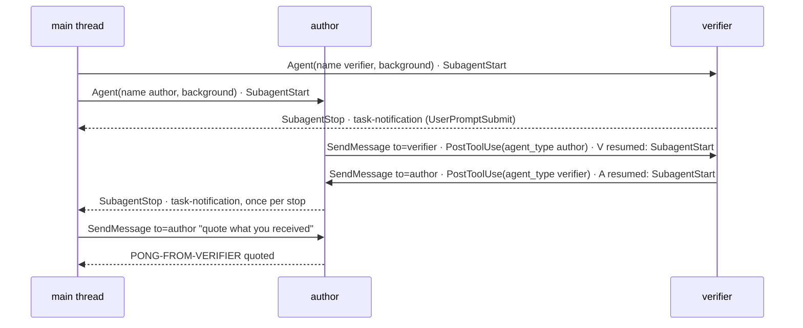

# Platform probes — Findings (v1)

Date: 2026-10-18

---
type: findings
topic: platform_probes
date: 2026-10-18
version: v1
prior-version: __reports__/platform_probes/00-findings_v0.md
key-metric: mechanisms with a run-backed verdict: 27 of 28 (prior: 14 of 25, delta: +13 rows resolved, +3 rows added)
decision-required: confirm
---

`confirm`: nothing blocks the build, but six amendments to `build/libripens_core.md` and `build/agents_and_skills.md`
(table at the end) change what those nodes implement, and the PI should say which to take before they start.
Claude Code **2.1.296**, macOS, logged in; all 10 rows that v0 could not run now have a verdict.

## Headline Result

metric: v4 mechanisms with a run-backed verdict (of 28 listed)
value: 27 (23 VERIFIED, 4 FAILED with a fallback that was itself run)
unit: mechanisms
prior: 14 of 25 (v0)
direction: up

The one remaining row (Agent Teams) is NOT TESTABLE HEADLESS; its manual procedure is at the end. Minimum Claude Code
version for the v4 hook set: **2.1.271** (documented floor); every probe ran on 2.1.296 only.

## Results Tables

`dbg:NNN` is a line of that run's `probes/out/<run>.debug.log`. Runs are listed in
[run_probes.md](../../probes/run_probes.md); curated raw material is in [evidence/](evidence/) (`v1_*` files are new).
Row numbers continue v0's; rows 26-28 are new.

### Verdicts, part 1: subagents and messaging

| # | Mechanism | Verdict | Evidence |
|--:|:--|:--|:--|
| 1 | Sibling subagents message each other by agent id (host session, unnamed) | **VERIFIED** (v0 evidence, now confirmed by row 2) | `evidence/subagent_pair_transcripts.txt` |
| 2 | Two **named plugin** agents (`probe:probe-author`, `probe:probe-verifier`) message each other directly with `SendMessage to: <name>` | **VERIFIED**: author → `verifier` resumed it; verifier → `author` resumed it; the author quoted `PONG-FROM-VERIFIER nonce=4412`. The main thread sent nothing between them. The receiver sees `<agent-message from="verifier">` inside "Another Claude session sent a message while you were working" | `m1_pair_v1a`: PostToolUse(SendMessage) from `agent_type: probe:probe-author` with `tool_response.pin.name: "verifier"`, then the mirror image; author's `last_assistant_message` |
| 3 | SubagentStart fires for plugin agents; fields | **VERIFIED**: `agent_id`, `agent_type` (`probe:probe-author`), plus `session_id`, `transcript_path`, `cwd`, `prompt_id`, `scratchpad_dir`. No `permission_mode`, no `effort`. It fires again on every **resume** (M1: verifier 2 starts, author 3 starts). The matcher must be the scoped id: `probe:probe-author` fired, `probe-author` never did | `evidence/v1_hook_inputs.jsonl`; `m1_pair_v1a` labels `SubagentStart@probe:probe-author` and `…@probe:probe-verifier`, none for the unscoped spelling |
| 4 | SubagentStop fields; `decision: block` once via `stop_hook_active` | **VERIFIED**: `agent_id`, `agent_type`, `agent_transcript_path`, `last_assistant_message`, `stop_hook_active`, `background_tasks`, `session_crons`, `effort`, `permission_mode`. The first stop was blocked, the second came with `stop_hook_active: true`, and the author's final text gained `PINEAPPLE` | `m2_inject_block_v1a`: two SubagentStop, `false` then `true`; the foreground report is `Hello! … AUTHOR-DONE PINEAPPLE` |
| 24 | In auto mode a subagent reports through `SubagentHandback`; `last_assistant_message` is not the report | **VERIFIED**: in auto mode the SubagentStop input has **no** `last_assistant_message`; the report is `tool_input.message` of the subagent's `PostToolUse(SubagentHandback)` (carries the subagent's `agent_id`); in `bypassPermissions` mode the report is `last_assistant_message` and the tool does not exist | `m6_auto_resume_v1a` vs `m5_resume_v1a`; `evidence/v1_shapes_and_excerpts.txt` |
| 25 | Frontmatter `hooks`, `permissionMode`, `mcpServers` ignored for plugin agents | **VERIFIED**: the loader warns once per field, the frontmatter `PreToolUse` hook never fired, and a `permissionMode: plan` agent wrote its file | `x4_frontmatter` dbg:63-65 `sets hooks, which is ignored for plugin agents` |
| 23 | Agent Teams: TaskCreated, TaskCompleted, TeammateIdle | **NOT TESTABLE HEADLESS**, manual procedure below | agent-teams.md |
| 28 | The Agent tool is `Agent` in hook inputs, not `Task` | **VERIFIED**: `tool_name: "Agent"` on PreToolUse and PostToolUse (the `system/init` tool list still says `Task`) | `m1_pair_v1a` (2 PreToolUse `Agent`) |

### Verdicts, part 2: hook input and output

| # | Mechanism | Verdict | Evidence |
|--:|:--|:--|:--|
| 5 | `mcp_tool` handler calls a plugin MCP server | **VERIFIED** (server `plugin:probe:stub`); median 3 ms, p90 6 ms, max 13 ms, n=148 | `probes/out/mcp_calls.jsonl`; transcript `durationMs` |
| 6 | `mcp_tool` on SubagentStart, SubagentStop, PreToolUse, PostToolUse, PostToolBatch, Stop, PreCompact, PostCompact | **VERIFIED**, with `${agent_id}`, `${agent_type}`, `${tool_name}`, `${tool_input.prompt}`, `${tool_response.agentId}`, `${tool_response.totalTokens}`, `${tool_calls}` (the whole array as a JSON string, about 3 KB). A missing path (`totalTokens` of a background launch) substitutes the empty string | `m1_pair_v1a`, `m2_inject_block_v1a` rows in `mcp_calls.jsonl` |
| 7 | `async: true` on an `mcp_tool` hook | **FAILED** (v0): accepted and ignored, the turn waits. Fallback: `command` + `async: true`, or a sync tool that answers in milliseconds | `a2_mcpasync_timing` dbg:272-289 |
| 8 | `mcp_tool` on SessionStart(startup/resume) and SessionEnd at process exit | **FAILED** (v0); still fails in v1: `mcp_tool hook error: … is not connected`. Fallback: `command` | `m1_pair_v1a` dbg:2048 |
| 9 | UserPromptSubmit: genuine vs cross-session | **VERIFIED** (v0): prefix `<cross-session-message from=…>`; transcript `turnOrigin: "peer"` | `x1_xsession` |
| 10 | UserPromptSubmit for an asyncRewake turn | **VERIFIED** (v0): prefix `<task-notification>
Stop hook feedback
` | `s3_rewake` |
| 11 | UserPromptSubmit for a **subagent hand-back** | **VERIFIED**, two shapes. Non-auto mode (`bypassPermissions`, the only non-auto mode run; plain `default` was not): `<task-notification><task-id>{agent_id}</task-id><tool-use-id>…<output-file>…<status>completed</status>
Agent "…" finished
<note>…</note><result>{report}</result><usage>…</usage></task-notification>`, one per stop, so a resumed agent notifies again. Auto mode: `<agent-message from="{name}">[Subagent hand-back] … {report, indented two spaces}</agent-message>` | `evidence/v1_shapes_and_excerpts.txt`; `m1_pair_v1a` (4 notifications), `m5_resume_v1a` (2), `m6_auto_resume_v1a` (2) |
| 20 | SessionStart / UserPromptSubmit `additionalContext`; `sessionTitle` | **VERIFIED** (v0); `additionalContext` of SubagentStart also **reaches the subagent**, on every resume (each of the 5 starts in M1; the author quoted it in all three of its final messages) | `m1_pair_v1a`, `m2_inject_block_v1a` streams |
| 19 | UserPromptExpansion matcher `lab` | **FAILED as spelled** (v0): needs the scoped `murmuration:lab` | `s2_misc` |
| 26 | A PreToolUse `mcp_tool` handler can deny a call | **VERIFIED**: the tool's text, a `permissionDecision: "deny"` JSON, blocked the `Write`; no file; the model saw `PreToolUse:Write hook error: PROBE-DENY-FROM-MCP-TOOL` | `x2_denymcp` result `DENIED …` |
| 18 | PostToolUse on `SendMessage` and on `Agent` | **VERIFIED**. `SendMessage`: input `to`, `message`, `summary`; response `success`, `message` (`Resuming agent verifier`), `pin{id,name,ref}`, `revivedAgentId` or `resumedAgentId`; when a subagent sends, the hook input carries its `agent_id` and `agent_type` (main-thread calls carry none). `Agent`: background launch returns `isAsync`, `status: async_launched`, `agentId`, `outputFile`, `resolvedModel`, no usage; **foreground** returns `content`, `totalTokens`, `totalDurationMs`, `totalToolUseCount`, `usage{…}`, `agentType` (e.g. 27,972 tokens) | `evidence/v1_hook_inputs.jsonl`; `m1_pair_v1a`, `m2_inject_block_v1a` |

### Verdicts, part 3: session, files, compaction, main thread

| # | Mechanism | Verdict | Evidence |
|--:|:--|:--|:--|
| 12 | Main-thread `agent` replaces the default prompt | **VERIFIED**, now with login: the default prompt is 12 blocks, 7,160 characters; under `--agent` it is the agent body (426) plus one tool-conditional block (the Artifact edit rule, 671): 1,097 characters. Tool-conditional blocks survive; the nine named in v0 do not | `evidence/v1_system_prompt_m3_default.txt`, `…_m3_agent.txt` |
| 13 | Same task with and without the agent | **VERIFIED**: both did the job. Default knew the git state from its snapshot (branch `main`, last commit, "clean at start"); the agent run did not, spent an extra `Glob` looking for `.git/HEAD`, said it could not run `git status`, and closed with the agent file's own line `AUTHOR-DONE`. Cost 0.057 vs 0.150 USD: the agent's prompt shares no prefix with the default one, so its cache was cold (cache writes 35,203 vs 11,640 tokens) | `m3_default_v1a`, `m3_agent_v1a` streams |
| 14 | `watchPaths` + FileChanged | **VERIFIED** (v0) | `s1_watch`, `s4_watchdir` |
| 15 | FileChanged reaches the PI | **FAILED for `systemMessage`/`additionalContext`** (v0). Fallback `asyncRewake` **VERIFIED**, now also **mid-turn**: two rewakes fired while a 30 s tool call ran; they were queued, and both arrived as UserPromptSubmit events with the turn's own `prompt_id` one second after the tool returned, before the next model call. Nothing interrupted the running tool | `x3_rewake_midturn` (`evidence/v1_shapes_and_excerpts.txt`) |
| 16 | PreCompact | **VERIFIED**: `trigger`, `custom_instructions` | `m4_compact_v1a` |
| 17 | PostCompact; SessionStart(`compact`) | **VERIFIED**. Order: PreCompact, then SessionStart(`compact`; `source`, `model`), then PostCompact (`trigger`, `compact_summary`). `mcp_tool` works on all three; SessionStart's `additionalContext` arrives. `compact_summary` starts with the model's last reply and contains an `<analysis>` block. The model recalled both words afterwards | `m4_compact_v1a` dbg:1066-1080 |
| 21 | Pre/PostModelSwitch | **VERIFIED** (v0) | `s2_misc` |
| 22 | Cross-session messages headless | **VERIFIED** (v0) | `x1_xsession` |
| 27 | An internal agent fires SubagentStop | **VERIFIED**: compaction runs an agent whose SubagentStop has `agent_type: ""` and `last_assistant_message` of the summary. Only matcher-scoped hooks avoid it | `m4_compact_v1a`, label `SubagentStop` with no scoped twin |

## Observations

| Signal | Baseline / Expected | Observed [source] | Interpretation |
|:--|:--|:--|:--|
| Hook latency | v4: static binary ~1 ms; `mcp_tool` avoids a process start | `command` (bash + jq): median 244 ms, p90 574, max 1,319, n=190; `mcp_tool`: median 3 ms, p90 6, max 13, n=148 [debug logs; transcripts] | The `mcp_tool` figure is measured; the Rust 1 ms is still a claim (the floor for any `command` is about 140 ms here) |
| Guard as `mcp_tool` | v4: guard is a `command` (exit 2) | A PreToolUse `mcp_tool` denied a Write [`x2_denymcp`] | The guard can move to the resident server, 3 ms instead of a process per tool call. If the server is down, a blocking-event hook waits up to `MCP_TIMEOUT`, then errors without blocking (hooks.md) |
| Cost of a pair | v4 budgets runs in the ledger | M1 (two background agents, 3 resumes, main thread waiting) cost 0.42 USD against a 0.60 cap; M2 0.15 [stream `total_cost_usd`] | Every resume re-injects the SubagentStart context and is one more ledger run; the pair's cost grows per exchange |
| Run telemetry | `PostToolUse(Agent)` gives tokens | Only for foreground calls; background launches return `isAsync` and no usage [M1 vs M2] | The ledger reads transcripts at SubagentStop, or the PI dispatches in the foreground |
| Hand-back at the PI | One shape | Two shapes by permission mode, plus one notification per stop of a resumed agent [M1, M5, M6] | The capture filter and the `comm` mirror must know both |
| Prompt origin | A field | None; wrappers `<cross-session-message`, `<task-notification>`, `<agent-message from=` [hook_inputs] | A three-prefix test, each with a verified example |

## Charts & Visualizations

The verified pair, with the hook events each step produced (run `m1_pair_v1a`):

Caption: every arrow was observed; the PostToolUse(SendMessage) inputs name the sender and the recipient, which is all `__examen__` mirroring needs.

## Contradictions & Surprises

- **Nothing in v0's `FAILED` list was softened by the model runs**, but two v0 claims moved: the default prompt is bigger than measured logged-out (7,160 vs 6,259 characters), and the agent prompt is not just the body (1,097 vs 426): tool-conditional guidance blocks are kept.
- **SubagentStart context is paid per resume**, not per run: the honoured `additionalContext` was re-injected each time a finished agent was resumed (5 starts in M1 for two agents).
- **`SubagentStop` has an agent with `agent_type: ""`** (compaction) that any unmatched hook receives.
- **`last_assistant_message` is missing, not empty,** in auto mode; code that reads it as a string will see `null`.
- **The v0 FileChanged puzzle held**: nothing makes a FileChanged `systemMessage` reach the model; only `asyncRewake` does, and mid-turn it waits for the tool in flight.

## Steering Questions
- [now] Which of the six amendments below does the PI take for `libripens_core` and `agents_and_skills`? The three that cost something: sync-only `mcp_tool` (restructures ten hook rows), the two hand-back shapes, and the per-resume ledger.
- [now] Should the PreToolUse guard move from `command` to the resident `mcp_tool` server? Measured 3 ms vs 244 ms, but a server outage then removes the guard.
- [next run] Run the Agent Teams procedure once if direct messaging between workers ever fails in the pilot; today it is not needed.
- [next run] Re-run M1 in the interactive terminal: headless `-p` and the Desktop host agree so far, but the interactive `fork` default for subagents was not exercised.
- [later] Repeat the verified rows on the oldest Claude Code you intend to support (documented floor 2.1.271).

## Pointers
- v0 findings: [00-findings_v0.md](00-findings_v0.md)
- Probe plugin, helpers, runs: [probes/](../../probes/) and [run_probes.md](../../probes/run_probes.md)
- Evidence: [evidence/](evidence/) (`v1_system_prompt_m3_*.txt`, `v1_hook_inputs.jsonl`, `v1_shapes_and_excerpts.txt`)
- Build reference: `__reports__/genesis/11-architecture_v4.md` §Hooks; event map `08-hooks_leverage_v0.md`; mechanisms `04-design_review_v0.md` §3

---

## Minimum Claude Code version for the v4 hook set

Unchanged from v0, now with the runs behind the features that have no documented floor.

| Feature the v4 set uses | Documented floor | Verified on |
|:--|:--|:--|
| `SubagentHandback` report path; `PostToolUse(Agent)` note | 2.1.271 | 2.1.296 (M6) |
| PreModelSwitch, PostModelSwitch, SessionStart cache fields | 2.1.251 | 2.1.296 |
| `scratchpad_dir` common field | 2.1.257 | 2.1.296 (present on every input) |
| Cross-session messaging | 2.1.224 | 2.1.296 |
| Multi-line JSON from an async hook (avoid: print one line); `onFailure` (not used) | 2.1.295 | not exercised |
| TaskCreated, TaskCompleted, TeammateIdle `agent` fields (fallback only) | 2.1.290 | not exercised |
| `mcp_tool`, FileChanged `watchPaths`, `asyncRewake`, PreCompact/PostCompact, SubagentStart/Stop with `agent_type` | none stated | 2.1.296 |

Statement: **v4 needs Claude Code ≥ 2.1.271**, verified at 2.1.296. `lab-init` warns below 2.1.271 and drops the model-switch hooks below 2.1.251.

## Amendments the findings force on the build nodes (described, not applied)

| Node | Amendment | Rows |
|:--|:--|:--|
| `build/libripens_core.md` Step 3 (hooks) | (a) `classify_prompt` for UserPromptSubmit: genuine unless the text starts with `<cross-session-message `, `<task-notification>` or `<agent-message from=`; a hand-back becomes a `comm` event with the `<result>` (default mode) or the indented body (auto mode), keyed by `<task-id>` = `agent_id` or by the `from` name. (b) Handle both hand-back paths: read the deliverable from `SubagentStop.last_assistant_message` if present, else from `PostToolUse(SubagentHandback).tool_input.message` for that `agent_id`; the presence gate must not treat a missing `last_assistant_message` as an empty deliverable. (c) Treat `SubagentStart` and `SubagentStop` as per-resume: a run is `(agent_id, n)`, and the ledger sums the stops. (d) Ignore a SubagentStop with `agent_type: ""`. (e) FileChanged: no matcher; watch from SessionStart `watchPaths`; deliver to the PI with an `asyncRewake` command (exit 2, one line on stderr), expecting it to arrive at the next tool boundary and as a non-genuine prompt | 4, 11, 15, 24, 27 |
| `build/libripens_core.md` Step 4 (MCP server) | `mcp_tool` is synchronous: the five rows tagged "mcp_tool, async" in v4 §Hooks become sync calls that answer in milliseconds with an internal queue, or `command` + `async: true`. The server serves concurrent calls (three arrive in the same millisecond). It can also host the PreToolUse guard (returns the `permissionDecision` JSON as text), if the PI accepts the outage risk. Keep SessionStart(startup/resume) and SessionEnd(exit) as `command`; `mcp_tool` works at `clear` and `compact` | 6, 7, 8, 26 |
| `build/agents_and_skills.md` Step 1 (`research-pi.md`) | Under `--agent` the nine default blocks named in v0 are gone and tool-conditional blocks stay. Decide, line by line, which `research-pi` or `research-loop` restores (parallel dispatch, outcomes reported faithfully, confirmation before outward-facing actions, memory), and keep them in the skill, not the PI file. The git status snapshot is gone: the first brief carries the repository state. Expect a cold prompt cache on the first run of the PI | 12, 13 |
| `build/agents_and_skills.md` Step 3 (commands) | `UserPromptExpansion` matches `murmuration:lab` and `murmuration:lab-status`; `/lab` also arrives at UserPromptSubmit as a raw slash command | 19 |
| `build/agents_and_skills.md` Step 4 (package) | Hook matchers for SubagentStart/Stop use the scoped agent types (`murmuration:author`, …). Agent files must not rely on frontmatter `hooks`, `permissionMode` or `mcpServers`. `lab-init` must not set `CLAUDE_CODE_EXPERIMENTAL_AGENT_TEAMS`. Pair briefs name the agents (`name`) and tell each the partner's name; `SendMessage to: <name>` works both ways. Declare minimum version 2.1.271. `SubagentStart` `additionalContext` is paid per resume, so keep it short | 2, 3, 25 |
| `build/pilot/` | Add a check that the ledger agrees with the sum of `SubagentStop` transcripts for a run with resumes, and that a disputed pair thread in `__examen__` equals the `PostToolUse(SendMessage)` sequence | 2, 18 |

## Manual procedure for the PI: Agent Teams, NOT TESTABLE HEADLESS

About 5 minutes, interactive terminal (the variable is set for that one process only):
1. `cd probes/out/work && PROBE_RUN=teams PROBE_OUT=$PWD/../events.jsonl CLAUDE_CODE_EXPERIMENTAL_AGENT_TEAMS=1 claude --plugin-dir ../../plugin --setting-sources project --model sonnet`
2. Prompt: `Create an agent team with two teammates named author and verifier, using the probe:probe-author and probe:probe-verifier agent types. Have author ask verifier a question and verifier answer it, then finish.`
3. Expected if teams behave as documented: events `TaskCreated`, `TaskCompleted`, `TeammateIdle` with label `teams` in `probes/out/events.jsonl`, and no `SubagentStop` for the teammates.
4. Close the session.
