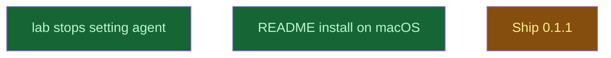

# PI choice and README

## Context
Amendment A1, level 4: the two plugin changes that 0.1.1 ships. It follows `publish` step 3 (0.1.0 installed from Nest) and runs `/lab`'s new rule on Eliott's decision ("Never set it").

## Goal
`lab_init` no longer sets `agent`, and the README tells a macOS user how to install from Nest at project scope.

## Pre-conditions
- [x] `publish.md` done (0.1.0 installed from Nest)

## Success Gates
- ✅ `lab_pi_choice.md` and `readme_install.md` gates pass and both are merged into `main`

## Status

## Nodes
| Node | Type | Status |
|:-----|:-----|:-------|
| `lab_pi_choice.md` | 📄 Leaf Task | ✅ Done |
| `readme_install.md` | 📄 Leaf Task | ✅ Done |
| `next/` | 📁 Directory | 🔄 In Progress |

## Amendment Log
| ID | Date | Source | Nodes Added | Rationale |
|:---|:-----|:-------|:------------|:----------|

## Progress
| Node | Branch | Commits | Notes |
|:-----|:-------|:--------|:------|
| `lab_pi_choice.md` | `task/lab-pi-choice` | 6fbf406, ed2c13c, 22996c2, merge 28eae54, 58408f1 | Sonnet implementer; adversarial verifier `verify-lab-pi-choice`: 19 cases through `run()` with no path writing `agent`, 7 of 8 mutants killed; verdict CHANGES on a vacuous append assert (fixed in 22996c2) and on two README sentences (already fixed by the readme merge 244fc76). Coordinator fix 58408f1: the Next text said "the lab sets nothing for you" right after the deny rules were written. Fresh scratch folder: `settings.local.json` holds only `permissions.deny`, Next names both ways to open as the PI. Not fixed, same as 0.1.0: adding a missing deny rule rewrites the whole file with `indent=2` and `ensure_ascii` |
| `readme_install.md` | `task/readme-install` | 7492250, merge 244fc76 | Plugin README: Install on macOS, Use, Update; root README: install at project scope, update path, dev copy beside the published one. `claude plugin validate` passes with no README warning |
