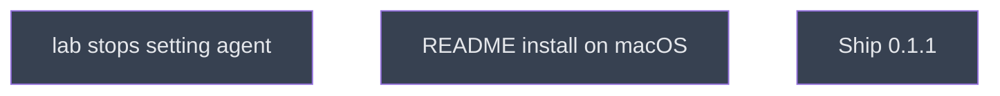

# PI choice and README

## Context
Amendment A1, level 4: the two plugin changes that 0.1.1 ships. It follows `publish` step 3 (0.1.0 installed from Nest) and runs `/lab`'s new rule on Eliott's decision ("Never set it").

## Goal
`lab_init` no longer sets `agent`, and the README tells a macOS user how to install from Nest at project scope.

## Pre-conditions
- [ ] `publish.md` done (0.1.0 installed from Nest)

## Success Gates
- ✅ `lab_pi_choice.md` and `readme_install.md` gates pass and both are merged into `main`

## Status

## Nodes
| Node | Type | Status |
|:-----|:-----|:-------|
| `lab_pi_choice.md` | 📄 Leaf Task | ⬜ Planned |
| `readme_install.md` | 📄 Leaf Task | ⬜ Planned |
| `next/` | 📁 Directory | ⬜ Planned |

## Amendment Log
| ID | Date | Source | Nodes Added | Rationale |
|:---|:-----|:-------|:------------|:----------|

## Progress
| Node | Branch | Commits | Notes |
|:-----|:-------|:--------|:------|
