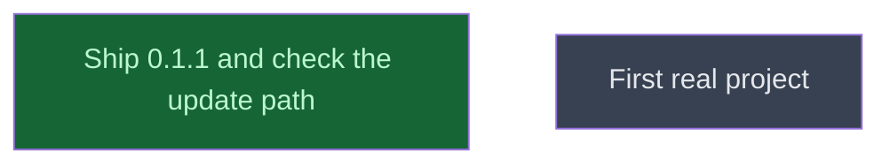

# Ship 0.1.1

## Context
Amendment A1, level 5: ships the level-4 changes as 0.1.1 and checks once the update path a user follows.

## Goal
An install of 0.1.0 from `cracking-shells` updates to 0.1.1 with the marketplace update and the plugin update.

## Pre-conditions
- [x] Level 4 merged into `main` (244fc76, 28eae54)

## Success Gates
- ✅ `ship_update.md` gates pass

## Status

## Nodes
| Node | Type | Status |
|:-----|:-----|:-------|
| `ship_update.md` | 📄 Leaf Task | ✅ Done |
| `next/` | 📁 Directory | ⬜ Planned |

## Amendment Log
| ID | Date | Source | Nodes Added | Rationale |
|:---|:-----|:-------|:------------|:----------|

## Progress
| Node | Branch | Commits | Notes |
|:-----|:-------|:--------|:------|
| `ship_update.md` | `main` (coordinator) | 72a61d0 | On Eliott's "Yes, push main": `main` pushed 7509378..72a61d0 (14 commits). Run 40659559118: macOS and Linux builds and `install_smoke` green, `commit_back` found "bin/ on main already holds these binaries; nothing to commit", the Windows build red as before (harness bug). `doubt()` None on 72a61d0. In the scratch folder, `marketplace update` then `plugin update --scope project` reported "updated from 0.1.0 to 0.1.1"; cache holds `0.1.0/` and `0.1.1/`. With the data dir's binary and `.verified` deleted first, one headless session reinstalled both (Mach-O arm64, 636512 B, sha 9c013758…); a01 denied, `ls` allowed. `lab_init.py` from the 0.1.1 cache in a fresh folder wrote `settings.local.json` with `permissions` only and printed plain `claude --agent murmuration:research-pi` |
