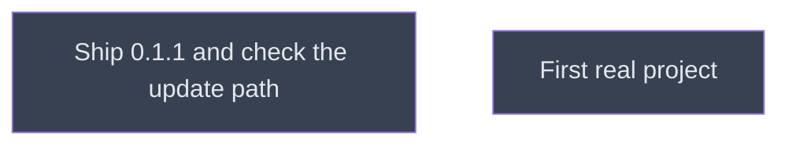

# Ship 0.1.1

## Context
Amendment A1, level 5: ships the level-4 changes as 0.1.1 and checks once the update path a user follows.

## Goal
An install of 0.1.0 from `cracking-shells` updates to 0.1.1 with the marketplace update and the plugin update.

## Pre-conditions
- [ ] Level 4 merged into `main`

## Success Gates
- ✅ `ship_update.md` gates pass

## Status

## Nodes
| Node | Type | Status |
|:-----|:-----|:-------|
| `ship_update.md` | 📄 Leaf Task | ⬜ Planned |
| `next/` | 📁 Directory | ⬜ Planned |

## Amendment Log
| ID | Date | Source | Nodes Added | Rationale |
|:---|:-----|:-------|:------------|:----------|

## Progress
| Node | Branch | Commits | Notes |
|:-----|:-------|:--------|:------|
