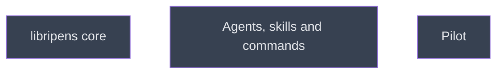

# Build

## Context
Second level of the Murmuration roadmap: runs after wave 1 (platform probes, instrument validation), whose findings may amend these nodes. Produces the `libripens` binary and the plugin's agents, skills and commands.

## Goal
Build the mechanical layer and the team, then pilot them.

## Pre-conditions
- [ ] `platform_probes` done: every mechanism v4 relies on is VERIFIED or has a recorded fallback
- [ ] `instrument_validation` done: the list of instruments allowed in the brief is decided

## Success Gates
- ✅ `libripens` and the plugin install locally and pass their self-tests
- ✅ The pilot node is done

## Status

## Nodes
| Node | Type | Status |
|:-----|:-----|:-------|
| `libripens_core.md` | 📄 Leaf Task | ⬜ Planned |
| `agents_and_skills.md` | 📄 Leaf Task | ⬜ Planned |
| `pilot/` | 📁 Directory | ⬜ Planned |

## Amendment Log
| ID | Date | Source | Nodes Added | Rationale |
|:---|:-----|:-------|:------------|:----------|

## Progress
| Node | Branch | Commits | Notes |
|:-----|:-------|:--------|:------|
