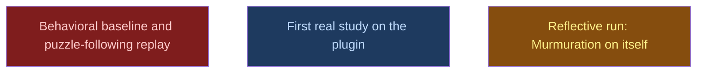

# Pilot

## Context
Third level: runs once the plugin installs. Produces the first real study and the first reflective run, the evaluation method chosen in architecture v6.

## Goal
Use Murmuration for real, then turn it on itself.

## Pre-conditions
- [ ] `build/agents_and_skills` and `build/minimal_lab` done

## Success Gates
- ✅ One real study and one reflective run completed, each with sealed wave notes, and the user has accepted or rejected every proposed change

## Status

## Nodes
| Node | Type | Status |
|:-----|:-----|:-------|
| `baseline.md` | 📄 Leaf Task | 🚫 Blocked |
| `first_study.md` | 📄 Leaf Task | 🔵 Amendment |
| `reflective_run.md` | 📄 Leaf Task | 🔄 In Progress |

## Amendment Log
| ID | Date | Source | Nodes Added | Rationale |
|:---|:-----|:-------|:------------|:----------|
| A2 | 2026-10-19 | __reports__/genesis/13-architecture_v6.md | ["first_study.md", "reflective_run.md"] | Statistical baseline replaced by real use and a reflective run; baseline.md blocked (superseded) |

## Progress
| Node | Branch | Commits | Notes |
|:-----|:-------|:--------|:------|
