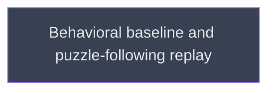

# Pilot

## Context
Third level: runs once `libripens` and the agents exist. Produces the behavioral baseline that later versions are compared against.

## Goal
Establish the behavioral baseline of Murmuration on a replay and one external reference.

## Pre-conditions
- [ ] `build/libripens_core` and `build/agents_and_skills` done

## Success Gates
- ✅ Baseline findings report committed with the core metrics of v4 §Behavioral baseline

## Status

## Nodes
| Node | Type | Status |
|:-----|:-----|:-------|
| `baseline.md` | 📄 Leaf Task | ⬜ Planned |

## Amendment Log
| ID | Date | Source | Nodes Added | Rationale |
|:---|:-----|:-------|:------------|:----------|

## Progress
| Node | Branch | Commits | Notes |
|:-----|:-------|:--------|:------|
