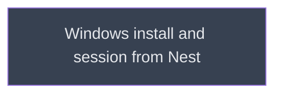

# Live Windows session

## Context
Added by A2: the live Windows check left `install` so 0.3.0 could ship tested on Windows in CI only. Runs after `release`, from the version on Nest, when a Windows machine is at hand.

## Goal
Murmuration observed working in a real Windows session.

## Pre-conditions
- [ ] `release` done

## Success Gates
- ⬜ `live_session.md` gates pass

## Status

## Nodes
| Node | Type | Status |
|:-----|:-----|:-------|
| `live_session.md` | 📄 Leaf Task | ⬜ Planned |

## Amendment Log
| ID | Date | Source | Nodes Added | Rationale |
|:---|:-----|:-------|:------------|:----------|
| A2 | 2026-10-30 | `__reports__/windows_install/A2_lifecycle_and_live_split.md` | ["live_session.md"] | The live Windows gate leaves `install`; no Windows machine this week |

## Progress
| Node | Branch | Commits | Notes |
|:-----|:-------|:--------|:------|
