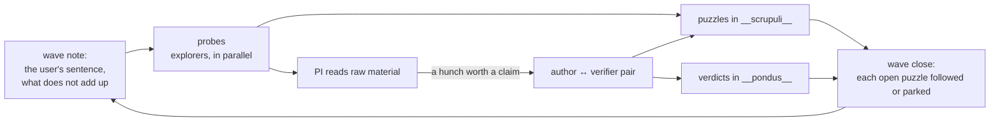

# Research loop

A Murmuration team works in waves inside a lab project. The principal investigator (PI) explores
and decides which hunches become claims. Authors turn hunches into labelled claims. Verifiers
check claims independently, in direct conversation with their author. Everyone records what
puzzles them. The files are plain markdown, one file per writer, so several agents can work at
the same time without touching each other's files.

## Read what applies to you

| You are | Read |
|:--|:--|
| The PI, at the start of a session | [`references/working_defaults.md`](references/working_defaults.md), then the current wave note in `__statera__/` and the open puzzles (`/lab-status`) |
| The PI, planning or closing a wave | [`references/waves.md`](references/waves.md) and [`templates/wave.md`](templates/wave.md) |
| The PI, writing a brief | [`references/briefs.md`](references/briefs.md) |
| Anyone writing a claim, a verdict or a puzzle | [`references/labels.md`](references/labels.md) and [`references/files.md`](references/files.md) |
| Anyone starting a new project's framing | [`templates/framing.md`](templates/framing.md) |

## The shape of a wave

## Lab files at a glance

| Path | Holds |
|:--|:--|
| `__design__/framing.md` | The question, notation and scope |
| `__statera__/user_words.md` | The user's prompts, verbatim and dated (written by a hook and by `/lab`; never edited by agents) |
| `__statera__/wave-NN.md` | One note per wave, written by the PI |
| `__pondus__/<claim-id>.md` | One file per claim: the author's head, then each verifier's section |
| `__scrupuli__/wave-NN-<agent>.md` | Each agent's puzzles for that wave |
