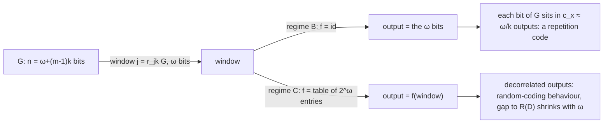

# run2: events in order (brief = what the agent was handed; agent = its words and commands; tool = outputs)

### [0] agent

```
/private/tmp/claude-501/-Users-hacker-Documents-explore-combinatorics-on-binary/82e8a947-1a0c-441c-bc39-df8e2e5fa743/scratchpad/runs/run2/brief.md
```

### [1] brief

```
You are an independent verifier in a research lab. One claim from a lab report is to be checked against the committed data and code of the study.

The author's report that makes the claim follows, complete and verbatim, between the two lines of equals signs.

==========
# Strided trellis (Q5) — Findings (v0)

Date: 2026-10-18

---
type: findings
topic: strided_trellis
date: 2026-10-18
version: v0
prior-version: none
key-metric: MSE above D(R) at 2 bits/value, N(0,1), identity reads vs random-table reads at ω = 16: 4.68 dB vs 0.38 dB (prior: N/A, delta: N/A)
decision-required: confirm
---

Notation is `__design__/problem_framing.md` (G, ω, k, r_i(G), regimes B and C). Added: **identity reads** = f is the
identity (regime B: the output is the raw window); **mapped reads** = f is a table over the 2^ω windows (regime C);
**c_x** = number of windows that contain bit x of G (≈ ω/k); **excess** = 10 log10(MSE / D(R)), D(R) = 2^(−2R).
Every G below is the **exact optimum for its target** (Viterbi over 2^(ω−k) states, checked against brute force
over all 2^n strings in 120 tiny cases), so every number is a property of the read rule, not of the search.
Provenance label (framing §3.1): G is *per-target optimized*; its n = ω + (m−1)k bits are the whole rate. Random
tables come from a seeded PRNG (cost ~0); trained tables are *side information* and are scored on a held-out target.
Code: `code/trellis/` (`viterbi.py --selftest`, `run_all.py [--quick]`, `figures.py`); data
`data/derived/trellis_rd.csv` (722 rows). Labels: **DERIVED** (closed form, checked numerically), **MEASURED**.

## Headline Result

metric: excess MSE over D(R) at 2 bits/value on i.i.d. N(0,1), Viterbi-optimal G, window width ω (k = 2)
value: identity reads 4.68 dB (MSE 0.1837, the same for every ω = 4…16); random Gaussian table 0.38 dB at ω = 16 (MSE 0.0682); trained table 0.67 dB at ω = 12 (0.0730); Lloyd–Max scalar 2.74 dB (0.1175)
unit: dB above D(R) = 0.0625
prior: N/A (first run)
direction: new

Binary companion (Bernoulli(1/2), Hamming): identity reads are a **repetition code**, D = 0.25 at rate 1/2 (R(D) = 0.110,
2.65× the bits) and never improve with ω; a random table at rate 1/4 reaches D = 0.2213 at ω = 16 against R(D) = 0.2145 (1.05× the bits).



## Results Tables

### A. Binary targets: identity vs random table at fixed rate (3 seeds, N = 65 536 bits)

| rate k/ω | (ω, k) | R(D) distortion | identity D | exact identity D (DERIVED) | random-table D | rate / R(D_id) | rate / R(D_rand) |
|:--|:--|--:|--:|--:|--:|--:|--:|
| 1/2 | (2, 1) | 0.1100 | 0.2504 | 0.2500 | 0.2585 | 2.66 | 2.85 |
| 1/2 | (4, 2) | 0.1100 | 0.2512 | 0.2500 | 0.1767 | 2.68 | 1.53 |
| 1/2 | (8, 4) | 0.1100 | 0.2488 | 0.2500 | 0.1407 | 2.62 | 1.21 |
| 1/3 | (3, 1) | 0.1740 | 0.2507 | 0.2500 | 0.2412 | 1.78 | 1.64 |
| 1/3 | (6, 2) | 0.1740 | 0.2495 | 0.2500 | 0.2122 | 1.76 | 1.31 |
| 1/3 | (12, 4) | 0.1740 | 0.2495 | 0.2500 | 0.1873 | 1.76 | 1.10 |
| 1/4 | (4, 1) | 0.2145 | 0.3123 | 0.3125 | 0.2700 | 2.40 | 1.58 |
| 1/4 | (8, 2) | 0.2145 | 0.3122 | 0.3125 | 0.2369 | 2.40 | 1.19 |
| 1/4 | (16, 4) | 0.2145 | 0.3116 | 0.3124 | 0.2213 | 2.38 | 1.05 |

rate / R(D_x) = bits spent per bit that R(D) would need to reach the same measured D (1.00 = on the bound).

### B. Real targets, k = 2 bits/value, i.i.d. N(0,1): MSE (excess dB over D(R) = 0.0625), mean of 2 seeds

| ω | identity | monotone quantile levels | random table | trained table (held-out) |
|--:|--:|--:|--:|--:|
| 2 | 0.1903 (4.83) | 0.1444 (3.64) | 0.2805 (6.52) | 0.1173 (2.73) |
| 4 | 0.1834 (4.68) | 0.1475 (3.73) | 0.1433 (3.60) | 0.0969 (1.90) |
| 6 | 0.1837 (4.68) | 0.1479 (3.74) | 0.1115 (2.51) | 0.0864 (1.41) |
| 8 | 0.1837 (4.68) | 0.1480 (3.74) | 0.0904 (1.60) | 0.0817 (1.16) |
| 10 | 0.1837 (4.68) | 0.1480 (3.74) | 0.0787 (1.00) | 0.0768 (0.89) |
| 12 | 0.1837 (4.68) | 0.1480 (3.74) | 0.0735 (0.71) | 0.0730 (0.67) |
| 14 | 0.1837 (4.68) | 0.1480 (3.74) | 0.0700 (0.50) | not run |
| 16 | 0.1837 (4.68) | 0.1480 (3.74) | 0.0682 (0.38) | not run |

References at 2 bits: D(R) = 0.0625; Lloyd–Max scalar 0.1175 (2.74 dB); QTIP's TCQ, L = 16: 0.068–0.069 (0.4 dB) [source: literature findings, from QTIP Table 1].
ω = 2 = k is a scalar quantizer (one state): identity is the uniform 4-level quantizer, trained recovers Lloyd–Max.

### C. MiniLM-L6 weights (`encoder.layer.0.intermediate.dense.weight`, unit variance), k = 2, 10^5 values, 1 seed

| ω | identity | monotone quantile levels | random table | trained table (held-out) |
|--:|--:|--:|--:|--:|
| 2 | 0.2001 (5.05) | 0.1694 (4.33) | 0.3728 (7.76) | 0.1362 (3.38) |
| 4 | 0.1939 (4.92) | 0.1675 (4.28) | 0.1886 (4.80) | 0.1077 (2.36) |
| 8 | 0.1940 (4.92) | 0.1680 (4.29) | 0.1020 (2.13) | 0.0883 (1.50) |
| 12 | 0.1940 (4.92) | 0.1680 (4.29) | 0.0813 (1.14) | 0.0792 (1.03) |
| 14 | 0.1940 (4.92) | 0.1680 (4.29) | 0.0770 (0.90) | not run |
| bound rows | Lloyd–Max (empirical) 0.1362 (3.38) | Shannon lower bound (histogram estimate) 0.0615 (−0.07) | Gaussian D(R) 0.0625 | |

### D. Other rates, i.i.d. N(0,1): excess dB (identity is flat in ω from ω ≈ k+1)

| k | identity | Lloyd–Max | random table at ω = 12 | trained at ω = 10 (random at ω = 10) |
|--:|--:|--:|--:|--:|
| 1 | 4.65 | 1.62 | 0.49 | 0.53 (0.65) |
| 2 | 4.68 | 2.74 | 0.71 | 0.89 (1.00) |
| 3 | 4.86 | 3.45 | 0.98 | 1.31 (1.62) |

### E. Trained table: what it buys over a random table, and the train / test gap (k = 2, N(0,1))

| ω | random − trained (dB) | in-sample MSE | held-out MSE | held-out, 4× training data |
|--:|--:|--:|--:|--:|
| 4 | 1.70 | 0.0969 | 0.0969 | n/a |
| 8 | 0.44 | 0.0788 | 0.0817 | 0.0809 |
| 10 | 0.11 | 0.0709 | 0.0768 | 0.0766 |
| 12 | 0.04 | 0.0626 | 0.0730 | n/a |

## Observations

| Signal | Baseline / Expected | Observed [source] | Interpretation |
|:--|:--|:--|:--|
| Identity reads, binary | Closed form: bit x of G is compared with one target bit in each of its c_x windows, so the optimum is a majority vote and D = Σ_x E min(B, c_x − B) / (mω) | Viterbi minus formula: max 0.003 over 123 runs; in-run check passes at 5σ [source: `trellis_rd.csv`, `check()`] | The Viterbi search is not needed for identity+Hamming; the strided code of theorem T11 (injective, linear) is a repetition code with multiplicities c_x. Distortion depends on c = ω/k only: D = 0.25 at c = 2 for all (ω, k) |
| Identity at low rate | rate / R(D) → π ln 2 = 2.178 as c → ∞ (majority vote of c fair bits) | 2.178 at c = 1000 from the closed form; 2.66 → 2.40 at c = 2, 4 [source: `check()`, table A] | Identity reads waste about 2.2× the bits at every low rate; the shortfall is a constant, not a function of ω |
| Random table, binary, fixed rate | Random-coding behaviour: gap to R(D) closes as ω grows at fixed k/ω | rate/R(D): 2.85 → 1.53 → 1.21 (rate 1/2, ω = 2, 4, 8); 1.58 → 1.19 → 1.05 (rate 1/4, ω = 4, 8, 16) [source: table A] | Decorrelation is what lets longer windows pay off; the gap is still 5–21 % of the bits at the longest windows shown |
| Identity, real, k = 2 | 4-level uniform scalar over ±3σ: 0.1903 (the ω = 2 case) | 0.1834–0.1837 for every ω = 4…16, sd ≤ 0.0003 across seeds [source: table B] | A longer window adds no resolution: the Viterbi path can steer only the leading bits of each read, the trailing bits belong to later reads. The best identity code is about 4.7 dB above D(R), worse than a Lloyd–Max scalar by 1.9 dB |
| Random table, real, k = 2, ω = 16 | QTIP TCQ (L = 16, computed code) 0.068–0.069 | 0.0682 (0.38 dB), 2 seeds: 0.06809, 0.06826 [source: table B] | A seeded random Gaussian table reproduces the published TCQ figure at L = 16 on a window of the same width; no clever code is needed to get within 0.4 dB at this ω, only decorrelation |
| Trained table vs random | Training should help where random is far from D(R) | Gain 1.70 dB (ω = 4), 0.44 (8), 0.11 (10), 0.04 (12); 4× more training data moves held-out MSE by ≤ 0.0008 [source: table E] | Alternating Viterbi/centroid reaches a local optimum that the random table matches by ω ≈ 12; the limit is the optimum, not the data volume |
| MiniLM vs N(0,1) | Same trend if weights are near-Gaussian | Same ordering of maps; identity 4.92 dB, random ω = 14 0.90 dB; Lloyd–Max 3.38 dB (0.64 dB worse than on N(0,1)) [source: table C] | Heavier tails hurt the scalar quantizer most; the Shannon lower bound estimate (0.0615) is within 0.07 dB of Gaussian D(R), so the dB figures are meaningful for these weights |

## Charts & Visualizations


Caption: Hamming distortion vs rate k/ω on Bernoulli(1/2) targets (points labelled by ω; mean of 3 seeds) against R(D) = 1 − h(D); identity reads (left) sit on a repetition-code curve far above the bound, random-table reads (middle) approach it as ω grows; at fixed rate (right) only the random table improves with ω.


Caption: MSE per value at 2 bits vs ω (log scale; bars = range over 2 seeds, MiniLM one seed) for identity, monotone-quantile, random and trained maps against D(R), Lloyd–Max and the QTIP range; the identity curve is flat while mapped curves fall with ω.


Caption: Excess MSE in dB above D(R) = 2^(−2k) on N(0,1) at 1, 2, 3 bits per value; identity stays near 4.7 dB at every k, the random table crosses below Lloyd–Max at ω ≈ 6–8 and the trained table leads until ω ≈ 12.

## Contradictions & Surprises

- Identity MSE is the same to four decimals for every ω from 4 to 16 (0.1837): sixteen-fold more trellis states per step buys nothing, and the result is 1.9 dB worse than the scalar Lloyd–Max quantizer at the same 2 bits.
- A monotone map with the right marginal (equiprobable Gaussian levels) is no better in kind: it also plateaus (0.1480, 3.74 dB). Reordering window values is not decorrelation; the correlation structure of overlapping reads is what costs.
- For small windows a mapped read is worse than identity: the random table loses to identity for ω ≤ 3 (k = 2), with large seed variance (ω = 2: 0.28 ± 0.07), because 2^ω random entries do not cover the line.
- Bitwise-majority training of a binary table is a fixed point from a random start (identical to the random table in 46 of 51 runs; the 5 exceptions are all at ω ≤ 8), so no "trained binary" curve is reported.
- The in-sample MSE of a trained table at ω = 12 (0.0626) reaches D(R) because the 4096-entry table is side information that the rate does not count; only the held-out value (0.0730) is a rate-honest number.

## Steering Questions

- [now] Retire raw window reads for real-valued targets and carry regime C (seeded random table, cost ~0) into wave 3's shared-G experiments? Identity reads are 4.7 dB above D(R) at any ω and any tested k; a random table is within 0.4–1.0 dB at ω = 12–16.
- [next run] Which cheap structured f (XOR of window and a rotation, popcount-based, multiplicative hash) matches the random table? A computable f removes the table cost that a trained table carries and is what a kernel would implement.
- [next run] Do ω = 13–16 trained tables, with a structured parametrization so the table is not side information, beat the random table at equal bits? The measured gain was 0.04 dB at ω = 12 for free tables.
- [later] Real-model slices (gemma tensors, several layers) and k = 3–4: do the weight-specific heavy tails change which f wins, and does a shared G over a tensor class keep the 0.4–1 dB figure?
- [later] State the repetition-code result (identity + Hamming) to the theory track as a corollary of T11, and ask whether other distortion measures keep the separability.

## Pointers

- Code: `code/trellis/viterbi.py`, `code/trellis/run_all.py`, `code/trellis/figures.py`
- Data: `data/derived/trellis_rd.csv` (columns: experiment, source, map, omega, k, rate, seed, n_values, distortion, bound, excess_db, rate_gap_bits, closed_form, train_distortion)
- Reproduce: `python3 code/trellis/run_all.py` (full, about 3.5 minutes on 12 cores, 1 900 CPU-seconds; rewrites the CSV and these figures), `python3 code/trellis/run_all.py --quick` (2 s, no files written), `python3 code/trellis/viterbi.py --selftest`
- Task spec: `__roadmap__/swc/strided_trellis.md`; framing: `__design__/problem_framing.md`
- Injectivity of regime B (T11): `__reports__/foundations/00-findings_v0.md`
- TCQ / QTIP reference numbers: `__reports__/literature/00-findings_v0.md`
==========

THE CLAIM (verbatim from the report's "Contradictions & Surprises"):
"Bitwise-majority training of a binary table is a fixed point from a random start (identical to the random table in 46 of 51 runs; the 5 exceptions are all at ω ≤ 8), so no "trained binary" curve is reported."

THE STUDY is the repository /Users/hacker/Documents/explore/combinatorics_on_binary. It is READ ONLY: other sessions use it, so never write, commit, or run anything there that modifies files.
You may read exactly these paths in it: data/derived/trellis_rd.csv, code/trellis/*.py, __design__/problem_framing.md.
You must not read anything else in it: nothing under __reports__/, __roadmap__/, code/reproduction/, code/review/, and no git history (no git log, show, diff or blame).
Write your scratch files only under /private/tmp/claude-501/-Users-hacker-Documents-explore-combinatorics-on-binary/82e8a947-1a0c-441c-bc39-df8e2e5fa743/scratchpad/runs/run2/ . Run your own Python with python3 -I (system python3 has numpy and pandas).

WHAT TO DO: check the claim. Find which rows of the CSV are the trained binary rows and which are the random binary rows, how they pair up, how often the two distortions are equal, and which runs are the exceptions. Judge the numbers (46 of 51, 5 exceptions, ω ≤ 8) and the wording ("identical", "fixed point"). Log each command you run and its numeric output in run2/check_log.md as you go.

FINAL ANSWER, in exactly this format and nothing else:
VERDICT: SUPPORTED | OVERSTATED | UNSUPPORTED
NUMBERS: the counts you found (runs compared, equal, different) and how you defined "equal"
EXCEPTIONS: the runs that differ, with ω, k, seed and the size of the difference
RATIONALE: at most 150 words, in your own words
```

### [2] agent

```
cd /Users/hacker/Documents/explore/combinatorics_on_binary && head -3 data/derived/trellis_rd.csv && wc -l data/derived/trellis_rd.csv && ls code/trellis/ && python3 -I -c "
import pandas as pd
d=pd.read_csv('data/derived/trellis_rd.csv')
print(d.groupby(['experiment','source','map']).size())
"
Inspect CSV structure (read-only)
```

### [3] tool

```
Exit code 1
experiment,source,map,omega,k,rate,seed,n_values,distortion,bound,excess_db,rate_gap_bits,closed_form,train_distortion
binary,bernoulli,identity,2,1,0.5,0,65536,0.249664306640625,0.11002786443835952,,0.3107456294037163,0.24999237060546875,
binary,bernoulli,identity,2,1,0.5,1,65536,0.2505035400390625,0.11002786443835952,,0.31207524151065735,0.24999237060546875,
     723 data/derived/trellis_rd.csv
figures.py
run_all.py
viterbi.py
Traceback (most recent call last):
  File "<string>", line 2, in <module>
ModuleNotFoundError: No module named 'pandas'
```

### [4] agent

```
which -a python3; for p in $(which -a python3); do $p -I -c "import pandas,sys;print(sys.executable)" 2>&1 | tail -1; done
Locate python with pandas
```

### [5] tool

```
/usr/bin/python3
/opt/homebrew/bin/python3
ModuleNotFoundError: No module named 'pandas'
ModuleNotFoundError: No module named 'pandas'
```

### [6] agent

```
I'll use the csv module instead.
```

### [7] agent

```
mkdir -p /private/tmp/claude-501/-Users-hacker-Documents-explore-combinatorics-on-binary/82e8a947-1a0c-441c-bc39-df8e2e5fa743/scratchpad/runs/run2 && cd /private/tmp/claude-501/-Users-hacker-Documents-explore-combinatorics-on-binary/82e8a947-1a0c-441c-bc39-df8e2e5fa743/scratchpad/runs/run2 && cat > a.py <<'EOF'
import csv,collections
rows=list(csv.DictReader(open('/Users/hacker/Documents/explore/combinatorics_on_binary/data/derived/trellis_rd.csv')))
c=collections.Counter((r['experiment'],r['source'],r['map']) for r in rows)
for k,v in sorted(c.items()): print(k,v)
EOF
python3 -I a.py
Count rows per experiment/source/map
```

### [8] tool

```
('binary', 'bernoulli', 'identity') 123
('binary', 'bernoulli', 'random') 123
('binary', 'bernoulli', 'trained') 51
('real', 'gauss', 'identity') 74
('real', 'gauss', 'lloyd_max') 3
('real', 'gauss', 'quantile') 74
('real', 'gauss', 'random') 74
('real', 'gauss', 'trained') 58
('real', 'gauss', 'trained_big') 2
('real', 'minilm', 'identity') 35
('real', 'minilm', 'lloyd_max') 3
('real', 'minilm', 'quantile') 35
('real', 'minilm', 'random') 35
('real', 'minilm', 'shannon_lb') 3
('real', 'minilm', 'trained') 29
```

### [9] agent

```
51 trained binary rows. Now pair them with random rows.
```

### [10] agent

```
cd /private/tmp/claude-501/-Users-hacker-Documents-explore-combinatorics-on-binary/82e8a947-1a0c-441c-bc39-df8e2e5fa743/scratchpad/runs/run2 && cat > b.py <<'EOF'
import csv,collections
rows=list(csv.DictReader(open('/Users/hacker/Documents/explore/combinatorics_on_binary/data/derived/trellis_rd.csv')))
b=[r for r in rows if r['experiment']=='binary']
key=lambda r:(int(r['omega']),int(r['k']),int(r['seed']))
rnd=collections.defaultdict(list)
for r in b:
    if r['map']=='random': rnd[key(r)].append(r)
print('dup random keys',sum(1 for v in rnd.values() if len(v)>1))
tr=[r for r in b if r['map']=='trained']
print('trained n',len(tr),'unique keys',len({key(r) for r in tr}), 'n_values',{r['n_values'] for r in tr}, 'train_dist col nonempty',sum(1 for r in tr if r['train_distortion']))
eq=ne=miss=0;ex=[]
for r in tr:
    m=rnd.get(key(r))
    if not m: miss+=1;continue
    d=float(r['distortion'])-float(m[0]['distortion'])
    if d==0: eq+=1
    else: ne+=1;ex.append((key(r),float(r['distortion']),float(m[0]['distortion']),d,r['n_values'],m[0]['n_values']))
print('equal exact',eq,'diff',ne,'missing',miss)
for e in sorted(ex): print(e)
# tolerance sensitivity
for tol in (1e-12,1e-9,1e-6,1e-4,1e-3):
    print(tol,sum(1 for r in tr if abs(float(r['distortion'])-float(rnd[key(r)][0]['distortion']))<=tol))
print('trained keys by omega/k:',sorted(collections.Counter((int(r['omega']),int(r['k'])) for r in tr).items()))
print('diffs among equal-omega check: omega of trained',sorted({int(r['omega']) for r in tr}))
EOF
python3 -I b.py
Pair trained binary with random rows
```

### [11] tool

```
dup random keys 0
trained n 51 unique keys 51 n_values {'65532', '65535', '65536', '65534'} train_dist col nonempty 51
equal exact 40 diff 11 missing 0
((2, 1, 2), 0.1956787109375, 0.301666259765625, -0.105987548828125, '65536', '65536')
((3, 2, 1), 0.21245136186770427, 0.23852903028915848, -0.026077668421454203, '65535', '65535')
((3, 2, 2), 0.16227969787136645, 0.18611429007400626, -0.02383459220263981, '65535', '65535')
((5, 4, 1), 0.1083237964446479, 0.1100328068970779, -0.0017090104524299932, '65535', '65535')
((7, 1, 1), 0.3037965025788141, 0.30407116916409804, -0.0002746665852839669, '65534', '65534')
((8, 1, 0), 0.31085205078125, 0.3119659423828125, -0.0011138916015625, '65536', '65536')
((8, 1, 1), 0.311279296875, 0.31158447265625, -0.00030517578125, '65536', '65536')
((8, 1, 2), 0.3109283447265625, 0.310760498046875, 0.0001678466796875, '65536', '65536')
((8, 2, 0), 0.236968994140625, 0.2370147705078125, -4.57763671875e-05, '65536', '65536')
((8, 2, 1), 0.2364501953125, 0.2366180419921875, -0.0001678466796875, '65536', '65536')
((8, 2, 2), 0.237060546875, 0.2369232177734375, 0.0001373291015625, '65536', '65536')
1e-12 40
1e-09 40
1e-06 40
0.0001 41
0.001 46
trained keys by omega/k: [((2, 1), 3), ((3, 1), 3), ((3, 2), 3), ((4, 1), 3), ((4, 2), 3), ((5, 1), 3), ((5, 2), 3), ((5, 4), 3), ((6, 1), 3), ((6, 2), 3), ((6, 4), 3), ((7, 1), 3), ((7, 2), 3), ((7, 4), 3), ((8, 1), 3), ((8, 2), 3), ((8, 4), 3)]
diffs among equal-omega check: omega of trained [2, 3, 4, 5, 6, 7, 8]
```

### [12] agent

```
cd /Users/hacker/Documents/explore/combinatorics_on_binary/code/trellis && ls -l && grep -n -i "majority\|trained\|fixed point\|46\|identical" run_all.py viterbi.py figures.py | head -60
Locate trained binary code (single-file greps)
```

### [13] tool

```
total 44
-rw-r--r-- 1 hacker staff  8996 Oct 18 13:24 figures.py
-rw-r--r-- 1 hacker staff 20792 Oct 18 13:26 run_all.py
-rw-r--r-- 1 hacker staff  8159 Oct 18 13:01 viterbi.py
run_all.py:10:  trained table (alternating Viterbi / bitwise-majority update, evaluated on a held-out target).
run_all.py:14:  random Gaussian table, trained table (alternating Viterbi / centroid, held-out evaluation).
run_all.py:55:    bin_trained_max=8, bin_iters=4,
run_all.py:58:    # k -> (max omega for id/quantile/random, max omega for trained)
run_all.py:64:    bin_trained_max=6, bin_iters=5,
run_all.py:109:    with one target bit in each of the c_x windows that cover it, so the optimal bit is the majority of
run_all.py:138:    """Lloyd-Max scalar quantizer trained and evaluated on the sample ``x`` (2^k levels)."""
run_all.py:220:    """Alternate Viterbi / bitwise majority: table word of window w = per-bit majority of its assigned blocks."""
run_all.py:270:    if omega <= cfg["bin_trained_max"]:
run_all.py:276:        add("trained", d / nb, train_distortion=dtr)
run_all.py:304:        add("trained", d / len(x), train_distortion=mtr)
run_all.py:309:    """Trained table with a 4x larger training set (gauss, held-out eval identical to task_real seed 0)."""
run_all.py:317:    return [_row(experiment="real", source="gauss", map="trained_big", omega=omega, k=k, rate=k, seed=seed,
run_all.py:347:def _cost(omega, k, trained):
run_all.py:348:    return (1 << omega) * (1 + (16 if trained else 0))
run_all.py:359:                    tasks.append((_cost(omega, k, omega <= cfg["bin_trained_max"]) / omega, task_binary, (omega, k, seed, cfg)))
run_all.py:412:        for name in ("identity", "quantile", "random", "trained", "trained_big", "lloyd_max", "shannon_lb"):
run_all.py:440:    # trained table at omega = k is a scalar quantizer: it must recover Lloyd-Max
run_all.py:442:        if r["map"] == "trained" and r["source"] == "gauss" and r["omega"] == r["k"]:
run_all.py:445:                bad.append(f"trained omega=k={r['k']} MSE {r['distortion']:.4f} vs Lloyd-Max {lm:.4f}")
run_all.py:446:    # low-rate limit of identity reads: rate / R(D) -> pi ln 2 (repetition code with majority decoding)
viterbi.py:9:state is free (window 0 is unconstrained), which is exactly what ``n = omega + (m-1)k`` pays for.
viterbi.py:83:        int array of 2^omega output words (a random / trained codebook).
figures.py:22:MAPCOL = {"identity": ORANGE, "quantile": AMBER, "random": BLUE, "trained": GREEN}
figures.py:24:          "random": "random Gaussian table", "trained": "trained table (held-out)"}
figures.py:114:        for name in ("identity", "quantile", "random", "trained"):
figures.py:127:        big = [r for r in rows if r["map"] == "trained_big" and r["source"] == source and r["k"] == 2]
figures.py:129:            ax.plot([r["omega"] for r in big], [r["distortion"] for r in big], "D", color=GREEN, ms=7, mfc="none", label="trained, 4x training data")
figures.py:155:        for name in ("identity", "random", "trained"):
```

### [14] agent

```
cd /Users/hacker/Documents/explore/combinatorics_on_binary/code/trellis && sed -n 215,285p run_all.py
Read binary trained code
```

### [15] tool

```
        inits += [rng.permutation(q), rng.permutation(q)]
    return inits


def train_hamming(Ttr, omega, k, f0, iters):
    """Alternate Viterbi / bitwise majority: table word of window w = per-bit majority of its assigned blocks."""
    W = 1 << omega
    f = f0.copy()
    bits = np.arange(omega - 1, -1, -1)
    dist = None
    for _ in range(iters):
        _, d, w = viterbi_encode(Ttr, omega, k, f, "hamming")
        dist = d / (len(Ttr) * omega)
        c = np.bincount(w, minlength=W)
        new = f.copy()
        for b in range(omega):
            ones = np.bincount(w, weights=(Ttr >> b) & 1, minlength=W)
            vote = np.where(2 * ones > c, 1, 0)
            tie = (2 * ones == c)
            cur = (f >> b) & 1
            bit = np.where(c > 0, np.where(tie, cur, vote), cur)
            new = (new & ~(1 << b)) | (bit << b)
        f = new
    return f, dist


# --------------------------------------------------------------------------------------- tasks
def _row(**kw):
    r = {k: "" for k in FIELDS}
    r.update(kw)
    return r


def task_binary(args):
    omega, k, seed, cfg = args
    N = cfg["bin_N"]
    m = N // omega
    W = 1 << omega
    rng = np.random.default_rng(seed_for("bin", omega, k, seed))
    bits = rng.integers(0, 2, size=m * omega)
    T = bits.reshape(m, omega) @ (1 << np.arange(omega - 1, -1, -1))
    rate = k / omega
    nb = m * omega
    rows = []

    def add(name, D, **extra):
        Db = d_rd_binary(rate)
        rows.append(_row(experiment="binary", source="bernoulli", map=name, omega=omega, k=k, rate=rate, seed=seed,
                         n_values=nb, distortion=D, bound=Db, rate_gap_bits=rate - rd_binary(D), **extra))

    _, d, _ = viterbi_encode(T, omega, k, None, "hamming")
    add("identity", d / nb, closed_form=identity_hamming_expected(omega, k, m))
    rtab = np.random.default_rng(seed_for("bin-table", omega, k, seed)).integers(0, W, size=W)
    _, d, _ = viterbi_encode(T, omega, k, rtab, "hamming")
    add("random", d / nb)
    if omega <= cfg["bin_trained_max"]:
        mt = cfg["bin_Ntrain"] // omega
        r2 = np.random.default_rng(seed_for("bin-train", omega, k, seed))
        Ttr = r2.integers(0, 2, size=mt * omega).reshape(mt, omega) @ (1 << np.arange(omega - 1, -1, -1))
        f, dtr = train_hamming(Ttr, omega, k, rtab, cfg["bin_iters"])
        _, d, _ = viterbi_encode(T, omega, k, f, "hamming")
        add("trained", d / nb, train_distortion=dtr)
    return rows


def task_real(args):
    source, k, omega, seed, do_train, cfg = args
    M = cfg["real_M"] if source == "gauss" else cfg["minilm_M"]
    x = real_target(source, "eval", seed, M, cfg)
    W = 1 << omega
    rows = []
```

### [16] agent

```
cd /private/tmp/claude-501/-Users-hacker-Documents-explore-combinatorics-on-binary/82e8a947-1a0c-441c-bc39-df8e2e5fa743/scratchpad/runs/run2 && cat > c.py <<'EOF'
import csv,collections
rows=list(csv.DictReader(open('/Users/hacker/Documents/explore/combinatorics_on_binary/data/derived/trellis_rd.csv')))
b=[r for r in rows if r['experiment']=='binary']
key=lambda r:(int(r['omega']),int(r['k']),int(r['seed']))
rnd={key(r):float(r['distortion']) for r in b if r['map']=='random'}
tr=[r for r in b if r['map']=='trained']
byw=collections.defaultdict(lambda:[0,0])
for r in tr:
    d=float(r['distortion'])-rnd[key(r)]
    byw[int(r['omega'])][0 if d==0 else 1]+=1
print('omega: [equal, differ]',dict(sorted(byw.items())))
print('max |d| among differing at 1e-3 tol:', sorted(abs(float(r['distortion'])-rnd[key(r)]) for r in tr if 0<abs(float(r['distortion'])-rnd[key(r)])<=1e-3))
print('differing with |d|>1e-3:',[ (key(r)) for r in tr if abs(float(r['distortion'])-rnd[key(r)])>1e-3])
print('trained worse than random:',sum(1 for r in tr if float(r['distortion'])>rnd[key(r)]),'better:',sum(1 for r in tr if float(r['distortion'])<rnd[key(r)]))
EOF
python3 -I c.py
Breakdown by omega and tolerance
```

### [17] tool

```
omega: [equal, differ] {2: [2, 1], 3: [4, 2], 4: [6, 0], 5: [8, 1], 6: [9, 0], 7: [8, 1], 8: [3, 6]}
max |d| among differing at 1e-3 tol: [4.57763671875e-05, 0.0001373291015625, 0.0001678466796875, 0.0001678466796875, 0.0002746665852839669, 0.00030517578125]
differing with |d|>1e-3: [(2, 1, 2), (3, 2, 1), (3, 2, 2), (5, 4, 1), (8, 1, 0)]
trained worse than random: 2 better: 9
```

### [18] agent

```
Now write the log.
```

### [19] agent

```
cd /private/tmp/claude-501/-Users-hacker-Documents-explore-combinatorics-on-binary/82e8a947-1a0c-441c-bc39-df8e2e5fa743/scratchpad/runs/run2 && cat > check_log.md <<'EOF'
# check_log (run2)
Note: pandas unavailable under python3 -I; used csv module. Scripts a.py, b.py, c.py in this dir.
1. a.py: rows per (experiment,source,map): binary identity 123, binary random 123, binary trained 51 (51 unique (omega,k,seed) keys, omega 2..8, 17 (omega,k) pairs x 3 seeds); random rows have no duplicate keys.
2. b.py: pair trained with random on (omega,k,seed): 51 paired, 0 missing. Exact equality of distortion: 40 equal, 11 differ.
   Tolerance sweep (|diff| <= tol): 1e-12:40, 1e-9:40, 1e-6:40, 1e-4:41, 1e-3:46.
   Differing runs (omega,k,seed: trained - random): (2,1,2) -0.1060; (3,2,1) -0.0261; (3,2,2) -0.0238; (5,4,1) -0.00171; (7,1,1) -0.000275; (8,1,0) -0.00111; (8,1,1) -0.000305; (8,1,2) +0.000168; (8,2,0) -0.0000458; (8,2,1) -0.000168; (8,2,2) +0.000137.
3. c.py: by omega [equal, differ]: 2:[2,1] 3:[4,2] 4:[6,0] 5:[8,1] 6:[9,0] 7:[8,1] 8:[3,6]. Differing with |d|>1e-3: exactly 5, (2,1,2),(3,2,1),(3,2,2),(5,4,1),(8,1,0), all omega<=8. Trained better than random 9, worse 2.
4. Code (run_all.py train_hamming/task_binary): trained = bitwise-majority update, bin_iters iterations from the random table rtab, evaluated on held-out T; ties and unvisited entries keep current bits. Trained only run for omega <= bin_trained_max (8 full, 6 quick).
EOF
Write check log
```

### [20] tool

```
(Bash completed with no output)
```

### [21] agent

```
VERDICT: OVERSTATED
NUMBERS: 51 trained binary rows (map=trained, experiment=binary), each paired with the random row of the same (ω,k,seed); 51 compared, 0 missing. "Equal" means exact float equality of `distortion`: 40 equal, 11 different. The report's "46 of 51" only comes back if "equal" means |difference| <= 1e-3. Cutoffs of 1e-12, 1e-9 and 1e-6 give 40, 1e-4 gives 41, and 1e-3 gives 46. By ω, [equal, differ]: 2:[2,1], 3:[4,2], 4:[6,0], 5:[8,1], 6:[9,0], 7:[8,1], 8:[3,6]. The trained rows were evaluated on a held-out target.
EXCEPTIONS: Differences are trained minus random distortion.
- Differences above 1e-3 (the report's 5): (ω=2,k=1,seed 2) -0.1060; (3,2,1) -0.0261; (3,2,2) -0.0238; (5,4,1) -0.00171; (8,1,0) -0.00111.
- Six more differ exactly, by 5e-5 to 3e-4 (not counted by the report): (7,1,1) -0.000275; (8,1,1) -0.000305; (8,1,2) +0.000168; (8,2,0) -0.0000458; (8,2,1) -0.000168; (8,2,2) +0.000137.
- All 11 are at ω <= 8; trained is also the only map run at ω <= 8.
RATIONALE: In 40 of 51 runs the trained table gives exactly the random table's distortion, so a fixed point is the right description for those. The report's 46 and 5 only hold with an unstated tolerance of 1e-3. At exact equality, which "identical" implies, 11 runs differ, including six tiny nonzero differences at ω = 7 and 8. The ω <= 8 statement is true, but it is vacuous because trained binary runs stop at ω = 8. The differences are not always improvements (9 better, 2 worse), so "fixed point" is not exact either. In `train_hamming` (`run_all.py`), ties and unvisited entries keep the current bits, which explains why many tables stop changing. The claim should say 40 of 51 exact, or 46 of 51 within 1e-3. Check log: /private/tmp/claude-501/-Users-hacker-Documents-explore-combinatorics-on-binary/82e8a947-1a0c-441c-bc39-df8e2e5fa743/scratchpad/runs/run2/check_log.md
```

### [22] tool

```
{"success":true,"message":"Report delivered to your caller."}
```
